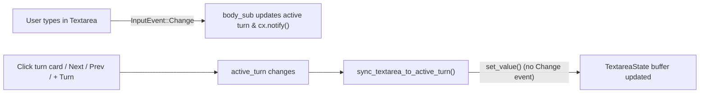

Single-line inputs handle session titles and search queries well, yet an **Antigravity Markdown & Conversation Workbench** lives on multi-line Markdown bodies: numbered steps, bullet lists, inline code spans, and prompt drafts. In this lesson you replace the static read-only inspector card from Lesson 0004 with GPUI Kit's multi-line `Textarea` widget backed by `TextareaState`, while introducing safe mutable borrowing in Rust via `Vec::get_mut`.

:::callout title="Recommended Primary Sources"
- **Interactive app**: `apps/0005-multiline-markdown-textarea/` (`cargo run` to edit any turn's multi-line Markdown live and watch word and line counters update per keystroke)
- **Widget source**: `gpui-component` `input/textarea.rs` (`Textarea`, `TextareaState`, `.rows(...)`, `.h(...)`) and `gpui-base` `input/base/state.rs` (`set_value` intentionally suppresses `InputEvent::Change`)
- Course References: [Glossary](../reference/GLOSSARY.md) and [GPUI Kit & Rust Quick Reference](../reference/gpui-kit-cheatsheet.md)
:::

## Architecture: Two-Way Data Flow Without Loops

Keeping an editor entity (`Entity<TextareaState>`) in sync with a plain Rust struct (`WorkbenchDoc`) is a classic desktop GUI problem:

1. **User types in the editor** → `TextareaState` emits `InputEvent::Change` → `body_sub` copies the editor's string into `doc.turns[active_turn].markdown` and calls `cx.notify()`.
2. **User clicks another turn card or toolbar button** → `WorkbenchView` updates `active_turn` → `sync_textarea_to_active_turn` pushes the newly selected turn's Markdown into `TextareaState::set_value(...)`.

Crucially, `TextareaState::set_value(...)` replaces the internal rope buffer **without** emitting `InputEvent::Change`, preventing an infinite feedback loop between model and widget.



## Block-by-Block Source Walkthrough

### Block 1 — Importing `Textarea` and `TextareaState`

```rust caption="Importing Textarea and TextareaState alongside Input"
use gpui_kit::component::ActiveTheme as _;
use gpui_kit::component::Disableable as _;
use gpui_kit::component::Selectable as _;
use gpui_kit::component::badge::Badge;
use gpui_kit::component::button::{Button, ButtonVariants as _};
use gpui_kit::component::input::{Input, InputEvent, InputState, Textarea, TextareaState};
use gpui_kit::component::tag::Tag;
use gpui_kit::component::theme::{Theme, ThemeMode};
use gpui_kit::component::{h_flex, v_flex};
use gpui_kit::*;
```

Notice that `TextareaState` emits the exact same `InputEvent` type as single-line `InputState`. In `gpui-kit`, single-line inputs, multi-line textareas, and full code editors share one unified input state machinery configured with different mode builders.

---

### Block 2 — Safe Mutable Indexing with `Vec::get_mut` and `if let Some(...)`

```rust caption="Counting lines and mutating a turn safely without panicking"
    pub fn line_count(&self) -> usize {
        self.markdown.lines().count().max(1)
    }

    pub fn update_turn_markdown(&mut self, index: usize, markdown: impl Into<String>) -> bool {
        if let Some(turn) = self.turns.get_mut(index) {
            turn.markdown = markdown.into();
            true
        } else {
            false
        }
    }
```

#### Rust Concept: `Option<&mut T>` and `if let`

- `.get(index)` (used earlier in `turn_at`) returns `Option<&ConversationTurn>` — a read-only shared reference.
- `.get_mut(index)` returns `Option<&mut ConversationTurn>` — an exclusive **mutable reference** to one element inside the `Vec`, or `None` if `index` is out of bounds.
- Using `self.turns[index] = ...` would panic and crash the whole GUI app if an invalid index ever arrived. Writing `if let Some(turn) = self.turns.get_mut(index)` unwraps the `Some` case cleanly and returns `false` on `None`.
- `.max(1)` ensures even an empty draft buffer displays `1 lines` cleanly instead of dropping to `0`.

---

### Block 3 — Creating `TextareaState` and Subscribing to `body_sub`

```rust caption="Configuring TextareaState rows and subscribing to multi-line edits"
        let body_textarea = cx.new(|cx| {
            TextareaState::new(window, cx)
                .rows(8)
                .placeholder("Edit turn Markdown...")
                .default_value(initial_markdown)
        });

        let body_sub = cx.subscribe_in(
            &body_textarea,
            window,
            |this, state, event: &InputEvent, _window, cx| {
                if matches!(event, InputEvent::Change) {
                    let next_body = state.read(cx).value().to_string();
                    this.update_active_markdown(next_body);
                    cx.notify();
                }
            },
        );
```

- `TextareaState::new(window, cx)` constructs an unstyled multi-line text buffer entity on GPUI's entity heap.
- `.rows(8)` requests an initial 8-row vertical budget, while `.default_value(initial_markdown)` seeds the buffer with turn #1's Markdown on startup.
- Remember to push `body_sub` into `view._subscriptions`! Dropping a `Subscription` cancels the listener immediately.

---

### Block 4 — One-Way Synchronization When Switching Turns

```rust caption="Pushing the newly active turn into TextareaState::set_value"
    pub fn sync_textarea_to_active_turn(&mut self, window: &mut Window, cx: &mut Context<Self>) {
        let active_md = self
            .active_turn_ref()
            .map(|turn| turn.markdown.clone())
            .unwrap_or_default();
        if let Some(textarea) = &self.body_textarea {
            textarea.update(cx, |state, cx| {
                state.set_value(active_md, window, cx);
            });
        }
    }

    pub fn update_active_markdown(&mut self, markdown: impl Into<String>) -> bool {
        self.doc.update_turn_markdown(self.active_turn, markdown)
    }
```

#### Why Every Selection Action Calls `sync_textarea_to_active_turn`

In every toolbar button (`Prev`, `Next`, `+ User Turn`, `+ Agent Turn`, `Delete Turn`) and every per-row `Inspect` button, the click handler calls `this.sync_textarea_to_active_turn(window, cx)` right after updating `active_turn`:

```rust caption="Keeping the editor synced across every selection transition"
                                        .on_click(cx.listener(move |this, _, window, cx| {
                                            this.select_turn(ix);
                                            this.sync_textarea_to_active_turn(window, cx);
                                            cx.notify();
                                        })),
```

Without that call, `active_turn` would change in `WorkbenchView`, updating the header word/line counts, while `TextareaState` would still display the previous turn's text.

---

### Block 5 — Rendering `Textarea` with Live Word and Line Counters

```rust caption="Rendering live word/line badges above the bounded Textarea widget"
            .child(
                v_flex()
                    .p_4()
                    .gap_2()
                    .rounded_md()
                    .border_1()
                    .border_color(theme.border)
                    .bg(theme.background)
                    .child(
                        h_flex()
                            .items_center()
                            .justify_between()
                            .child(
                                div()
                                    .text_sm()
                                    .text_color(theme.muted_foreground)
                                    .child("Active Turn Markdown Buffer"),
                            )
                            .child(
                                h_flex()
                                    .gap_2()
                                    .child(Tag::secondary().child(format!("{active_words} words")))
                                    .child(Tag::secondary().child(format!("{active_lines} lines"))),
                            ),
                    )
                    .children(
                        self.body_textarea
                            .as_ref()
                            .map(|textarea| Textarea::new(textarea).h(px(220.))),
                    ),
            )
```

Notice `.h(px(220.))` on `Textarea::new(textarea)`. Multi-line editors scroll internally when given a fixed vertical height, preventing long turns from pushing the turn list off-screen. And because `body_sub` calls `cx.notify()` on every keystroke, editing the active turn immediately updates:
- `{active_words} words` and `{active_lines} lines` on the editor card header
- the turn card's first-line summary (`turn.preview_line()`) above the editor
- the live session filter (`visible_indices`) if a filter query matches the newly typed text.

---

### Complete `src/main.rs` Listing

```rust caption="apps/0005-multiline-markdown-textarea/src/main.rs"
use gpui_kit::component::ActiveTheme as _;
use gpui_kit::component::Disableable as _;
use gpui_kit::component::Selectable as _;
use gpui_kit::component::badge::Badge;
use gpui_kit::component::button::{Button, ButtonVariants as _};
use gpui_kit::component::input::{Input, InputEvent, InputState, Textarea, TextareaState};
use gpui_kit::component::tag::Tag;
use gpui_kit::component::theme::{Theme, ThemeMode};
use gpui_kit::component::{h_flex, v_flex};
use gpui_kit::*;

#[derive(Debug, Clone, Copy, PartialEq, Eq)]
pub enum TurnRole {
    User,
    Assistant,
}

impl TurnRole {
    pub fn badge_label(&self) -> &'static str {
        match self {
            TurnRole::User => "USER",
            TurnRole::Assistant => "AGENT",
        }
    }
}

#[derive(Debug, Clone, PartialEq, Eq)]
pub struct ConversationTurn {
    pub role: TurnRole,
    pub markdown: String,
}

impl ConversationTurn {
    pub fn new(role: TurnRole, markdown: impl Into<String>) -> Self {
        Self {
            role,
            markdown: markdown.into(),
        }
    }

    pub fn word_count(&self) -> usize {
        self.markdown.split_whitespace().count()
    }

    pub fn line_count(&self) -> usize {
        self.markdown.lines().count().max(1)
    }

    pub fn preview_line(&self) -> &str {
        self.markdown.lines().next().unwrap_or("")
    }
}

#[derive(Debug, Clone, PartialEq, Eq)]
pub struct WorkbenchDoc {
    pub title: String,
    pub turns: Vec<ConversationTurn>,
}

impl WorkbenchDoc {
    pub fn sample_session() -> Self {
        Self {
            title: String::from("Antigravity Session: Refactor CLI Parser"),
            turns: vec![
                ConversationTurn::new(
                    TurnRole::User,
                    "Inspect `src/args.rs` and summarize why `--quiet` overrides `--verbose`.",
                ),
                ConversationTurn::new(
                    TurnRole::Assistant,
                    "In `parse_flags`, `--quiet` runs second and mutates `verbosity` to `0`.\n\nNext steps:\n- Track explicit CLI precedence\n- Keep flag parsing pure",
                ),
                ConversationTurn::new(
                    TurnRole::User,
                    "Draft a regression test checking flag order independence.",
                ),
            ],
        }
    }

    pub fn set_title(&mut self, title: impl Into<String>) {
        let trimmed = title.into();
        if !trimmed.trim().is_empty() {
            self.title = trimmed;
        }
    }

    pub fn update_turn_markdown(&mut self, index: usize, markdown: impl Into<String>) -> bool {
        if let Some(turn) = self.turns.get_mut(index) {
            turn.markdown = markdown.into();
            true
        } else {
            false
        }
    }

    pub fn filtered_turn_indices(&self, query: &str) -> Vec<usize> {
        let needle = query.trim().to_lowercase();
        self.turns
            .iter()
            .enumerate()
            .filter(|(_, turn)| {
                needle.is_empty()
                    || turn.markdown.to_lowercase().contains(&needle)
                    || turn.role.badge_label().to_lowercase().contains(&needle)
            })
            .map(|(ix, _)| ix)
            .collect()
    }

    pub fn turn_at(&self, index: usize) -> Option<&ConversationTurn> {
        self.turns.get(index)
    }

    pub fn total_words(&self) -> usize {
        self.turns.iter().map(ConversationTurn::word_count).sum()
    }

    pub fn to_markdown(&self) -> String {
        let mut out = format!("# {}\n\n", self.title);
        for turn in &self.turns {
            out.push_str(&format!(
                "## {}\n\n{}\n\n",
                turn.role.badge_label(),
                turn.markdown
            ));
        }
        out.trim_end().to_string()
    }
}

pub struct WorkbenchView {
    pub doc: WorkbenchDoc,
    pub active_turn: usize,
    pub filter_query: String,
    pub title_input: Option<Entity<InputState>>,
    pub filter_input: Option<Entity<InputState>>,
    pub body_textarea: Option<Entity<TextareaState>>,
    _subscriptions: Vec<Subscription>,
}

impl WorkbenchView {
    pub fn new() -> Self {
        Self {
            doc: WorkbenchDoc::sample_session(),
            active_turn: 0,
            filter_query: String::new(),
            title_input: None,
            filter_input: None,
            body_textarea: None,
            _subscriptions: Vec::new(),
        }
    }

    pub fn new_with_window(window: &mut Window, cx: &mut Context<Self>) -> Self {
        let mut view = Self::new();
        let initial_title = view.doc.title.clone();
        let initial_markdown = view
            .active_turn_ref()
            .map(|turn| turn.markdown.clone())
            .unwrap_or_default();

        let title_input = cx.new(|cx| {
            InputState::new(window, cx)
                .placeholder("Session title...")
                .default_value(initial_title)
        });
        let filter_input = cx.new(|cx| {
            InputState::new(window, cx)
                .clean_on_escape()
                .placeholder("Filter turns by text or role (USER / AGENT)...")
        });
        let body_textarea = cx.new(|cx| {
            TextareaState::new(window, cx)
                .rows(8)
                .placeholder("Edit turn Markdown...")
                .default_value(initial_markdown)
        });

        let title_sub = cx.subscribe_in(
            &title_input,
            window,
            |this, state, event: &InputEvent, _window, cx| {
                if matches!(event, InputEvent::Change) {
                    let next_title = state.read(cx).value().to_string();
                    this.doc.set_title(next_title);
                    cx.notify();
                }
            },
        );

        let filter_sub = cx.subscribe_in(
            &filter_input,
            window,
            |this, state, event: &InputEvent, _window, cx| {
                if matches!(event, InputEvent::Change) {
                    this.filter_query = state.read(cx).value().to_string();
                    cx.notify();
                }
            },
        );

        let body_sub = cx.subscribe_in(
            &body_textarea,
            window,
            |this, state, event: &InputEvent, _window, cx| {
                if matches!(event, InputEvent::Change) {
                    let next_body = state.read(cx).value().to_string();
                    this.update_active_markdown(next_body);
                    cx.notify();
                }
            },
        );

        view.title_input = Some(title_input);
        view.filter_input = Some(filter_input);
        view.body_textarea = Some(body_textarea);
        view._subscriptions.push(title_sub);
        view._subscriptions.push(filter_sub);
        view._subscriptions.push(body_sub);
        view
    }

    pub fn sync_textarea_to_active_turn(&mut self, window: &mut Window, cx: &mut Context<Self>) {
        let active_md = self
            .active_turn_ref()
            .map(|turn| turn.markdown.clone())
            .unwrap_or_default();
        if let Some(textarea) = &self.body_textarea {
            textarea.update(cx, |state, cx| {
                state.set_value(active_md, window, cx);
            });
        }
    }

    pub fn update_active_markdown(&mut self, markdown: impl Into<String>) -> bool {
        self.doc.update_turn_markdown(self.active_turn, markdown)
    }

    pub fn select_turn(&mut self, index: usize) -> bool {
        if index < self.doc.turns.len() {
            self.active_turn = index;
            true
        } else {
            false
        }
    }

    pub fn select_next_turn(&mut self) {
        if self.active_turn + 1 < self.doc.turns.len() {
            self.active_turn += 1;
        }
    }

    pub fn select_prev_turn(&mut self) {
        self.active_turn = self.active_turn.saturating_sub(1);
    }

    pub fn append_turn(&mut self, role: TurnRole, markdown: impl Into<String>) -> usize {
        self.doc.turns.push(ConversationTurn::new(role, markdown));
        let new_index = self.doc.turns.len() - 1;
        self.active_turn = new_index;
        new_index
    }

    pub fn remove_active_turn(&mut self) -> Option<ConversationTurn> {
        if self.doc.turns.len() <= 1 || self.active_turn >= self.doc.turns.len() {
            return None;
        }
        let removed = self.doc.turns.remove(self.active_turn);
        if self.active_turn >= self.doc.turns.len() {
            self.active_turn = self.doc.turns.len() - 1;
        }
        Some(removed)
    }

    pub fn active_turn_ref(&self) -> Option<&ConversationTurn> {
        self.doc.turn_at(self.active_turn)
    }
}

impl Default for WorkbenchView {
    fn default() -> Self {
        Self::new()
    }
}

impl Render for WorkbenchView {
    fn render(&mut self, _window: &mut Window, cx: &mut Context<Self>) -> impl IntoElement {
        let theme = cx.theme();
        let visible_indices = self.doc.filtered_turn_indices(&self.filter_query);
        let summary = format!(
            "{} ({} / {} visible, {} words) — Selected #{}",
            self.doc.title,
            visible_indices.len(),
            self.doc.turns.len(),
            self.doc.total_words(),
            self.active_turn + 1
        );
        let markdown_preview = self.doc.to_markdown();
        let can_delete = self.doc.turns.len() > 1;
        let (active_words, active_lines) = self
            .active_turn_ref()
            .map(|turn| (turn.word_count(), turn.line_count()))
            .unwrap_or((0, 0));

        v_flex()
            .size_full()
            .p_6()
            .gap_4()
            .bg(theme.background)
            .text_color(theme.foreground)
            .child(
                h_flex()
                    .items_center()
                    .justify_between()
                    .child(
                        h_flex()
                            .items_center()
                            .gap_3()
                            .child("Antigravity Markdown & Conversation Workbench")
                            .child(
                                Badge::new()
                                    .count(visible_indices.len())
                                    .child(div().px_2().py_1().child("Visible")),
                            ),
                    )
                    .child(
                        h_flex()
                            .gap_2()
                            .child(Button::new("prev-turn").secondary().label("Prev").on_click(
                                cx.listener(|this, _, window, cx| {
                                    this.select_prev_turn();
                                    this.sync_textarea_to_active_turn(window, cx);
                                    cx.notify();
                                }),
                            ))
                            .child(Button::new("next-turn").secondary().label("Next").on_click(
                                cx.listener(|this, _, window, cx| {
                                    this.select_next_turn();
                                    this.sync_textarea_to_active_turn(window, cx);
                                    cx.notify();
                                }),
                            ))
                            .child(
                                Button::new("add-user-turn")
                                    .secondary()
                                    .label("+ User Turn")
                                    .on_click(cx.listener(|this, _, window, cx| {
                                        this.append_turn(
                                            TurnRole::User,
                                            "Follow-up question about CLI flag precedence.",
                                        );
                                        this.sync_textarea_to_active_turn(window, cx);
                                        cx.notify();
                                    })),
                            )
                            .child(
                                Button::new("add-agent-turn")
                                    .secondary()
                                    .label("+ Agent Turn")
                                    .on_click(cx.listener(|this, _, window, cx| {
                                        this.append_turn(
                                            TurnRole::Assistant,
                                            "Proposed patch keeps the last flag explicit.",
                                        );
                                        this.sync_textarea_to_active_turn(window, cx);
                                        cx.notify();
                                    })),
                            )
                            .child(
                                Button::new("delete-turn")
                                    .danger()
                                    .label("Delete Turn")
                                    .disabled(!can_delete)
                                    .on_click(cx.listener(|this, _, window, cx| {
                                        this.remove_active_turn();
                                        this.sync_textarea_to_active_turn(window, cx);
                                        cx.notify();
                                    })),
                            )
                            .child(
                                Button::new("export-md")
                                    .primary()
                                    .label("Print Markdown")
                                    .on_click(move |_, _, _| {
                                        println!("{markdown_preview}");
                                    }),
                            ),
                    ),
            )
            .child(
                h_flex()
                    .gap_3()
                    .children(
                        self.title_input
                            .as_ref()
                            .map(|input| div().flex_1().child(Input::new(input))),
                    )
                    .children(
                        self.filter_input.as_ref().map(|input| {
                            div().w(px(320.)).child(Input::new(input).cleanable(true))
                        }),
                    ),
            )
            .child(div().text_color(theme.muted_foreground).child(summary))
            .child(
                v_flex()
                    .gap_2()
                    .children(visible_indices.into_iter().filter_map(|ix| {
                        let turn = self.doc.turn_at(ix)?;
                        let is_active = ix == self.active_turn;
                        let role_tag = match turn.role {
                            TurnRole::User => Tag::primary().child("USER"),
                            TurnRole::Assistant => Tag::secondary().child("AGENT"),
                        };
                        let border_color = if is_active {
                            theme.primary
                        } else {
                            theme.border
                        };

                        Some(
                            h_flex()
                                .p_3()
                                .gap_3()
                                .items_center()
                                .justify_between()
                                .rounded_md()
                                .border_1()
                                .border_color(border_color)
                                .bg(theme.secondary)
                                .child(
                                    h_flex()
                                        .gap_3()
                                        .items_center()
                                        .child(role_tag)
                                        .child(format!("#{} — {}", ix + 1, turn.preview_line())),
                                )
                                .child(
                                    Button::new(("select-turn", ix))
                                        .ghost()
                                        .selected(is_active)
                                        .label(if is_active { "Selected" } else { "Inspect" })
                                        .on_click(cx.listener(move |this, _, window, cx| {
                                            this.select_turn(ix);
                                            this.sync_textarea_to_active_turn(window, cx);
                                            cx.notify();
                                        })),
                                ),
                        )
                    })),
            )
            .child(
                v_flex()
                    .p_4()
                    .gap_2()
                    .rounded_md()
                    .border_1()
                    .border_color(theme.border)
                    .bg(theme.background)
                    .child(
                        h_flex()
                            .items_center()
                            .justify_between()
                            .child(
                                div()
                                    .text_sm()
                                    .text_color(theme.muted_foreground)
                                    .child("Active Turn Markdown Buffer"),
                            )
                            .child(
                                h_flex()
                                    .gap_2()
                                    .child(Tag::secondary().child(format!("{active_words} words")))
                                    .child(Tag::secondary().child(format!("{active_lines} lines"))),
                            ),
                    )
                    .children(
                        self.body_textarea
                            .as_ref()
                            .map(|textarea| Textarea::new(textarea).h(px(220.))),
                    ),
            )
    }
}

fn main() {
    gpui_kit::application()
        .with_assets(gpui_kit::assets::Assets)
        .run(|cx| {
            gpui_kit::init(cx);
            Theme::change(ThemeMode::Dark, None, cx);
            gpui_kit::open_window(WindowOptions::default(), cx, |window, cx| {
                cx.new(|cx| WorkbenchView::new_with_window(window, cx))
            })
            .expect("failed to open workbench window");
        });
}

#[cfg(test)]
mod tests {
    use super::{ConversationTurn, TurnRole, WorkbenchDoc, WorkbenchView};

    #[test]
    fn turn_line_count_counts_multiline_markdown() {
        let single = ConversationTurn::new(TurnRole::User, "One line");
        let empty = ConversationTurn::new(TurnRole::Assistant, "");
        let multi = ConversationTurn::new(TurnRole::Assistant, "Line 1\nLine 2\nLine 3");

        assert_eq!(single.line_count(), 1);
        assert_eq!(empty.line_count(), 1);
        assert_eq!(multi.line_count(), 3);
    }

    #[test]
    fn update_turn_markdown_uses_get_mut_safely() {
        let mut doc = WorkbenchDoc::sample_session();

        assert!(doc.update_turn_markdown(0, "Line A\nLine B"));
        assert_eq!(
            doc.turn_at(0).map(|t| t.markdown.as_str()),
            Some("Line A\nLine B")
        );
        assert!(!doc.update_turn_markdown(99, "Out of bounds"));
    }

    #[test]
    fn update_active_markdown_mutates_selected_turn_only() {
        let mut view = WorkbenchView::new();
        assert!(view.select_turn(1));
        assert!(view.update_active_markdown("Updated assistant guidance"));

        assert_eq!(
            view.active_turn_ref().map(|t| t.markdown.as_str()),
            Some("Updated assistant guidance")
        );
        assert_eq!(
            view.doc.turn_at(0).map(|t| t.preview_line()),
            Some("Inspect `src/args.rs` and summarize why `--quiet` overrides `--verbose`.")
        );
    }

    #[test]
    fn append_and_remove_adjust_active_turn_and_word_totals() {
        let mut view = WorkbenchView::new();
        let before_words = view.doc.total_words();
        view.append_turn(TurnRole::User, "Two words");
        assert_eq!(view.doc.total_words(), before_words + 2);

        assert!(view.remove_active_turn().is_some());
        assert_eq!(view.doc.total_words(), before_words);
    }

    #[test]
    fn filtered_turn_indices_finds_multiline_bullets() {
        let doc = WorkbenchDoc::sample_session();
        assert_eq!(
            doc.filtered_turn_indices("nonexistent phrase"),
            Vec::<usize>::new()
        );
        assert_eq!(doc.filtered_turn_indices("CLI precedence"), vec![1]);
    }

    #[test]
    fn default_view_has_no_window_textarea() {
        let view = WorkbenchView::new();
        assert!(view.body_textarea.is_none());
    }
}
```

## Hands-On Exercise: Safe Mutable Buffer Updates

:::exercise id="ex-0005" title="Interactive Lab: Mutable Turn Buffer & Buffer Sync" badge="Skill Practice"
Fill in the blanks to safely update a turn's Markdown string using `get_mut`, and push the active turn's text into `TextareaState` without emitting `InputEvent::Change`:

```rust
pub fn update_turn_markdown(&mut self, index: usize, markdown: impl Into<String>) -> bool {
    if let Some(turn) = self.turns.{{blank:get_mut|Borrow a mutable slice element safely as Option<&mut T>|???|7}}(index) {
        turn.markdown = markdown.into();
        true
    } else {
        false
    }
}

pub fn sync_textarea_to_active_turn(&mut self, window: &mut Window, cx: &mut Context<Self>) {
    let active_md = self
        .active_turn_ref()
        .map(|turn| turn.markdown.clone())
        .unwrap_or_default();
    if let Some(textarea) = &self.body_textarea {
        textarea.update(cx, |state, cx| {
            state.{{blank:set_value|Programmatically replace buffer text without firing InputEvent::Change|???|9}}(active_md, window, cx);
        });
    }
}
```

:::prompts
hint: "Use get_mut for safe mutable Vec indexing and set_value on TextareaState."
success: "Great job! You avoided out-of-bounds panics and infinite change-event feedback loops."
:::
:::

## Check Your Understanding

:::quiz id="quiz-0005" title="Retrieval Practice: TextareaState & Safe Mutable Access" badge="3 Questions • Equal-Length Options"
- question: "Why does WorkbenchView call TextareaState::set_value whenever you select a different turn?"
  wrong_hint: "Consider what events fire vs. stay silent during programmatic updates."
  options:
    - letter: "A"
      text: "set_value replaces the editor buffer cleanly without emitting a redundant Change event back"
      correct: true
      explain: "Correct! TextareaState::set_value updates the editor contents programmatically and avoids firing InputEvent::Change."
    - letter: "B"
      text: "set_value compiles the active turn text into HTML markup before painting every frame"
      correct: false
      explain: "TextareaState edits plain text; HTML rendering is not performed here."
    - letter: "C"
      text: "set_value copies the whole multi-turn Vec into a system clipboard buffer every click"
      correct: false
      explain: "set_value only updates the active TextareaState buffer and does not touch the clipboard."
    - letter: "D"
      text: "set_value disconnects every active Subscription handle until the user focuses another text input"
      correct: false
      explain: "Your _subscriptions stay connected; set_value simply skips emitting InputEvent::Change."
- question: "Why does WorkbenchDoc::update_turn_markdown call self.turns.get_mut(index) instead of indexing self.turns[index]?"
  wrong_hint: "Compare Option<&mut T> return types against direct indexing panic behavior."
  options:
    - letter: "A"
      text: "get_mut clones the entire vector onto the stack to preserve rollback snapshots automatically"
      correct: false
      explain: "get_mut borrows in place with zero cloning."
    - letter: "B"
      text: "get_mut returns Option so an out-of-bounds index safely returns false without ever panicking"
      correct: true
      explain: "Correct! turns.get_mut(index) returns None on out-of-bounds indices instead of panicking."
    - letter: "C"
      text: "get_mut spawns a background thread that locks the window context during string allocation"
      correct: false
      explain: "get_mut is a synchronous slice lookup with zero threads."
    - letter: "D"
      text: "get_mut freezes every turn field as immutable so GPUI can cache layout geometry"
      correct: false
      explain: "get_mut grants an exclusive mutable reference (&mut ConversationTurn), not an immutable borrow."
- question: "What happens if you call this.select_turn(ix) on click without calling this.sync_textarea_to_active_turn(window, cx)?"
  wrong_hint: "Remember that TextareaState owns its own internal buffer separate from doc.turns."
  options:
    - letter: "A"
      text: "Rust refuses to compile the file because Window handles cannot cross listener closures"
      correct: false
      explain: "cx.listener provides window directly; compilation is unaffected."
    - letter: "B"
      text: "GPUI automatically clears every character from active_turn and resets line_count down to zero"
      correct: false
      explain: "doc.turns stays intact; only the Textarea buffer falls out of sync."
    - letter: "C"
      text: "The inspector badge updates while the textarea continues displaying the previously selected turn"
      correct: true
      explain: "Correct! body_textarea owns its own Entity<TextareaState> buffer until you push active_md via set_value."
    - letter: "D"
      text: "InputState intercepts every click event and triggers a runtime panic inside body_sub handler"
      correct: false
      explain: "No panic occurs; the widget simply keeps showing the stale text."
:::

## Verify & Run

Run the unit tests, formatting check, strict Clippy lints, and desktop app from the Lesson 0005 companion crate:

:::verify id="verify-0005" title="Verification Lab: Multi-Line Textarea Sync" badge="Terminal Gate"
```bash
cargo fmt --manifest-path apps/0005-multiline-markdown-textarea/Cargo.toml --check
cargo test --manifest-path apps/0005-multiline-markdown-textarea/Cargo.toml
cargo clippy --manifest-path apps/0005-multiline-markdown-textarea/Cargo.toml --all-targets -- -D warnings
cargo run --manifest-path apps/0005-multiline-markdown-textarea/Cargo.toml
```

Expected verification output:

```text
running 6 tests
test tests::update_turn_markdown_uses_get_mut_safely ... ok
test tests::default_view_has_no_window_textarea ... ok
test tests::append_and_remove_adjust_active_turn_and_word_totals ... ok
test tests::filtered_turn_indices_finds_multiline_bullets ... ok
test tests::turn_line_count_counts_multiline_markdown ... ok
test tests::update_active_markdown_mutates_selected_turn_only ... ok

test result: ok. 6 passed; 0 failed; 0 ignored; 0 measured; 0 filtered out; finished in 0.00s
```
:::

:::teacher-prompt title="Extend This Lesson with Your Agent"
Ask your AI teacher: *"In Lesson 0005, add an `Insert Prompt Template` button that calls `TextareaState::insert` at the current cursor position rather than replacing the entire turn buffer."*
:::
