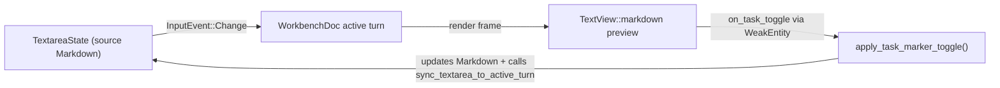

Editing raw Markdown is only half the workbench. Agent sessions also need formatted reading: inline code spans, bold emphasis, paragraphs, and interactive `- [ ]` / `- [x]` agent checklists. In this lesson you add GPUI Kit's `TextView::markdown` widget beneath the turn editor and wire clickable task checkboxes back into both `WorkbenchDoc` and `TextareaState`.

:::callout title="Recommended Primary Sources"
- **Interactive app**: `apps/0006-live-markdown-preview-textview/` (`cargo run`, click turn #2, and click either rendered task checkbox or edit the `- [ ]` source text directly)
- **Widget source**: `gpui-base` `text/text_view.rs` (`TextView::markdown`, `TaskToggleEvent::marker_range`, `on_task_toggle`)
- Course References: [Glossary](../reference/GLOSSARY.md) and [GPUI Kit & Rust Quick Reference](../reference/gpui-kit-cheatsheet.md)
:::

## Architecture: Bidirectional Task Sync via `WeakEntity`

`TextView::markdown` does **not** mutate your source string behind your back when a user clicks a `- [ ]` checkbox. Instead, it emits a `TaskToggleEvent` carrying two byte ranges in the Markdown string:
- `marker_range()` — the exact `[ ]` or `[x]` slice (`Range<usize>`)
- `checked()` — the desired new boolean state (`true` or `false`)



Because `on_task_toggle` requires a `Send + Sync + 'static` closure (so GPUI can store the callback safely across threads/frames), you pass `let view = cx.entity().downgrade()` instead of `cx.listener(...)`.

## Block-by-Block Source Walkthrough

### Block 1 — Byte-Safe Task Marker Replacement (`Range<usize>`)

```rust caption="Replacing a Markdown task checkbox byte range without panicking"
pub fn apply_task_marker_toggle(
    markdown: &str,
    marker_range: Range<usize>,
    checked: bool,
) -> Option<String> {
    let slice = markdown.get(marker_range.clone())?;
    if !matches!(slice, "[ ]" | "[x]" | "[X]") {
        return None;
    }

    let replacement = if checked { "[x]" } else { "[ ]" };
    Some(format!(
        "{}{}{}",
        &markdown[..marker_range.start],
        replacement,
        &markdown[marker_range.end..]
    ))
}
```

#### Rust Concept: Byte Slices, `Range<usize>`, and the `?` Operator

- A Rust `&str` is UTF-8 encoded bytes, and `std::ops::Range<usize>` (written `start..end`) is half-open: it includes `start` and excludes `end`.
- Calling `markdown.get(marker_range.clone())` performs both bounds checks **and** UTF-8 character-boundary checks, returning `Option<&str>`.
- The postfix `?` operator unpacks `Some(slice)` or returns `None` immediately from `apply_task_marker_toggle`. Once `markdown.get(...)` has verified valid UTF-8 boundaries, slicing `&markdown[..marker_range.start]` and `&markdown[marker_range.end..]` is guaranteed not to panic.

---

### Block 2 — Counting Completed Checklist Items on Each Turn

```rust caption="Scanning Markdown checklist markers for live badge progress"
    pub fn task_counts(&self) -> (usize, usize) {
        let mut completed = 0usize;
        let mut total = 0usize;
        for line in self.markdown.lines() {
            let trimmed = line.trim_start();
            if trimmed.starts_with("- [x]") || trimmed.starts_with("- [X]") {
                completed += 1;
                total += 1;
            } else if trimmed.starts_with("- [ ]") {
                total += 1;
            }
        }
        (completed, total)
    }
```

Here `(usize, usize)` is a **tuple** holding `(completed, total)`. Returning small tuples avoids inventing throwaway structs for two related counts, and callers destructure them with `(tasks_done, tasks_total)`.

---

### Block 3 — Applying Toggles Across Both Model and Editor

```rust caption="Updating active turn Markdown and syncing TextareaState"
    pub fn toggle_active_task_marker(
        &mut self,
        marker_range: Range<usize>,
        checked: bool,
        window: &mut Window,
        cx: &mut Context<Self>,
    ) -> bool {
        let Some(updated) = self
            .active_turn_ref()
            .and_then(|turn| apply_task_marker_toggle(&turn.markdown, marker_range, checked))
        else {
            return false;
        };
        if !self.update_active_markdown(updated) {
            return false;
        }
        self.sync_textarea_to_active_turn(window, cx);
        true
    }
```

#### Rust Concept: `let ... else`

`let Some(updated) = ... else { return false; };` binds `updated` when the `Option` is `Some`, or executes the diverging `else` block (`return`, `break`, or `continue`) immediately when it is `None`. This keeps validation flat with shallow nesting instead of deep nested `if let` pyramid blocks.

---

### Block 4 — Rendering `TextView::markdown` with `WeakEntity`

```rust caption="Rendering interactive Markdown checkboxes with TextView::markdown"
        let view = cx.entity().downgrade();
```

```rust caption="Wiring TaskToggleEvent back into WorkbenchView via WeakEntity::update"
            .child(
                v_flex()
                    .p_4()
                    .gap_2()
                    .rounded_md()
                    .border_1()
                    .border_color(theme.border)
                    .bg(theme.background)
                    .child(
                        h_flex()
                            .items_center()
                            .justify_between()
                            .child(
                                div()
                                    .text_sm()
                                    .text_color(theme.muted_foreground)
                                    .child("Live Rendered Markdown Preview"),
                            )
                            .child(
                                Tag::secondary().child(format!("{tasks_done}/{tasks_total} tasks")),
                            ),
                    )
                    .child(
                        TextView::markdown("turn-markdown-preview", active_markdown)
                            .selectable(true)
                            .on_task_toggle(move |event: &TaskToggleEvent, window, cx| {
                                let marker_range = event.marker_range();
                                let checked = event.checked();
                                let _ = view.update(cx, |this, cx| {
                                    if this.toggle_active_task_marker(
                                        marker_range,
                                        checked,
                                        window,
                                        cx,
                                    ) {
                                        cx.notify();
                                    }
                                });
                            }),
                    ),
            )
```

#### Why `WeakEntity` Instead of Strong `Entity`?

- A strong `Entity<WorkbenchView>` keeps the view alive as long as any closure holds it; holding a strong handle to yourself inside your own child element creates a **reference cycle**.
- `cx.entity().downgrade()` creates a `WeakEntity<WorkbenchView>` that implements `Send + Sync + 'static` without incrementing the strong reference count. Calling `view.update(cx, ...)` safely returns a `Result`, doing nothing if the view was already dropped.

---

### Complete `src/main.rs` Listing

```rust caption="apps/0006-live-markdown-preview-textview/src/main.rs"
use std::ops::Range;

use gpui_kit::component::ActiveTheme as _;
use gpui_kit::component::Disableable as _;
use gpui_kit::component::Selectable as _;
use gpui_kit::component::badge::Badge;
use gpui_kit::component::button::{Button, ButtonVariants as _};
use gpui_kit::component::input::{Input, InputEvent, InputState, Textarea, TextareaState};
use gpui_kit::component::tag::Tag;
use gpui_kit::component::text::{TaskToggleEvent, TextView};
use gpui_kit::component::theme::{Theme, ThemeMode};
use gpui_kit::component::{h_flex, v_flex};
use gpui_kit::*;

#[derive(Debug, Clone, Copy, PartialEq, Eq)]
pub enum TurnRole {
    User,
    Assistant,
}

impl TurnRole {
    pub fn badge_label(&self) -> &'static str {
        match self {
            TurnRole::User => "USER",
            TurnRole::Assistant => "AGENT",
        }
    }
}

pub fn apply_task_marker_toggle(
    markdown: &str,
    marker_range: Range<usize>,
    checked: bool,
) -> Option<String> {
    let slice = markdown.get(marker_range.clone())?;
    if !matches!(slice, "[ ]" | "[x]" | "[X]") {
        return None;
    }

    let replacement = if checked { "[x]" } else { "[ ]" };
    Some(format!(
        "{}{}{}",
        &markdown[..marker_range.start],
        replacement,
        &markdown[marker_range.end..]
    ))
}

#[derive(Debug, Clone, PartialEq, Eq)]
pub struct ConversationTurn {
    pub role: TurnRole,
    pub markdown: String,
}

impl ConversationTurn {
    pub fn new(role: TurnRole, markdown: impl Into<String>) -> Self {
        Self {
            role,
            markdown: markdown.into(),
        }
    }

    pub fn word_count(&self) -> usize {
        self.markdown.split_whitespace().count()
    }

    pub fn line_count(&self) -> usize {
        self.markdown.lines().count().max(1)
    }

    pub fn task_counts(&self) -> (usize, usize) {
        let mut completed = 0usize;
        let mut total = 0usize;
        for line in self.markdown.lines() {
            let trimmed = line.trim_start();
            if trimmed.starts_with("- [x]") || trimmed.starts_with("- [X]") {
                completed += 1;
                total += 1;
            } else if trimmed.starts_with("- [ ]") {
                total += 1;
            }
        }
        (completed, total)
    }

    pub fn preview_line(&self) -> &str {
        self.markdown.lines().next().unwrap_or("")
    }
}

#[derive(Debug, Clone, PartialEq, Eq)]
pub struct WorkbenchDoc {
    pub title: String,
    pub turns: Vec<ConversationTurn>,
}

impl WorkbenchDoc {
    pub fn sample_session() -> Self {
        Self {
            title: String::from("Antigravity Session: Refactor CLI Parser"),
            turns: vec![
                ConversationTurn::new(
                    TurnRole::User,
                    "Inspect `src/args.rs` and summarize why `--quiet` overrides `--verbose`.",
                ),
                ConversationTurn::new(
                    TurnRole::Assistant,
                    "In `parse_flags`, `--quiet` runs second and mutates `verbosity` to `0`.\n\nChecklist:\n- [x] Track explicit CLI precedence\n- [ ] Keep flag parsing pure",
                ),
                ConversationTurn::new(
                    TurnRole::User,
                    "Draft a regression test checking flag order independence.",
                ),
            ],
        }
    }

    pub fn set_title(&mut self, title: impl Into<String>) {
        let trimmed = title.into();
        if !trimmed.trim().is_empty() {
            self.title = trimmed;
        }
    }

    pub fn update_turn_markdown(&mut self, index: usize, markdown: impl Into<String>) -> bool {
        if let Some(turn) = self.turns.get_mut(index) {
            turn.markdown = markdown.into();
            true
        } else {
            false
        }
    }

    pub fn filtered_turn_indices(&self, query: &str) -> Vec<usize> {
        let needle = query.trim().to_lowercase();
        self.turns
            .iter()
            .enumerate()
            .filter(|(_, turn)| {
                needle.is_empty()
                    || turn.markdown.to_lowercase().contains(&needle)
                    || turn.role.badge_label().to_lowercase().contains(&needle)
            })
            .map(|(ix, _)| ix)
            .collect()
    }

    pub fn turn_at(&self, index: usize) -> Option<&ConversationTurn> {
        self.turns.get(index)
    }

    pub fn total_words(&self) -> usize {
        self.turns.iter().map(ConversationTurn::word_count).sum()
    }

    pub fn to_markdown(&self) -> String {
        let mut out = format!("# {}\n\n", self.title);
        for turn in &self.turns {
            out.push_str(&format!(
                "## {}\n\n{}\n\n",
                turn.role.badge_label(),
                turn.markdown
            ));
        }
        out.trim_end().to_string()
    }
}

pub struct WorkbenchView {
    pub doc: WorkbenchDoc,
    pub active_turn: usize,
    pub filter_query: String,
    pub title_input: Option<Entity<InputState>>,
    pub filter_input: Option<Entity<InputState>>,
    pub body_textarea: Option<Entity<TextareaState>>,
    _subscriptions: Vec<Subscription>,
}

impl WorkbenchView {
    pub fn new() -> Self {
        Self {
            doc: WorkbenchDoc::sample_session(),
            active_turn: 0,
            filter_query: String::new(),
            title_input: None,
            filter_input: None,
            body_textarea: None,
            _subscriptions: Vec::new(),
        }
    }

    pub fn new_with_window(window: &mut Window, cx: &mut Context<Self>) -> Self {
        let mut view = Self::new();
        let initial_title = view.doc.title.clone();
        let initial_markdown = view
            .active_turn_ref()
            .map(|turn| turn.markdown.clone())
            .unwrap_or_default();

        let title_input = cx.new(|cx| {
            InputState::new(window, cx)
                .placeholder("Session title...")
                .default_value(initial_title)
        });
        let filter_input = cx.new(|cx| {
            InputState::new(window, cx)
                .clean_on_escape()
                .placeholder("Filter turns by text or role (USER / AGENT)...")
        });
        let body_textarea = cx.new(|cx| {
            TextareaState::new(window, cx)
                .rows(8)
                .placeholder("Edit turn Markdown...")
                .default_value(initial_markdown)
        });

        let title_sub = cx.subscribe_in(
            &title_input,
            window,
            |this, state, event: &InputEvent, _window, cx| {
                if matches!(event, InputEvent::Change) {
                    let next_title = state.read(cx).value().to_string();
                    this.doc.set_title(next_title);
                    cx.notify();
                }
            },
        );

        let filter_sub = cx.subscribe_in(
            &filter_input,
            window,
            |this, state, event: &InputEvent, _window, cx| {
                if matches!(event, InputEvent::Change) {
                    this.filter_query = state.read(cx).value().to_string();
                    cx.notify();
                }
            },
        );

        let body_sub = cx.subscribe_in(
            &body_textarea,
            window,
            |this, state, event: &InputEvent, _window, cx| {
                if matches!(event, InputEvent::Change) {
                    let next_body = state.read(cx).value().to_string();
                    this.update_active_markdown(next_body);
                    cx.notify();
                }
            },
        );

        view.title_input = Some(title_input);
        view.filter_input = Some(filter_input);
        view.body_textarea = Some(body_textarea);
        view._subscriptions.push(title_sub);
        view._subscriptions.push(filter_sub);
        view._subscriptions.push(body_sub);
        view
    }

    pub fn sync_textarea_to_active_turn(&mut self, window: &mut Window, cx: &mut Context<Self>) {
        let active_md = self
            .active_turn_ref()
            .map(|turn| turn.markdown.clone())
            .unwrap_or_default();
        if let Some(textarea) = &self.body_textarea {
            textarea.update(cx, |state, cx| {
                state.set_value(active_md, window, cx);
            });
        }
    }

    pub fn update_active_markdown(&mut self, markdown: impl Into<String>) -> bool {
        self.doc.update_turn_markdown(self.active_turn, markdown)
    }

    pub fn toggle_active_task_marker(
        &mut self,
        marker_range: Range<usize>,
        checked: bool,
        window: &mut Window,
        cx: &mut Context<Self>,
    ) -> bool {
        let Some(updated) = self
            .active_turn_ref()
            .and_then(|turn| apply_task_marker_toggle(&turn.markdown, marker_range, checked))
        else {
            return false;
        };
        if !self.update_active_markdown(updated) {
            return false;
        }
        self.sync_textarea_to_active_turn(window, cx);
        true
    }

    pub fn select_turn(&mut self, index: usize) -> bool {
        if index < self.doc.turns.len() {
            self.active_turn = index;
            true
        } else {
            false
        }
    }

    pub fn select_next_turn(&mut self) {
        if self.active_turn + 1 < self.doc.turns.len() {
            self.active_turn += 1;
        }
    }

    pub fn select_prev_turn(&mut self) {
        self.active_turn = self.active_turn.saturating_sub(1);
    }

    pub fn append_turn(&mut self, role: TurnRole, markdown: impl Into<String>) -> usize {
        self.doc.turns.push(ConversationTurn::new(role, markdown));
        let new_index = self.doc.turns.len() - 1;
        self.active_turn = new_index;
        new_index
    }

    pub fn remove_active_turn(&mut self) -> Option<ConversationTurn> {
        if self.doc.turns.len() <= 1 || self.active_turn >= self.doc.turns.len() {
            return None;
        }
        let removed = self.doc.turns.remove(self.active_turn);
        if self.active_turn >= self.doc.turns.len() {
            self.active_turn = self.doc.turns.len() - 1;
        }
        Some(removed)
    }

    pub fn active_turn_ref(&self) -> Option<&ConversationTurn> {
        self.doc.turn_at(self.active_turn)
    }
}

impl Default for WorkbenchView {
    fn default() -> Self {
        Self::new()
    }
}

impl Render for WorkbenchView {
    fn render(&mut self, _window: &mut Window, cx: &mut Context<Self>) -> impl IntoElement {
        let theme = cx.theme();
        let visible_indices = self.doc.filtered_turn_indices(&self.filter_query);
        let summary = format!(
            "{} ({} / {} visible, {} words) — Selected #{}",
            self.doc.title,
            visible_indices.len(),
            self.doc.turns.len(),
            self.doc.total_words(),
            self.active_turn + 1
        );
        let markdown_preview = self.doc.to_markdown();
        let can_delete = self.doc.turns.len() > 1;
        let (active_markdown, active_words, active_lines, (tasks_done, tasks_total)) = self
            .active_turn_ref()
            .map(|turn| {
                (
                    turn.markdown.clone(),
                    turn.word_count(),
                    turn.line_count(),
                    turn.task_counts(),
                )
            })
            .unwrap_or_default();
        let view = cx.entity().downgrade();

        v_flex()
            .size_full()
            .p_6()
            .gap_4()
            .bg(theme.background)
            .text_color(theme.foreground)
            .child(
                h_flex()
                    .items_center()
                    .justify_between()
                    .child(
                        h_flex()
                            .items_center()
                            .gap_3()
                            .child("Antigravity Markdown & Conversation Workbench")
                            .child(
                                Badge::new()
                                    .count(visible_indices.len())
                                    .child(div().px_2().py_1().child("Visible")),
                            ),
                    )
                    .child(
                        h_flex()
                            .gap_2()
                            .child(Button::new("prev-turn").secondary().label("Prev").on_click(
                                cx.listener(|this, _, window, cx| {
                                    this.select_prev_turn();
                                    this.sync_textarea_to_active_turn(window, cx);
                                    cx.notify();
                                }),
                            ))
                            .child(Button::new("next-turn").secondary().label("Next").on_click(
                                cx.listener(|this, _, window, cx| {
                                    this.select_next_turn();
                                    this.sync_textarea_to_active_turn(window, cx);
                                    cx.notify();
                                }),
                            ))
                            .child(
                                Button::new("add-user-turn")
                                    .secondary()
                                    .label("+ User Turn")
                                    .on_click(cx.listener(|this, _, window, cx| {
                                        this.append_turn(
                                            TurnRole::User,
                                            "Follow-up question about CLI flag precedence.",
                                        );
                                        this.sync_textarea_to_active_turn(window, cx);
                                        cx.notify();
                                    })),
                            )
                            .child(
                                Button::new("add-agent-turn")
                                    .secondary()
                                    .label("+ Agent Turn")
                                    .on_click(cx.listener(|this, _, window, cx| {
                                        this.append_turn(
                                            TurnRole::Assistant,
                                            "Proposed checklist:\n- [ ] Keep flag parsing pure",
                                        );
                                        this.sync_textarea_to_active_turn(window, cx);
                                        cx.notify();
                                    })),
                            )
                            .child(
                                Button::new("delete-turn")
                                    .danger()
                                    .label("Delete Turn")
                                    .disabled(!can_delete)
                                    .on_click(cx.listener(|this, _, window, cx| {
                                        this.remove_active_turn();
                                        this.sync_textarea_to_active_turn(window, cx);
                                        cx.notify();
                                    })),
                            )
                            .child(
                                Button::new("export-md")
                                    .primary()
                                    .label("Print Markdown")
                                    .on_click(move |_, _, _| {
                                        println!("{markdown_preview}");
                                    }),
                            ),
                    ),
            )
            .child(
                h_flex()
                    .gap_3()
                    .children(
                        self.title_input
                            .as_ref()
                            .map(|input| div().flex_1().child(Input::new(input))),
                    )
                    .children(
                        self.filter_input.as_ref().map(|input| {
                            div().w(px(320.)).child(Input::new(input).cleanable(true))
                        }),
                    ),
            )
            .child(div().text_color(theme.muted_foreground).child(summary))
            .child(
                v_flex()
                    .gap_2()
                    .children(visible_indices.into_iter().filter_map(|ix| {
                        let turn = self.doc.turn_at(ix)?;
                        let is_active = ix == self.active_turn;
                        let role_tag = match turn.role {
                            TurnRole::User => Tag::primary().child("USER"),
                            TurnRole::Assistant => Tag::secondary().child("AGENT"),
                        };
                        let border_color = if is_active {
                            theme.primary
                        } else {
                            theme.border
                        };

                        Some(
                            h_flex()
                                .p_3()
                                .gap_3()
                                .items_center()
                                .justify_between()
                                .rounded_md()
                                .border_1()
                                .border_color(border_color)
                                .bg(theme.secondary)
                                .child(
                                    h_flex()
                                        .gap_3()
                                        .items_center()
                                        .child(role_tag)
                                        .child(format!("#{} — {}", ix + 1, turn.preview_line())),
                                )
                                .child(
                                    Button::new(("select-turn", ix))
                                        .ghost()
                                        .selected(is_active)
                                        .label(if is_active { "Selected" } else { "Inspect" })
                                        .on_click(cx.listener(move |this, _, window, cx| {
                                            this.select_turn(ix);
                                            this.sync_textarea_to_active_turn(window, cx);
                                            cx.notify();
                                        })),
                                ),
                        )
                    })),
            )
            .child(
                v_flex()
                    .p_4()
                    .gap_2()
                    .rounded_md()
                    .border_1()
                    .border_color(theme.border)
                    .bg(theme.background)
                    .child(
                        h_flex()
                            .items_center()
                            .justify_between()
                            .child(
                                div()
                                    .text_sm()
                                    .text_color(theme.muted_foreground)
                                    .child("Active Turn Markdown Buffer"),
                            )
                            .child(
                                h_flex()
                                    .gap_2()
                                    .child(Tag::secondary().child(format!("{active_words} words")))
                                    .child(Tag::secondary().child(format!("{active_lines} lines"))),
                            ),
                    )
                    .children(
                        self.body_textarea
                            .as_ref()
                            .map(|textarea| Textarea::new(textarea).h(px(160.))),
                    ),
            )
            .child(
                v_flex()
                    .p_4()
                    .gap_2()
                    .rounded_md()
                    .border_1()
                    .border_color(theme.border)
                    .bg(theme.background)
                    .child(
                        h_flex()
                            .items_center()
                            .justify_between()
                            .child(
                                div()
                                    .text_sm()
                                    .text_color(theme.muted_foreground)
                                    .child("Live Rendered Markdown Preview"),
                            )
                            .child(
                                Tag::secondary().child(format!("{tasks_done}/{tasks_total} tasks")),
                            ),
                    )
                    .child(
                        TextView::markdown("turn-markdown-preview", active_markdown)
                            .selectable(true)
                            .on_task_toggle(move |event: &TaskToggleEvent, window, cx| {
                                let marker_range = event.marker_range();
                                let checked = event.checked();
                                let _ = view.update(cx, |this, cx| {
                                    if this.toggle_active_task_marker(
                                        marker_range,
                                        checked,
                                        window,
                                        cx,
                                    ) {
                                        cx.notify();
                                    }
                                });
                            }),
                    ),
            )
    }
}

fn main() {
    gpui_kit::application()
        .with_assets(gpui_kit::assets::Assets)
        .run(|cx| {
            gpui_kit::init(cx);
            Theme::change(ThemeMode::Dark, None, cx);
            gpui_kit::open_window(WindowOptions::default(), cx, |window, cx| {
                cx.new(|cx| WorkbenchView::new_with_window(window, cx))
            })
            .expect("failed to open workbench window");
        });
}

#[cfg(test)]
mod tests {
    use super::{
        ConversationTurn, TurnRole, WorkbenchDoc, WorkbenchView, apply_task_marker_toggle,
    };

    #[test]
    fn apply_task_marker_toggle_flips_valid_checkbox_ranges() {
        let source = "- [x] Done item\n- [ ] Pending item";
        let unchecked = apply_task_marker_toggle(source, 2..5, false).expect("valid marker range");
        assert_eq!(unchecked, "- [ ] Done item\n- [ ] Pending item");

        let checked = apply_task_marker_toggle(&unchecked, 18..21, true).expect("second marker");
        assert_eq!(checked, "- [ ] Done item\n- [x] Pending item");
    }

    #[test]
    fn apply_task_marker_toggle_rejects_invalid_or_out_of_bounds_ranges() {
        let source = "- [ ] Pending item";
        assert_eq!(apply_task_marker_toggle(source, 0..3, true), None);
        assert_eq!(apply_task_marker_toggle(source, 10..99, true), None);
    }

    #[test]
    fn turn_task_counts_totals_completed_and_open_items() {
        let turn = &WorkbenchDoc::sample_session().turns[1];
        assert_eq!(turn.task_counts(), (1, 2));

        let plain = ConversationTurn::new(TurnRole::User, "No checklist here");
        assert_eq!(plain.task_counts(), (0, 0));
    }

    #[test]
    fn update_active_markdown_mutates_selected_turn_only() {
        let mut view = WorkbenchView::new();
        assert!(view.select_turn(1));
        assert!(view.update_active_markdown("Updated assistant guidance"));

        assert_eq!(
            view.active_turn_ref().map(|t| t.markdown.as_str()),
            Some("Updated assistant guidance")
        );
    }

    #[test]
    fn filtered_turn_indices_finds_task_checklist_items() {
        let doc = WorkbenchDoc::sample_session();
        assert_eq!(doc.filtered_turn_indices("CLI precedence"), vec![1]);
        assert_eq!(
            doc.filtered_turn_indices("nonexistent phrase"),
            Vec::<usize>::new()
        );
    }

    #[test]
    fn default_view_has_no_window_textarea() {
        let view = WorkbenchView::new();
        assert!(view.body_textarea.is_none());
    }
}
```

## Hands-On Exercise: Toggle Markdown Checkboxes Safely

:::exercise id="ex-0006" title="Interactive Lab: Safe Checkbox Patching & WeakEntity" badge="Skill Practice"
Fill in the blanks to validate a task checkbox slice cleanly and wire `WeakEntity` into `on_task_toggle`:

```rust
let slice = markdown.{{blank:get|Safely slice byte Range<usize> as Option<&str>|???|3}}(marker_range.clone())?;
if !matches!(slice, "[ ]" | "[x]" | "[X]") {
    return None;
}

let view = cx.entity().{{blank:downgrade|Create a WeakEntity<Self> without strong reference cycles|???|9}}();
```

:::prompts
hint: "Use str::get(range) to avoid slice panics and cx.entity().downgrade() for WeakEntity."
success: "Excellent! Interactive checkboxes now sync safely without risking reference cycles or panics."
:::
:::

## Check Your Understanding

:::quiz id="quiz-0006" title="Retrieval Practice: TextView & WeakEntity" badge="3 Questions • Equal-Length Options"
- question: "Why does render call cx.entity().downgrade() before moving view into on_task_toggle?"
  wrong_hint: "Think about Send + Sync + 'static closure bounds and reference cycles."
  options:
    - letter: "A"
      text: "downgrade compresses the entire ConversationTurn vector into ASCII bytes before window layout runs"
      correct: false
      explain: "downgrade creates a weak handle to the entity without touching any vector fields."
    - letter: "B"
      text: "WeakEntity is Send and Sync without creating a reference cycle that leaks memory"
      correct: true
      explain: "Correct! on_task_toggle requires Send + Sync + 'static, and WeakEntity prevents strong reference cycles."
    - letter: "C"
      text: "cx.listener closures cannot capture String slices unless every turn uses raw integer IDs"
      correct: false
      explain: "on_task_toggle is not a button listener API; it expects a standalone Fn closure instead."
    - letter: "D"
      text: "TextView deletes the root WorkbenchView entity automatically whenever any checkbox changes state twice"
      correct: false
      explain: "TextView never owns or deletes your root view; WeakEntity only checks whether it still lives."
- question: "Why does apply_task_marker_toggle inspect markdown.get(marker_range.clone()) instead of slicing directly?"
  wrong_hint: "Consider stale ranges or mid-UTF-8 byte boundaries when indexing strings."
  options:
    - letter: "A"
      text: "TextView stores UTF-16 code units internally while Rust strings always require JSON escaping"
      correct: false
      explain: "GPUI and Rust both use UTF-8 byte offsets; JSON escaping is unrelated."
    - letter: "B"
      text: "Range indices in Rust are inclusive at both endpoints unless unwrapped with Option"
      correct: false
      explain: "Range<usize> (start..end) is half-open in Rust regardless of .get()."
    - letter: "C"
      text: "Direct slicing panics on stale offsets while get safely returns None when invalid"
      correct: true
      explain: "Correct! str::get validates bounds and UTF-8 boundaries, returning None rather than panicking."
    - letter: "D"
      text: "Calling get clones the checked task label into a separate heap allocation automatically"
      correct: false
      explain: "str::get borrows an Option<&str> slice with zero heap allocation."
- question: "What happens inside WorkbenchView after a user clicks a - [ ] checkbox in the preview panel?"
  wrong_hint: "Follow toggle_active_task_marker from TextView back to TextareaState."
  options:
    - letter: "A"
      text: "TextView mutates the backing TextareaState directly without notifying WorkbenchView or word counts"
      correct: false
      explain: "TextView does not mutate any external state; it emits TaskToggleEvent."
    - letter: "B"
      text: "apply_task_marker_toggle rewrites the source turn and sync_textarea_to_active_turn updates the editor buffer immediately"
      correct: true
      explain: "Correct! Your view patches doc.turns[active_turn].markdown and pushes the result into TextareaState."
    - letter: "C"
      text: "GPUI removes the clicked task bullet item from turns and appends it"
      correct: false
      explain: "Checkboxes stay in place with [ ] toggled to [x] or vice versa."
    - letter: "D"
      text: "on_task_toggle launches a background process to recompile the crate before painting glyphs"
      correct: false
      explain: "Toggling happens synchronously in memory followed by a normal frame redraw."
:::

## Verify & Run

Run formatting, unit tests, strict Clippy lints, and the desktop app for Lesson 0006:

:::verify id="verify-0006" title="Verification Lab: Live Markdown Preview & Task Checkboxes" badge="Terminal Gate"
```bash
cargo fmt --manifest-path apps/0006-live-markdown-preview-textview/Cargo.toml --check
cargo test --manifest-path apps/0006-live-markdown-preview-textview/Cargo.toml
cargo clippy --manifest-path apps/0006-live-markdown-preview-textview/Cargo.toml --all-targets -- -D warnings
cargo run --manifest-path apps/0006-live-markdown-preview-textview/Cargo.toml
```

Expected verification output:

```text
running 6 tests
test tests::apply_task_marker_toggle_flips_valid_checkbox_ranges ... ok
test tests::default_view_has_no_window_textarea ... ok
test tests::filtered_turn_indices_finds_task_checklist_items ... ok
test tests::apply_task_marker_toggle_rejects_invalid_or_out_of_bounds_ranges ... ok
test tests::update_active_markdown_mutates_selected_turn_only ... ok
test tests::turn_task_counts_totals_completed_and_open_items ... ok

test result: ok. 6 passed; 0 failed; 0 ignored; 0 measured; 0 filtered out; finished in 0.00s
```
:::

:::teacher-prompt title="Extend This Lesson with Your Agent"
Ask your AI teacher: *"In Lesson 0006, wire `.on_link_click(...)` on `TextView::markdown` so clicking a relative repository file link selects or highlights any turn mentioning that filename."*
:::
