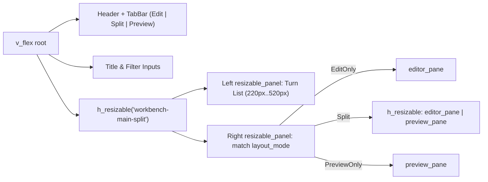

Stacking turn cards, an editor, and a Markdown preview in a single vertical column quickly runs out of screen height. Desktop IDEs and agent workbenches solve that with **draggable split panes** and a **mode switcher** (`Edit`, `Split`, `Preview`). In this lesson you reorganize `WorkbenchView::render` around GPUI Kit's `h_resizable`, `resizable_panel`, and segmented `TabBar` components — and see how Rust's ownership and `.into_any_element()` keep conditional layouts type-safe.

:::callout title="Recommended Primary Sources"
- **Interactive app**: `apps/0007-split-pane-resizable-workbench/` (`cargo run`, drag the split dividers between panes, and switch between `Edit`, `Split`, and `Preview` tabs)
- **Widget source**: `gpui-base` `resizable/panel.rs` (`h_resizable`, `resizable_panel`, `.size(...)`, `.size_range(...)`) and `gpui-component` `tab/tab_bar.rs` (`TabBar`, `Tab`)
- Course References: [Glossary](../reference/GLOSSARY.md) and [GPUI Kit & Rust Quick Reference](../reference/gpui-kit-cheatsheet.md)
:::

## Architecture: Nested Split Panels & View Modes

We partition the workbench body into two outer columns with `h_resizable("workbench-main-split")`:
- **Left panel**: fixed-default `320px` turn list clamped via `.size_range(px(220.)..px(520.))`.
- **Right panel**: driven by `WorkspaceLayoutMode`, rendering either the raw editor (`EditOnly`), a nested `h_resizable("editor-preview-split")` holding editor + preview side by side (`Split`), or the formatted preview alone (`PreviewOnly`).



## Block-by-Block Source Walkthrough

### Block 1 — Modeling `WorkspaceLayoutMode` as a Rust Enum

```rust caption="Mapping TabBar indices cleanly to strongly typed layout variants"
#[derive(Debug, Clone, Copy, PartialEq, Eq)]
pub enum WorkspaceLayoutMode {
    EditOnly,
    Split,
    PreviewOnly,
}

impl WorkspaceLayoutMode {
    pub fn index(&self) -> usize {
        match self {
            WorkspaceLayoutMode::EditOnly => 0,
            WorkspaceLayoutMode::Split => 1,
            WorkspaceLayoutMode::PreviewOnly => 2,
        }
    }

    pub fn from_index(index: usize) -> Self {
        match index {
            0 => WorkspaceLayoutMode::EditOnly,
            2 => WorkspaceLayoutMode::PreviewOnly,
            _ => WorkspaceLayoutMode::Split,
        }
    }

    pub fn label(&self) -> &'static str {
        match self {
            WorkspaceLayoutMode::EditOnly => "Edit",
            WorkspaceLayoutMode::Split => "Split",
            WorkspaceLayoutMode::PreviewOnly => "Preview",
        }
    }
}
```

Separating the enum methods `index` and `from_index` makes the UI-to-model mapping explicit and easy to unit-test without needing a live GUI window.

---

### Block 2 — Capturing `visible_count` Before Moving `visible_indices`

```rust caption="Reading vector length before consuming visible_indices by value"
        let visible_indices = self.doc.filtered_turn_indices(&self.filter_query);
        let visible_count = visible_indices.len();
        let summary = format!(
            "{} ({} / {} visible, {} words) — {} mode — Selected #{}",
            self.doc.title,
            visible_count,
            self.doc.turns.len(),
            self.doc.total_words(),
            self.layout_mode.label(),
            self.active_turn + 1
        );
```

#### Rust Concept: Ownership and Moves (`into_iter`)

Because `turn_list_pane` is built *before* the header toolbar `Badge`, calling `visible_indices.into_iter()` moves ownership of the `Vec<usize>` into the iterator. Recording `let visible_count = visible_indices.len();` upfront gives us a plain `Copy` integer (`usize`) that can be reused in both `summary` and `Badge::new().count(visible_count)` with zero cloning.

---

### Block 3 — Unifying Branch Types with `.into_any_element()`

```rust caption="Selecting single-pane or nested split-pane layout from WorkspaceLayoutMode"
        let right_workspace = match self.layout_mode {
            WorkspaceLayoutMode::EditOnly => div()
                .size_full()
                .pl_3()
                .child(editor_pane)
                .into_any_element(),
            WorkspaceLayoutMode::Split => div()
                .size_full()
                .pl_3()
                .child(
                    h_resizable("editor-preview-split")
                        .child(resizable_panel().child(div().size_full().pr_2().child(editor_pane)))
                        .child(
                            resizable_panel().child(div().size_full().pl_2().child(preview_pane)),
                        ),
                )
                .into_any_element(),
            WorkspaceLayoutMode::PreviewOnly => div()
                .size_full()
                .pl_3()
                .child(preview_pane)
                .into_any_element(),
        };
```

#### Why `.into_any_element()`?

In Rust, every arm of a `match` expression must evaluate to the exact same type. A `div()` wrapping `h_resizable(...)` has a different concrete Rust type than a `div()` wrapping `editor_pane`. Calling `.into_any_element()` type-erases each branch into `AnyElement` so all three arms unify seamlessly.

---

### Block 4 — Wiring `TabBar` and `h_resizable` into the Root View

```rust caption="Segmented TabBar switching layout modes in the toolbar"
                            .child(
                                TabBar::new("layout-mode-tabs")
                                    .segmented()
                                    .selected_index(self.layout_mode.index())
                                    .on_click(cx.listener(|this, ix: &usize, _window, cx| {
                                        this.set_layout_mode(WorkspaceLayoutMode::from_index(*ix));
                                        cx.notify();
                                    }))
                                    .child(Tab::new().label(WorkspaceLayoutMode::EditOnly.label()))
                                    .child(Tab::new().label(WorkspaceLayoutMode::Split.label()))
                                    .child(
                                        Tab::new().label(WorkspaceLayoutMode::PreviewOnly.label()),
                                    ),
                            )
```

```rust caption="Outer horizontal resizable split with clamped left turn list"
            .child(
                div().flex_1().min_h_0().child(
                    h_resizable("workbench-main-split")
                        .child(
                            resizable_panel()
                                .size(px(320.))
                                .size_range(px(220.)..px(520.))
                                .child(turn_list_pane),
                        )
                        .child(resizable_panel().child(right_workspace)),
                ),
            )
```

#### Critical `ResizablePanel` Rule

Never call `.flex_basis(...)`, `.absolute()`, or `.overflow_hidden()` directly on `resizable_panel()`, because `ResizablePanelGroup` manages panel flex sizing and divider dragging itself. Instead, place padding or scroll styling on an inner `div()` child (note `.flex_1().min_h_0()` around `h_resizable(...)` so the split group expands cleanly without overflowing).

---

### Complete `src/main.rs` Listing

```rust caption="apps/0007-split-pane-resizable-workbench/src/main.rs"
use std::ops::Range;

use gpui_kit::component::ActiveTheme as _;
use gpui_kit::component::Disableable as _;
use gpui_kit::component::Selectable as _;
use gpui_kit::component::badge::Badge;
use gpui_kit::component::button::{Button, ButtonVariants as _};
use gpui_kit::component::input::{Input, InputEvent, InputState, Textarea, TextareaState};
use gpui_kit::component::resizable::{h_resizable, resizable_panel};
use gpui_kit::component::tab::{Tab, TabBar};
use gpui_kit::component::tag::Tag;
use gpui_kit::component::text::{TaskToggleEvent, TextView};
use gpui_kit::component::theme::{Theme, ThemeMode};
use gpui_kit::component::{h_flex, v_flex};
use gpui_kit::*;

#[derive(Debug, Clone, Copy, PartialEq, Eq)]
pub enum TurnRole {
    User,
    Assistant,
}

impl TurnRole {
    pub fn badge_label(&self) -> &'static str {
        match self {
            TurnRole::User => "USER",
            TurnRole::Assistant => "AGENT",
        }
    }
}

#[derive(Debug, Clone, Copy, PartialEq, Eq)]
pub enum WorkspaceLayoutMode {
    EditOnly,
    Split,
    PreviewOnly,
}

impl WorkspaceLayoutMode {
    pub fn index(&self) -> usize {
        match self {
            WorkspaceLayoutMode::EditOnly => 0,
            WorkspaceLayoutMode::Split => 1,
            WorkspaceLayoutMode::PreviewOnly => 2,
        }
    }

    pub fn from_index(index: usize) -> Self {
        match index {
            0 => WorkspaceLayoutMode::EditOnly,
            2 => WorkspaceLayoutMode::PreviewOnly,
            _ => WorkspaceLayoutMode::Split,
        }
    }

    pub fn label(&self) -> &'static str {
        match self {
            WorkspaceLayoutMode::EditOnly => "Edit",
            WorkspaceLayoutMode::Split => "Split",
            WorkspaceLayoutMode::PreviewOnly => "Preview",
        }
    }
}

pub fn apply_task_marker_toggle(
    markdown: &str,
    marker_range: Range<usize>,
    checked: bool,
) -> Option<String> {
    let slice = markdown.get(marker_range.clone())?;
    if !matches!(slice, "[ ]" | "[x]" | "[X]") {
        return None;
    }

    let replacement = if checked { "[x]" } else { "[ ]" };
    Some(format!(
        "{}{}{}",
        &markdown[..marker_range.start],
        replacement,
        &markdown[marker_range.end..]
    ))
}

#[derive(Debug, Clone, PartialEq, Eq)]
pub struct ConversationTurn {
    pub role: TurnRole,
    pub markdown: String,
}

impl ConversationTurn {
    pub fn new(role: TurnRole, markdown: impl Into<String>) -> Self {
        Self {
            role,
            markdown: markdown.into(),
        }
    }

    pub fn word_count(&self) -> usize {
        self.markdown.split_whitespace().count()
    }

    pub fn line_count(&self) -> usize {
        self.markdown.lines().count().max(1)
    }

    pub fn task_counts(&self) -> (usize, usize) {
        let mut completed = 0usize;
        let mut total = 0usize;
        for line in self.markdown.lines() {
            let trimmed = line.trim_start();
            if trimmed.starts_with("- [x]") || trimmed.starts_with("- [X]") {
                completed += 1;
                total += 1;
            } else if trimmed.starts_with("- [ ]") {
                total += 1;
            }
        }
        (completed, total)
    }

    pub fn preview_line(&self) -> &str {
        self.markdown.lines().next().unwrap_or("")
    }
}

#[derive(Debug, Clone, PartialEq, Eq)]
pub struct WorkbenchDoc {
    pub title: String,
    pub turns: Vec<ConversationTurn>,
}

impl WorkbenchDoc {
    pub fn sample_session() -> Self {
        Self {
            title: String::from("Antigravity Session: Refactor CLI Parser"),
            turns: vec![
                ConversationTurn::new(
                    TurnRole::User,
                    "Inspect `src/args.rs` and summarize why `--quiet` overrides `--verbose`.",
                ),
                ConversationTurn::new(
                    TurnRole::Assistant,
                    "In `parse_flags`, `--quiet` runs second and mutates `verbosity` to `0`.\n\nChecklist:\n- [x] Track explicit CLI precedence\n- [ ] Keep flag parsing pure",
                ),
                ConversationTurn::new(
                    TurnRole::User,
                    "Draft a regression test checking flag order independence.",
                ),
            ],
        }
    }

    pub fn set_title(&mut self, title: impl Into<String>) {
        let trimmed = title.into();
        if !trimmed.trim().is_empty() {
            self.title = trimmed;
        }
    }

    pub fn update_turn_markdown(&mut self, index: usize, markdown: impl Into<String>) -> bool {
        if let Some(turn) = self.turns.get_mut(index) {
            turn.markdown = markdown.into();
            true
        } else {
            false
        }
    }

    pub fn filtered_turn_indices(&self, query: &str) -> Vec<usize> {
        let needle = query.trim().to_lowercase();
        self.turns
            .iter()
            .enumerate()
            .filter(|(_, turn)| {
                needle.is_empty()
                    || turn.markdown.to_lowercase().contains(&needle)
                    || turn.role.badge_label().to_lowercase().contains(&needle)
            })
            .map(|(ix, _)| ix)
            .collect()
    }

    pub fn turn_at(&self, index: usize) -> Option<&ConversationTurn> {
        self.turns.get(index)
    }

    pub fn total_words(&self) -> usize {
        self.turns.iter().map(ConversationTurn::word_count).sum()
    }

    pub fn to_markdown(&self) -> String {
        let mut out = format!("# {}\n\n", self.title);
        for turn in &self.turns {
            out.push_str(&format!(
                "## {}\n\n{}\n\n",
                turn.role.badge_label(),
                turn.markdown
            ));
        }
        out.trim_end().to_string()
    }
}

pub struct WorkbenchView {
    pub doc: WorkbenchDoc,
    pub active_turn: usize,
    pub filter_query: String,
    pub layout_mode: WorkspaceLayoutMode,
    pub title_input: Option<Entity<InputState>>,
    pub filter_input: Option<Entity<InputState>>,
    pub body_textarea: Option<Entity<TextareaState>>,
    _subscriptions: Vec<Subscription>,
}

impl WorkbenchView {
    pub fn new() -> Self {
        Self {
            doc: WorkbenchDoc::sample_session(),
            active_turn: 0,
            filter_query: String::new(),
            layout_mode: WorkspaceLayoutMode::Split,
            title_input: None,
            filter_input: None,
            body_textarea: None,
            _subscriptions: Vec::new(),
        }
    }

    pub fn new_with_window(window: &mut Window, cx: &mut Context<Self>) -> Self {
        let mut view = Self::new();
        let initial_title = view.doc.title.clone();
        let initial_markdown = view
            .active_turn_ref()
            .map(|turn| turn.markdown.clone())
            .unwrap_or_default();

        let title_input = cx.new(|cx| {
            InputState::new(window, cx)
                .placeholder("Session title...")
                .default_value(initial_title)
        });
        let filter_input = cx.new(|cx| {
            InputState::new(window, cx)
                .clean_on_escape()
                .placeholder("Filter turns by text or role (USER / AGENT)...")
        });
        let body_textarea = cx.new(|cx| {
            TextareaState::new(window, cx)
                .rows(12)
                .placeholder("Edit turn Markdown...")
                .default_value(initial_markdown)
        });

        let title_sub = cx.subscribe_in(
            &title_input,
            window,
            |this, state, event: &InputEvent, _window, cx| {
                if matches!(event, InputEvent::Change) {
                    let next_title = state.read(cx).value().to_string();
                    this.doc.set_title(next_title);
                    cx.notify();
                }
            },
        );

        let filter_sub = cx.subscribe_in(
            &filter_input,
            window,
            |this, state, event: &InputEvent, _window, cx| {
                if matches!(event, InputEvent::Change) {
                    this.filter_query = state.read(cx).value().to_string();
                    cx.notify();
                }
            },
        );

        let body_sub = cx.subscribe_in(
            &body_textarea,
            window,
            |this, state, event: &InputEvent, _window, cx| {
                if matches!(event, InputEvent::Change) {
                    let next_body = state.read(cx).value().to_string();
                    this.update_active_markdown(next_body);
                    cx.notify();
                }
            },
        );

        view.title_input = Some(title_input);
        view.filter_input = Some(filter_input);
        view.body_textarea = Some(body_textarea);
        view._subscriptions.push(title_sub);
        view._subscriptions.push(filter_sub);
        view._subscriptions.push(body_sub);
        view
    }

    pub fn set_layout_mode(&mut self, mode: WorkspaceLayoutMode) {
        self.layout_mode = mode;
    }

    pub fn sync_textarea_to_active_turn(&mut self, window: &mut Window, cx: &mut Context<Self>) {
        let active_md = self
            .active_turn_ref()
            .map(|turn| turn.markdown.clone())
            .unwrap_or_default();
        if let Some(textarea) = &self.body_textarea {
            textarea.update(cx, |state, cx| {
                state.set_value(active_md, window, cx);
            });
        }
    }

    pub fn update_active_markdown(&mut self, markdown: impl Into<String>) -> bool {
        self.doc.update_turn_markdown(self.active_turn, markdown)
    }

    pub fn toggle_active_task_marker(
        &mut self,
        marker_range: Range<usize>,
        checked: bool,
        window: &mut Window,
        cx: &mut Context<Self>,
    ) -> bool {
        let Some(updated) = self
            .active_turn_ref()
            .and_then(|turn| apply_task_marker_toggle(&turn.markdown, marker_range, checked))
        else {
            return false;
        };
        if !self.update_active_markdown(updated) {
            return false;
        }
        self.sync_textarea_to_active_turn(window, cx);
        true
    }

    pub fn select_turn(&mut self, index: usize) -> bool {
        if index < self.doc.turns.len() {
            self.active_turn = index;
            true
        } else {
            false
        }
    }

    pub fn select_next_turn(&mut self) {
        if self.active_turn + 1 < self.doc.turns.len() {
            self.active_turn += 1;
        }
    }

    pub fn select_prev_turn(&mut self) {
        self.active_turn = self.active_turn.saturating_sub(1);
    }

    pub fn append_turn(&mut self, role: TurnRole, markdown: impl Into<String>) -> usize {
        self.doc.turns.push(ConversationTurn::new(role, markdown));
        let new_index = self.doc.turns.len() - 1;
        self.active_turn = new_index;
        new_index
    }

    pub fn remove_active_turn(&mut self) -> Option<ConversationTurn> {
        if self.doc.turns.len() <= 1 || self.active_turn >= self.doc.turns.len() {
            return None;
        }
        let removed = self.doc.turns.remove(self.active_turn);
        if self.active_turn >= self.doc.turns.len() {
            self.active_turn = self.doc.turns.len() - 1;
        }
        Some(removed)
    }

    pub fn active_turn_ref(&self) -> Option<&ConversationTurn> {
        self.doc.turn_at(self.active_turn)
    }
}

impl Default for WorkbenchView {
    fn default() -> Self {
        Self::new()
    }
}

impl Render for WorkbenchView {
    fn render(&mut self, _window: &mut Window, cx: &mut Context<Self>) -> impl IntoElement {
        let theme = cx.theme();
        let visible_indices = self.doc.filtered_turn_indices(&self.filter_query);
        let visible_count = visible_indices.len();
        let summary = format!(
            "{} ({} / {} visible, {} words) — {} mode — Selected #{}",
            self.doc.title,
            visible_count,
            self.doc.turns.len(),
            self.doc.total_words(),
            self.layout_mode.label(),
            self.active_turn + 1
        );
        let markdown_preview = self.doc.to_markdown();
        let can_delete = self.doc.turns.len() > 1;
        let (active_markdown, active_words, active_lines, (tasks_done, tasks_total)) = self
            .active_turn_ref()
            .map(|turn| {
                (
                    turn.markdown.clone(),
                    turn.word_count(),
                    turn.line_count(),
                    turn.task_counts(),
                )
            })
            .unwrap_or_default();
        let view = cx.entity().downgrade();

        let turn_list_pane =
            v_flex()
                .size_full()
                .pr_3()
                .gap_2()
                .children(visible_indices.into_iter().filter_map(|ix| {
                    let turn = self.doc.turn_at(ix)?;
                    let is_active = ix == self.active_turn;
                    let role_tag = match turn.role {
                        TurnRole::User => Tag::primary().child("USER"),
                        TurnRole::Assistant => Tag::secondary().child("AGENT"),
                    };
                    let border_color = if is_active {
                        theme.primary
                    } else {
                        theme.border
                    };

                    Some(
                        h_flex()
                            .p_3()
                            .gap_3()
                            .items_center()
                            .justify_between()
                            .rounded_md()
                            .border_1()
                            .border_color(border_color)
                            .bg(theme.secondary)
                            .child(
                                h_flex()
                                    .gap_2()
                                    .items_center()
                                    .child(role_tag)
                                    .child(format!("#{} — {}", ix + 1, turn.preview_line())),
                            )
                            .child(
                                Button::new(("select-turn", ix))
                                    .ghost()
                                    .selected(is_active)
                                    .label(if is_active { "Selected" } else { "Inspect" })
                                    .on_click(cx.listener(move |this, _, window, cx| {
                                        this.select_turn(ix);
                                        this.sync_textarea_to_active_turn(window, cx);
                                        cx.notify();
                                    })),
                            ),
                    )
                }));

        let editor_pane = v_flex()
            .size_full()
            .p_4()
            .gap_2()
            .rounded_md()
            .border_1()
            .border_color(theme.border)
            .bg(theme.background)
            .child(
                h_flex()
                    .items_center()
                    .justify_between()
                    .child(
                        div()
                            .text_sm()
                            .text_color(theme.muted_foreground)
                            .child("Active Turn Markdown Buffer"),
                    )
                    .child(
                        h_flex()
                            .gap_2()
                            .child(Tag::secondary().child(format!("{active_words} words")))
                            .child(Tag::secondary().child(format!("{active_lines} lines"))),
                    ),
            )
            .children(
                self.body_textarea
                    .as_ref()
                    .map(|textarea| Textarea::new(textarea).h(px(280.))),
            );

        let preview_pane = v_flex()
            .size_full()
            .p_4()
            .gap_2()
            .rounded_md()
            .border_1()
            .border_color(theme.border)
            .bg(theme.background)
            .child(
                h_flex()
                    .items_center()
                    .justify_between()
                    .child(
                        div()
                            .text_sm()
                            .text_color(theme.muted_foreground)
                            .child("Live Rendered Markdown Preview"),
                    )
                    .child(Tag::secondary().child(format!("{tasks_done}/{tasks_total} tasks"))),
            )
            .child(
                TextView::markdown("turn-markdown-preview", active_markdown)
                    .selectable(true)
                    .on_task_toggle(move |event: &TaskToggleEvent, window, cx| {
                        let marker_range = event.marker_range();
                        let checked = event.checked();
                        let _ = view.update(cx, |this, cx| {
                            if this.toggle_active_task_marker(marker_range, checked, window, cx) {
                                cx.notify();
                            }
                        });
                    }),
            );

        let right_workspace = match self.layout_mode {
            WorkspaceLayoutMode::EditOnly => div()
                .size_full()
                .pl_3()
                .child(editor_pane)
                .into_any_element(),
            WorkspaceLayoutMode::Split => div()
                .size_full()
                .pl_3()
                .child(
                    h_resizable("editor-preview-split")
                        .child(resizable_panel().child(div().size_full().pr_2().child(editor_pane)))
                        .child(
                            resizable_panel().child(div().size_full().pl_2().child(preview_pane)),
                        ),
                )
                .into_any_element(),
            WorkspaceLayoutMode::PreviewOnly => div()
                .size_full()
                .pl_3()
                .child(preview_pane)
                .into_any_element(),
        };

        v_flex()
            .size_full()
            .p_6()
            .gap_4()
            .bg(theme.background)
            .text_color(theme.foreground)
            .child(
                h_flex()
                    .items_center()
                    .justify_between()
                    .child(
                        h_flex()
                            .items_center()
                            .gap_3()
                            .child("Antigravity Markdown & Conversation Workbench")
                            .child(
                                Badge::new()
                                    .count(visible_count)
                                    .child(div().px_2().py_1().child("Visible")),
                            ),
                    )
                    .child(
                        h_flex()
                            .items_center()
                            .gap_2()
                            .child(
                                TabBar::new("layout-mode-tabs")
                                    .segmented()
                                    .selected_index(self.layout_mode.index())
                                    .on_click(cx.listener(|this, ix: &usize, _window, cx| {
                                        this.set_layout_mode(WorkspaceLayoutMode::from_index(*ix));
                                        cx.notify();
                                    }))
                                    .child(Tab::new().label(WorkspaceLayoutMode::EditOnly.label()))
                                    .child(Tab::new().label(WorkspaceLayoutMode::Split.label()))
                                    .child(
                                        Tab::new().label(WorkspaceLayoutMode::PreviewOnly.label()),
                                    ),
                            )
                            .child(Button::new("prev-turn").secondary().label("Prev").on_click(
                                cx.listener(|this, _, window, cx| {
                                    this.select_prev_turn();
                                    this.sync_textarea_to_active_turn(window, cx);
                                    cx.notify();
                                }),
                            ))
                            .child(Button::new("next-turn").secondary().label("Next").on_click(
                                cx.listener(|this, _, window, cx| {
                                    this.select_next_turn();
                                    this.sync_textarea_to_active_turn(window, cx);
                                    cx.notify();
                                }),
                            ))
                            .child(
                                Button::new("add-user-turn")
                                    .secondary()
                                    .label("+ User Turn")
                                    .on_click(cx.listener(|this, _, window, cx| {
                                        this.append_turn(
                                            TurnRole::User,
                                            "Follow-up question about CLI flag precedence.",
                                        );
                                        this.sync_textarea_to_active_turn(window, cx);
                                        cx.notify();
                                    })),
                            )
                            .child(
                                Button::new("add-agent-turn")
                                    .secondary()
                                    .label("+ Agent Turn")
                                    .on_click(cx.listener(|this, _, window, cx| {
                                        this.append_turn(
                                            TurnRole::Assistant,
                                            "Proposed checklist:\n- [ ] Keep flag parsing pure",
                                        );
                                        this.sync_textarea_to_active_turn(window, cx);
                                        cx.notify();
                                    })),
                            )
                            .child(
                                Button::new("delete-turn")
                                    .danger()
                                    .label("Delete Turn")
                                    .disabled(!can_delete)
                                    .on_click(cx.listener(|this, _, window, cx| {
                                        this.remove_active_turn();
                                        this.sync_textarea_to_active_turn(window, cx);
                                        cx.notify();
                                    })),
                            )
                            .child(
                                Button::new("export-md")
                                    .primary()
                                    .label("Print Markdown")
                                    .on_click(move |_, _, _| {
                                        println!("{markdown_preview}");
                                    }),
                            ),
                    ),
            )
            .child(
                h_flex()
                    .gap_3()
                    .children(
                        self.title_input
                            .as_ref()
                            .map(|input| div().flex_1().child(Input::new(input))),
                    )
                    .children(
                        self.filter_input.as_ref().map(|input| {
                            div().w(px(320.)).child(Input::new(input).cleanable(true))
                        }),
                    ),
            )
            .child(div().text_color(theme.muted_foreground).child(summary))
            .child(
                div().flex_1().min_h_0().child(
                    h_resizable("workbench-main-split")
                        .child(
                            resizable_panel()
                                .size(px(320.))
                                .size_range(px(220.)..px(520.))
                                .child(turn_list_pane),
                        )
                        .child(resizable_panel().child(right_workspace)),
                ),
            )
    }
}

fn main() {
    gpui_kit::application()
        .with_assets(gpui_kit::assets::Assets)
        .run(|cx| {
            gpui_kit::init(cx);
            Theme::change(ThemeMode::Dark, None, cx);
            gpui_kit::open_window(WindowOptions::default(), cx, |window, cx| {
                cx.new(|cx| WorkbenchView::new_with_window(window, cx))
            })
            .expect("failed to open workbench window");
        });
}

#[cfg(test)]
mod tests {
    use super::{
        ConversationTurn, TurnRole, WorkbenchDoc, WorkbenchView, WorkspaceLayoutMode,
        apply_task_marker_toggle,
    };

    #[test]
    fn layout_mode_round_trips_tab_indices() {
        for (ix, expected) in [
            (0, WorkspaceLayoutMode::EditOnly),
            (1, WorkspaceLayoutMode::Split),
            (2, WorkspaceLayoutMode::PreviewOnly),
        ] {
            let mode = WorkspaceLayoutMode::from_index(ix);
            assert_eq!(mode, expected);
            assert_eq!(mode.index(), ix);
        }
        assert_eq!(
            WorkspaceLayoutMode::from_index(99),
            WorkspaceLayoutMode::Split
        );
    }

    #[test]
    fn set_layout_mode_switches_workbench_view_mode() {
        let mut view = WorkbenchView::new();
        assert_eq!(view.layout_mode, WorkspaceLayoutMode::Split);
        view.set_layout_mode(WorkspaceLayoutMode::PreviewOnly);
        assert_eq!(view.layout_mode, WorkspaceLayoutMode::PreviewOnly);
        view.set_layout_mode(WorkspaceLayoutMode::EditOnly);
        assert_eq!(view.layout_mode, WorkspaceLayoutMode::EditOnly);
    }

    #[test]
    fn apply_task_marker_toggle_flips_valid_checkbox_ranges() {
        let source = "- [x] Done item\n- [ ] Pending item";
        let unchecked = apply_task_marker_toggle(source, 2..5, false).expect("valid marker range");
        assert_eq!(unchecked, "- [ ] Done item\n- [ ] Pending item");

        let checked = apply_task_marker_toggle(&unchecked, 18..21, true).expect("second marker");
        assert_eq!(checked, "- [ ] Done item\n- [x] Pending item");
    }

    #[test]
    fn apply_task_marker_toggle_rejects_invalid_or_out_of_bounds_ranges() {
        let source = "- [ ] Pending item";
        assert_eq!(apply_task_marker_toggle(source, 0..3, true), None);
        assert_eq!(apply_task_marker_toggle(source, 10..99, true), None);
    }

    #[test]
    fn turn_task_counts_totals_completed_and_open_items() {
        let turn = &WorkbenchDoc::sample_session().turns[1];
        assert_eq!(turn.task_counts(), (1, 2));

        let plain = ConversationTurn::new(TurnRole::User, "No checklist here");
        assert_eq!(plain.task_counts(), (0, 0));
    }

    #[test]
    fn update_active_markdown_mutates_selected_turn_only() {
        let mut view = WorkbenchView::new();
        assert!(view.select_turn(1));
        assert!(view.update_active_markdown("Updated assistant guidance"));

        assert_eq!(
            view.active_turn_ref().map(|t| t.markdown.as_str()),
            Some("Updated assistant guidance")
        );
    }

    #[test]
    fn filtered_turn_indices_finds_task_checklist_items() {
        let doc = WorkbenchDoc::sample_session();
        assert_eq!(doc.filtered_turn_indices("CLI precedence"), vec![1]);
        assert_eq!(
            doc.filtered_turn_indices("nonexistent phrase"),
            Vec::<usize>::new()
        );
    }
}
```

## Hands-On Exercise: Resizable Split & Mode Tabs

:::exercise id="ex-0007" title="Interactive Lab: Mode Tabs & Clamped Split Panels" badge="Skill Practice"
Fill in the blanks to bind a segmented `TabBar` to `WorkspaceLayoutMode` and clamp the left turn sidebar width between `220px` and `520px`:

```rust
TabBar::new("layout-mode-tabs")
    .{{blank:segmented|Enable pill-style segmented tab strip appearance|???|9}}()
    .selected_index(self.layout_mode.index())
    .on_click(cx.listener(|this, ix: &usize, _window, cx| {
        this.set_layout_mode(WorkspaceLayoutMode::from_index(*ix));
        cx.notify();
    }))

h_resizable("workbench-main-split")
    .child(
        resizable_panel()
            .size(px(320.))
            .{{blank:size_range|Clamp minimum and maximum resizable panel width in pixels|???|10}}(px(220.)..px(520.))
            .child(turn_list_pane),
    )
```

:::prompts
hint: "Use .segmented() on TabBar and .size_range(min..max) on resizable_panel()."
success: "Nice work! Your split-pane layout now enforces bounds and switches modes cleanly."
:::
:::

## Check Your Understanding

:::quiz id="quiz-0007" title="Retrieval Practice: Split Panels & AnyElement" badge="3 Questions • Equal-Length Options"
- question: "Why must you avoid calling flex_basis, absolute, or overflow_hidden directly on resizable_panel()?"
  wrong_hint: "Think about what owns divider math inside ResizablePanelGroup."
  options:
    - letter: "A"
      text: "GPUI ignores any panel child unless the user holds Option down"
      correct: false
      explain: "Modifier keys do not change layout method behavior."
    - letter: "B"
      text: "ResizablePanelGroup computes flex widths dynamically so overriding those styles breaks dragging"
      correct: true
      explain: "Correct! ResizablePanelGroup owns panel flex rules and divider bounds directly."
    - letter: "C"
      text: "Calling those builders causes TextareaState to reset cursor positions every render"
      correct: false
      explain: "Child entity cursor state is independent of flex CSS styling."
    - letter: "D"
      text: "Clippy rejects resizable_panel calls whenever flex_basis appears inside a debug build"
      correct: false
      explain: "It is a runtime layout pitfall, not a Clippy lint."
- question: "Why does right_workspace call into_any_element() on each arm of match self.layout_mode?"
  wrong_hint: "Remember Rust's rule that every arm of match must have one identical static type."
  options:
    - letter: "A"
      text: "GPUI requires converting every UI element into JSON tokens before window rendering begins"
      correct: false
      explain: "Elements compile directly into typed Rust layout trees with zero JSON conversion."
    - letter: "B"
      text: "into_any_element spawns an isolated GPU texture thread per pane when TabBar clicks fire"
      correct: false
      explain: "All layout runs on the main UI thread; into_any_element performs type erasure."
    - letter: "C"
      text: "Calling into_any_element preserves all scroll offsets inside ResizablePanel across complete window close events"
      correct: false
      explain: "into_any_element is a compile-time type wrapper and does not persist across window closes."
    - letter: "D"
      text: "Each match arm builds a distinct Rust type so into_any_element unifies them cleanly"
      correct: true
      explain: "Correct! h_resizable(...) and div() have different concrete types, unified via AnyElement."
- question: "Why did render save let visible_count = visible_indices.len(); before building turn_list_pane?"
  wrong_hint: "Check whether into_iter() borrows or moves Vec<usize>."
  options:
    - letter: "A"
      text: "Vec::len mutates the underlying allocation and therefore requires an exclusive mutable borrow"
      correct: false
      explain: "Vec::len takes &self and performs zero mutation."
    - letter: "B"
      text: "Badge::count only accepts compile-time integer literals rather than local usize runtime values"
      correct: false
      explain: "Badge::count accepts any runtime usize value."
    - letter: "C"
      text: "turn_list_pane consumes visible_indices by value with into_iter before Badge needs its length"
      correct: true
      explain: "Correct! .into_iter() moves visible_indices, so copying its usize length beforehand avoids cloning."
    - letter: "D"
      text: "TabBar drops visible_indices whenever WorkspaceLayoutMode switches from Split back to EditOnly mode"
      correct: false
      explain: "TabBar has no reference to visible_indices; Rust ownership rules drive the ordering."
:::

## Verify & Run

Run formatting, unit tests, strict Clippy lints, and launch the split-pane desktop workbench:

:::verify id="verify-0007" title="Verification Lab: Resizable Split Panels & Layout Modes" badge="Terminal Gate"
```bash
cargo fmt --manifest-path apps/0007-split-pane-resizable-workbench/Cargo.toml --check
cargo test --manifest-path apps/0007-split-pane-resizable-workbench/Cargo.toml
cargo clippy --manifest-path apps/0007-split-pane-resizable-workbench/Cargo.toml --all-targets -- -D warnings
cargo run --manifest-path apps/0007-split-pane-resizable-workbench/Cargo.toml
```

Expected verification output:

```text
running 7 tests
test tests::apply_task_marker_toggle_flips_valid_checkbox_ranges ... ok
test tests::layout_mode_round_trips_tab_indices ... ok
test tests::apply_task_marker_toggle_rejects_invalid_or_out_of_bounds_ranges ... ok
test tests::set_layout_mode_switches_workbench_view_mode ... ok
test tests::filtered_turn_indices_finds_task_checklist_items ... ok
test tests::turn_task_counts_totals_completed_and_open_items ... ok
test tests::update_active_markdown_mutates_selected_turn_only ... ok

test result: ok. 7 passed; 0 failed; 0 ignored; 0 measured; 0 filtered out; finished in 0.00s
```
:::

:::teacher-prompt title="Extend This Lesson with Your Agent"
Ask your AI teacher: *"In Lesson 0007, persist `Entity<ResizableState>` on `WorkbenchView` and add a `Reset Layout` button that restores the 320px sidebar width after dragging."*
:::
