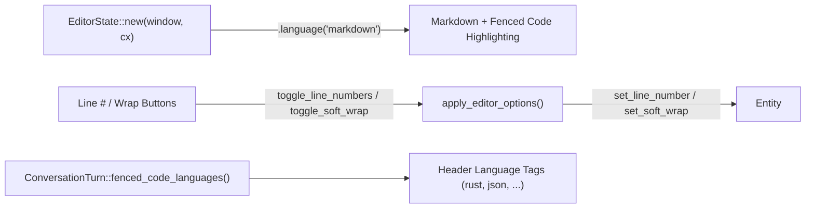

AI coding agents communicate in Markdown laced with fenced code diffs (`rust`, `json`, `bash`, `toml`). A plain multi-line `Textarea` treats headings, links, and code blocks as flat characters. In this lesson you swap in GPUI Kit's tree-sitter `Editor` and `EditorState`, configure `.language("markdown")`, wire live `Line #` and `Wrap` toggle controls, and scan each turn for fenced code languages.

:::callout title="Recommended Primary Sources"
- **Interactive app**: `apps/0008-code-editor-and-syntax-highlighting/` (`cargo run`, click turn #2 to edit syntax-highlighted Markdown + fenced Rust code, and toggle `Line #` and `Wrap`)
- **Widget source**: `gpui-component` `input/editor.rs` (`Editor::new`) and `gpui-base` `input/base/state.rs` (`EditorState`, `.language(...)`, `set_line_number`, `set_soft_wrap`)
- Course References: [Glossary](../reference/GLOSSARY.md) and [GPUI Kit & Rust Quick Reference](../reference/gpui-kit-cheatsheet.md)
:::

## Architecture: `EditorState` and Mode Toggles

Just like `TextareaState`, `EditorState` wraps GPUI Kit's unified input buffer, emits `InputEvent::Change`, and supports `.set_value(...)` without emitting redundant events — so swapping `body_textarea` for `body_editor` preserves our exact data-flow architecture while gaining tree-sitter highlighting, line-number gutters, and runtime wrapping toggles.



## Block-by-Block Source Walkthrough

### Block 1 — Extracting Unique Fenced Code Languages (`in_fence` State)

```rust caption="Scanning Markdown lines with a toggle flag for opening code fences"
    pub fn fenced_code_languages(&self) -> Vec<String> {
        let mut langs = Vec::new();
        let mut in_fence = false;
        for line in self.markdown.lines() {
            let trimmed = line.trim();
            if let Some(rest) = trimmed.strip_prefix("```") {
                if !in_fence {
                    let lang = rest.split_whitespace().next().unwrap_or("");
                    if !lang.is_empty() && !langs.iter().any(|existing| existing == lang) {
                        langs.push(lang.to_string());
                    }
                }
                in_fence = !in_fence;
            }
        }
        langs
    }
```

#### Rust Concept: `str::strip_prefix` and Duplicate Guards

- `trimmed.strip_prefix("```")` returns `Option<&str>` — `Some(remainder)` if the prefix matched, or `None` otherwise — avoiding manual index arithmetic.
- Tracking `in_fence` ensures closing fences (` ``` `) flip the parser state back to prose without accidentally treating prose or subsequent lines as fence headers.
- `!langs.iter().any(|existing| existing == lang)` deduplicates languages while preserving first-seen order.

---

### Block 2 — Initializing `EditorState` with Language and Gutter Flags

```rust caption="Configuring EditorState with Markdown highlighting, line numbers, and soft wrap"
        let body_editor = cx.new(|cx| {
            EditorState::new(window, cx)
                .language("markdown")
                .line_number(view.line_numbers)
                .soft_wrap(view.soft_wrap)
                .default_value(initial_markdown)
        });
```

#### Shared Helpers for Clean Runtime Toggles

Notice how we separate pure model state (`line_numbers`, `soft_wrap`) from GPUI's `EditorState` update helper (`apply_editor_options`):

```rust caption="Separating pure boolean state toggles from GPUI Entity updates"
    pub fn toggle_line_numbers(&mut self) -> bool {
        self.line_numbers = !self.line_numbers;
        self.line_numbers
    }

    pub fn toggle_soft_wrap(&mut self) -> bool {
        self.soft_wrap = !self.soft_wrap;
        self.soft_wrap
    }

    pub fn apply_editor_options(&mut self, window: &mut Window, cx: &mut Context<Self>) {
        let line_numbers = self.line_numbers;
        let soft_wrap = self.soft_wrap;
        if let Some(editor) = &self.body_editor {
            editor.update(cx, |state, cx| {
                state.set_line_number(line_numbers, window, cx);
                state.set_soft_wrap(soft_wrap, window, cx);
            });
        }
    }
```

Keeping state transitions in pure `&mut self` methods lets unit tests verify toggles without requiring a live OS window.

---

### Block 3 — Rendering `Editor::new` and Header Toggle Chips

```rust caption="Rendering Editor with detected fence tags and Line # / Wrap toggle buttons"
                    .child(
                        h_flex()
                            .items_center()
                            .gap_2()
                            .child(
                                div()
                                    .text_sm()
                                    .text_color(theme.muted_foreground)
                                    .child("Markdown Code Editor"),
                            )
                            .children(
                                fence_langs
                                    .into_iter()
                                    .map(|lang| Tag::secondary().child(lang)),
                            ),
                    )
                    .child(
                        h_flex()
                            .gap_2()
                            .child(
                                Button::new("toggle-line-numbers")
                                    .ghost()
                                    .selected(self.line_numbers)
                                    .label("Line #")
                                    .on_click(cx.listener(|this, _, window, cx| {
                                        this.toggle_line_numbers();
                                        this.apply_editor_options(window, cx);
                                        cx.notify();
                                    })),
                            )
                            .child(
                                Button::new("toggle-soft-wrap")
                                    .ghost()
                                    .selected(self.soft_wrap)
                                    .label("Wrap")
                                    .on_click(cx.listener(|this, _, window, cx| {
                                        this.toggle_soft_wrap();
                                        this.apply_editor_options(window, cx);
                                        cx.notify();
                                    })),
                            )
                            .child(Tag::secondary().child(format!("{active_words} words")))
                            .child(Tag::secondary().child(format!("{active_lines} lines"))),
                    ),
            )
            .children(
                self.body_editor
                    .as_ref()
                    .map(|editor| Editor::new(editor).h(px(280.))),
            );
```

Notice `.selected(self.line_numbers)` and `.selected(self.soft_wrap)` reuse `Selectable` styling (introduced in Lesson 0003) so toggle buttons highlight their active state clearly.

---

### Complete `src/main.rs` Listing

```rust caption="apps/0008-code-editor-and-syntax-highlighting/src/main.rs"
use std::ops::Range;

use gpui_kit::component::ActiveTheme as _;
use gpui_kit::component::Disableable as _;
use gpui_kit::component::Selectable as _;
use gpui_kit::component::badge::Badge;
use gpui_kit::component::button::{Button, ButtonVariants as _};
use gpui_kit::component::input::{Editor, EditorState, Input, InputEvent, InputState};
use gpui_kit::component::resizable::{h_resizable, resizable_panel};
use gpui_kit::component::tab::{Tab, TabBar};
use gpui_kit::component::tag::Tag;
use gpui_kit::component::text::{TaskToggleEvent, TextView};
use gpui_kit::component::{h_flex, v_flex};
use gpui_kit::*;

#[derive(Debug, Clone, Copy, PartialEq, Eq)]
pub enum TurnRole {
    User,
    Assistant,
}

impl TurnRole {
    pub fn badge_label(&self) -> &'static str {
        match self {
            TurnRole::User => "USER",
            TurnRole::Assistant => "AGENT",
        }
    }
}

#[derive(Debug, Clone, Copy, PartialEq, Eq)]
pub enum WorkspaceLayoutMode {
    EditOnly,
    Split,
    PreviewOnly,
}

impl WorkspaceLayoutMode {
    pub fn index(&self) -> usize {
        match self {
            WorkspaceLayoutMode::EditOnly => 0,
            WorkspaceLayoutMode::Split => 1,
            WorkspaceLayoutMode::PreviewOnly => 2,
        }
    }

    pub fn from_index(index: usize) -> Self {
        match index {
            0 => WorkspaceLayoutMode::EditOnly,
            2 => WorkspaceLayoutMode::PreviewOnly,
            _ => WorkspaceLayoutMode::Split,
        }
    }

    pub fn label(&self) -> &'static str {
        match self {
            WorkspaceLayoutMode::EditOnly => "Edit",
            WorkspaceLayoutMode::Split => "Split",
            WorkspaceLayoutMode::PreviewOnly => "Preview",
        }
    }
}

pub fn apply_task_marker_toggle(
    markdown: &str,
    marker_range: Range<usize>,
    checked: bool,
) -> Option<String> {
    let slice = markdown.get(marker_range.clone())?;
    if !matches!(slice, "[ ]" | "[x]" | "[X]") {
        return None;
    }

    let replacement = if checked { "[x]" } else { "[ ]" };
    Some(format!(
        "{}{}{}",
        &markdown[..marker_range.start],
        replacement,
        &markdown[marker_range.end..]
    ))
}

#[derive(Debug, Clone, PartialEq, Eq)]
pub struct ConversationTurn {
    pub role: TurnRole,
    pub markdown: String,
}

impl ConversationTurn {
    pub fn new(role: TurnRole, markdown: impl Into<String>) -> Self {
        Self {
            role,
            markdown: markdown.into(),
        }
    }

    pub fn word_count(&self) -> usize {
        self.markdown.split_whitespace().count()
    }

    pub fn line_count(&self) -> usize {
        self.markdown.lines().count().max(1)
    }

    pub fn task_counts(&self) -> (usize, usize) {
        let mut completed = 0usize;
        let mut total = 0usize;
        for line in self.markdown.lines() {
            let trimmed = line.trim_start();
            if trimmed.starts_with("- [x]") || trimmed.starts_with("- [X]") {
                completed += 1;
                total += 1;
            } else if trimmed.starts_with("- [ ]") {
                total += 1;
            }
        }
        (completed, total)
    }

    pub fn fenced_code_languages(&self) -> Vec<String> {
        let mut langs = Vec::new();
        let mut in_fence = false;
        for line in self.markdown.lines() {
            let trimmed = line.trim();
            if let Some(rest) = trimmed.strip_prefix("```") {
                if !in_fence {
                    let lang = rest.split_whitespace().next().unwrap_or("");
                    if !lang.is_empty() && !langs.iter().any(|existing| existing == lang) {
                        langs.push(lang.to_string());
                    }
                }
                in_fence = !in_fence;
            }
        }
        langs
    }

    pub fn preview_line(&self) -> &str {
        self.markdown.lines().next().unwrap_or("")
    }
}

#[derive(Debug, Clone, PartialEq, Eq)]
pub struct WorkbenchDoc {
    pub title: String,
    pub turns: Vec<ConversationTurn>,
}

impl WorkbenchDoc {
    pub fn sample_session() -> Self {
        Self {
            title: String::from("Antigravity Session: Refactor CLI Parser"),
            turns: vec![
                ConversationTurn::new(
                    TurnRole::User,
                    "Inspect `src/args.rs` and summarize why `--quiet` overrides `--verbose`.",
                ),
                ConversationTurn::new(
                    TurnRole::Assistant,
                    "In `parse_flags`, `--quiet` runs second and mutates `verbosity` to `0`.\n\n```rust\nfn parse_flags(args: &[&str]) -> u8 {\n    let quiet = args.contains(&\"--quiet\");\n    if quiet { 0 } else { 1 }\n}\n```\n\nChecklist:\n- [x] Track explicit CLI precedence\n- [ ] Keep flag parsing pure",
                ),
                ConversationTurn::new(
                    TurnRole::User,
                    "Draft a regression test checking flag order independence.",
                ),
            ],
        }
    }

    pub fn set_title(&mut self, title: impl Into<String>) {
        let trimmed = title.into();
        if !trimmed.trim().is_empty() {
            self.title = trimmed;
        }
    }

    pub fn update_turn_markdown(&mut self, index: usize, markdown: impl Into<String>) -> bool {
        if let Some(turn) = self.turns.get_mut(index) {
            turn.markdown = markdown.into();
            true
        } else {
            false
        }
    }

    pub fn filtered_turn_indices(&self, query: &str) -> Vec<usize> {
        let needle = query.trim().to_lowercase();
        self.turns
            .iter()
            .enumerate()
            .filter(|(_, turn)| {
                needle.is_empty()
                    || turn.markdown.to_lowercase().contains(&needle)
                    || turn.role.badge_label().to_lowercase().contains(&needle)
            })
            .map(|(ix, _)| ix)
            .collect()
    }

    pub fn turn_at(&self, index: usize) -> Option<&ConversationTurn> {
        self.turns.get(index)
    }

    pub fn total_words(&self) -> usize {
        self.turns.iter().map(ConversationTurn::word_count).sum()
    }

    pub fn to_markdown(&self) -> String {
        let mut out = format!("# {}\n\n", self.title);
        for turn in &self.turns {
            out.push_str(&format!(
                "## {}\n\n{}\n\n",
                turn.role.badge_label(),
                turn.markdown
            ));
        }
        out.trim_end().to_string()
    }
}

pub struct WorkbenchView {
    pub doc: WorkbenchDoc,
    pub active_turn: usize,
    pub filter_query: String,
    pub layout_mode: WorkspaceLayoutMode,
    pub line_numbers: bool,
    pub soft_wrap: bool,
    pub title_input: Option<Entity<InputState>>,
    pub filter_input: Option<Entity<InputState>>,
    pub body_editor: Option<Entity<EditorState>>,
    _subscriptions: Vec<Subscription>,
}

impl WorkbenchView {
    pub fn new() -> Self {
        Self {
            doc: WorkbenchDoc::sample_session(),
            active_turn: 0,
            filter_query: String::new(),
            layout_mode: WorkspaceLayoutMode::Split,
            line_numbers: true,
            soft_wrap: true,
            title_input: None,
            filter_input: None,
            body_editor: None,
            _subscriptions: Vec::new(),
        }
    }

    pub fn new_with_window(window: &mut Window, cx: &mut Context<Self>) -> Self {
        let mut view = Self::new();
        let initial_title = view.doc.title.clone();
        let initial_markdown = view
            .active_turn_ref()
            .map(|turn| turn.markdown.clone())
            .unwrap_or_default();

        let title_input = cx.new(|cx| {
            InputState::new(window, cx)
                .placeholder("Session title...")
                .default_value(initial_title)
        });
        let filter_input = cx.new(|cx| {
            InputState::new(window, cx)
                .clean_on_escape()
                .placeholder("Filter turns by text or role (USER / AGENT)...")
        });
        let body_editor = cx.new(|cx| {
            EditorState::new(window, cx)
                .language("markdown")
                .line_number(view.line_numbers)
                .soft_wrap(view.soft_wrap)
                .default_value(initial_markdown)
        });

        let title_sub = cx.subscribe_in(
            &title_input,
            window,
            |this, state, event: &InputEvent, _window, cx| {
                if matches!(event, InputEvent::Change) {
                    let next_title = state.read(cx).value().to_string();
                    this.doc.set_title(next_title);
                    cx.notify();
                }
            },
        );

        let filter_sub = cx.subscribe_in(
            &filter_input,
            window,
            |this, state, event: &InputEvent, _window, cx| {
                if matches!(event, InputEvent::Change) {
                    this.filter_query = state.read(cx).value().to_string();
                    cx.notify();
                }
            },
        );

        let body_sub = cx.subscribe_in(
            &body_editor,
            window,
            |this, state, event: &InputEvent, _window, cx| {
                if matches!(event, InputEvent::Change) {
                    let next_body = state.read(cx).value().to_string();
                    this.update_active_markdown(next_body);
                    cx.notify();
                }
            },
        );

        view.title_input = Some(title_input);
        view.filter_input = Some(filter_input);
        view.body_editor = Some(body_editor);
        view._subscriptions.push(title_sub);
        view._subscriptions.push(filter_sub);
        view._subscriptions.push(body_sub);
        view
    }

    pub fn set_layout_mode(&mut self, mode: WorkspaceLayoutMode) {
        self.layout_mode = mode;
    }

    pub fn toggle_line_numbers(&mut self) -> bool {
        self.line_numbers = !self.line_numbers;
        self.line_numbers
    }

    pub fn toggle_soft_wrap(&mut self) -> bool {
        self.soft_wrap = !self.soft_wrap;
        self.soft_wrap
    }

    pub fn apply_editor_options(&mut self, window: &mut Window, cx: &mut Context<Self>) {
        let line_numbers = self.line_numbers;
        let soft_wrap = self.soft_wrap;
        if let Some(editor) = &self.body_editor {
            editor.update(cx, |state, cx| {
                state.set_line_number(line_numbers, window, cx);
                state.set_soft_wrap(soft_wrap, window, cx);
            });
        }
    }

    pub fn sync_editor_to_active_turn(&mut self, window: &mut Window, cx: &mut Context<Self>) {
        let active_md = self
            .active_turn_ref()
            .map(|turn| turn.markdown.clone())
            .unwrap_or_default();
        if let Some(editor) = &self.body_editor {
            editor.update(cx, |state, cx| {
                state.set_value(active_md, window, cx);
            });
        }
    }

    pub fn update_active_markdown(&mut self, markdown: impl Into<String>) -> bool {
        self.doc.update_turn_markdown(self.active_turn, markdown)
    }

    pub fn toggle_active_task_marker(
        &mut self,
        marker_range: Range<usize>,
        checked: bool,
        window: &mut Window,
        cx: &mut Context<Self>,
    ) -> bool {
        let Some(updated) = self
            .active_turn_ref()
            .and_then(|turn| apply_task_marker_toggle(&turn.markdown, marker_range, checked))
        else {
            return false;
        };
        if !self.update_active_markdown(updated) {
            return false;
        }
        self.sync_editor_to_active_turn(window, cx);
        true
    }

    pub fn select_turn(&mut self, index: usize) -> bool {
        if index < self.doc.turns.len() {
            self.active_turn = index;
            true
        } else {
            false
        }
    }

    pub fn select_next_turn(&mut self) {
        if self.active_turn + 1 < self.doc.turns.len() {
            self.active_turn += 1;
        }
    }

    pub fn select_prev_turn(&mut self) {
        self.active_turn = self.active_turn.saturating_sub(1);
    }

    pub fn append_turn(&mut self, role: TurnRole, markdown: impl Into<String>) -> usize {
        self.doc.turns.push(ConversationTurn::new(role, markdown));
        let new_index = self.doc.turns.len() - 1;
        self.active_turn = new_index;
        new_index
    }

    pub fn remove_active_turn(&mut self) -> Option<ConversationTurn> {
        if self.doc.turns.len() <= 1 || self.active_turn >= self.doc.turns.len() {
            return None;
        }
        let removed = self.doc.turns.remove(self.active_turn);
        if self.active_turn >= self.doc.turns.len() {
            self.active_turn = self.doc.turns.len() - 1;
        }
        Some(removed)
    }

    pub fn active_turn_ref(&self) -> Option<&ConversationTurn> {
        self.doc.turn_at(self.active_turn)
    }
}

impl Default for WorkbenchView {
    fn default() -> Self {
        Self::new()
    }
}

impl Render for WorkbenchView {
    fn render(&mut self, _window: &mut Window, cx: &mut Context<Self>) -> impl IntoElement {
        let theme = cx.theme();
        let visible_indices = self.doc.filtered_turn_indices(&self.filter_query);
        let visible_count = visible_indices.len();
        let summary = format!(
            "{} ({} / {} visible, {} words) — {} mode — Selected #{}",
            self.doc.title,
            visible_count,
            self.doc.turns.len(),
            self.doc.total_words(),
            self.layout_mode.label(),
            self.active_turn + 1
        );
        let markdown_preview = self.doc.to_markdown();
        let can_delete = self.doc.turns.len() > 1;
        let (active_markdown, active_words, active_lines, (tasks_done, tasks_total), fence_langs) =
            self.active_turn_ref()
                .map(|turn| {
                    (
                        turn.markdown.clone(),
                        turn.word_count(),
                        turn.line_count(),
                        turn.task_counts(),
                        turn.fenced_code_languages(),
                    )
                })
                .unwrap_or_default();
        let view = cx.entity().downgrade();

        let turn_list_pane =
            v_flex()
                .size_full()
                .pr_3()
                .gap_2()
                .children(visible_indices.into_iter().filter_map(|ix| {
                    let turn = self.doc.turn_at(ix)?;
                    let is_active = ix == self.active_turn;
                    let role_tag = match turn.role {
                        TurnRole::User => Tag::primary().child("USER"),
                        TurnRole::Assistant => Tag::secondary().child("AGENT"),
                    };
                    let border_color = if is_active {
                        theme.primary
                    } else {
                        theme.border
                    };

                    Some(
                        h_flex()
                            .p_3()
                            .gap_3()
                            .items_center()
                            .justify_between()
                            .rounded_md()
                            .border_1()
                            .border_color(border_color)
                            .bg(theme.secondary)
                            .child(
                                h_flex()
                                    .gap_2()
                                    .items_center()
                                    .child(role_tag)
                                    .child(format!("#{} — {}", ix + 1, turn.preview_line())),
                            )
                            .child(
                                Button::new(("select-turn", ix))
                                    .ghost()
                                    .selected(is_active)
                                    .label(if is_active { "Selected" } else { "Inspect" })
                                    .on_click(cx.listener(move |this, _, window, cx| {
                                        this.select_turn(ix);
                                        this.sync_editor_to_active_turn(window, cx);
                                        cx.notify();
                                    })),
                            ),
                    )
                }));

        let editor_pane = v_flex()
            .size_full()
            .p_4()
            .gap_2()
            .rounded_md()
            .border_1()
            .border_color(theme.border)
            .bg(theme.background)
            .child(
                h_flex()
                    .items_center()
                    .justify_between()
                    .child(
                        h_flex()
                            .items_center()
                            .gap_2()
                            .child(
                                div()
                                    .text_sm()
                                    .text_color(theme.muted_foreground)
                                    .child("Markdown Code Editor"),
                            )
                            .children(
                                fence_langs
                                    .into_iter()
                                    .map(|lang| Tag::secondary().child(lang)),
                            ),
                    )
                    .child(
                        h_flex()
                            .gap_2()
                            .child(
                                Button::new("toggle-line-numbers")
                                    .ghost()
                                    .selected(self.line_numbers)
                                    .label("Line #")
                                    .on_click(cx.listener(|this, _, window, cx| {
                                        this.toggle_line_numbers();
                                        this.apply_editor_options(window, cx);
                                        cx.notify();
                                    })),
                            )
                            .child(
                                Button::new("toggle-soft-wrap")
                                    .ghost()
                                    .selected(self.soft_wrap)
                                    .label("Wrap")
                                    .on_click(cx.listener(|this, _, window, cx| {
                                        this.toggle_soft_wrap();
                                        this.apply_editor_options(window, cx);
                                        cx.notify();
                                    })),
                            )
                            .child(Tag::secondary().child(format!("{active_words} words")))
                            .child(Tag::secondary().child(format!("{active_lines} lines"))),
                    ),
            )
            .children(
                self.body_editor
                    .as_ref()
                    .map(|editor| Editor::new(editor).h(px(280.))),
            );

        let preview_pane = v_flex()
            .size_full()
            .p_4()
            .gap_2()
            .rounded_md()
            .border_1()
            .border_color(theme.border)
            .bg(theme.background)
            .child(
                h_flex()
                    .items_center()
                    .justify_between()
                    .child(
                        div()
                            .text_sm()
                            .text_color(theme.muted_foreground)
                            .child("Live Rendered Markdown Preview"),
                    )
                    .child(Tag::secondary().child(format!("{tasks_done}/{tasks_total} tasks"))),
            )
            .child(
                TextView::markdown("turn-markdown-preview", active_markdown)
                    .selectable(true)
                    .on_task_toggle(move |event: &TaskToggleEvent, window, cx| {
                        let marker_range = event.marker_range();
                        let checked = event.checked();
                        let _ = view.update(cx, |this, cx| {
                            if this.toggle_active_task_marker(marker_range, checked, window, cx) {
                                cx.notify();
                            }
                        });
                    }),
            );

        let right_workspace = match self.layout_mode {
            WorkspaceLayoutMode::EditOnly => div()
                .size_full()
                .pl_3()
                .child(editor_pane)
                .into_any_element(),
            WorkspaceLayoutMode::Split => div()
                .size_full()
                .pl_3()
                .child(
                    h_resizable("editor-preview-split")
                        .child(resizable_panel().child(div().size_full().pr_2().child(editor_pane)))
                        .child(
                            resizable_panel().child(div().size_full().pl_2().child(preview_pane)),
                        ),
                )
                .into_any_element(),
            WorkspaceLayoutMode::PreviewOnly => div()
                .size_full()
                .pl_3()
                .child(preview_pane)
                .into_any_element(),
        };

        v_flex()
            .size_full()
            .p_6()
            .gap_4()
            .bg(theme.background)
            .text_color(theme.foreground)
            .child(
                h_flex()
                    .items_center()
                    .justify_between()
                    .child(
                        h_flex()
                            .items_center()
                            .gap_3()
                            .child("Antigravity Markdown & Conversation Workbench")
                            .child(
                                Badge::new()
                                    .count(visible_count)
                                    .child(div().px_2().py_1().child("Visible")),
                            ),
                    )
                    .child(
                        h_flex()
                            .items_center()
                            .gap_2()
                            .child(
                                TabBar::new("layout-mode-tabs")
                                    .segmented()
                                    .selected_index(self.layout_mode.index())
                                    .on_click(cx.listener(|this, ix: &usize, _window, cx| {
                                        this.set_layout_mode(WorkspaceLayoutMode::from_index(*ix));
                                        cx.notify();
                                    }))
                                    .child(Tab::new().label(WorkspaceLayoutMode::EditOnly.label()))
                                    .child(Tab::new().label(WorkspaceLayoutMode::Split.label()))
                                    .child(
                                        Tab::new().label(WorkspaceLayoutMode::PreviewOnly.label()),
                                    ),
                            )
                            .child(Button::new("prev-turn").secondary().label("Prev").on_click(
                                cx.listener(|this, _, window, cx| {
                                    this.select_prev_turn();
                                    this.sync_editor_to_active_turn(window, cx);
                                    cx.notify();
                                }),
                            ))
                            .child(Button::new("next-turn").secondary().label("Next").on_click(
                                cx.listener(|this, _, window, cx| {
                                    this.select_next_turn();
                                    this.sync_editor_to_active_turn(window, cx);
                                    cx.notify();
                                }),
                            ))
                            .child(
                                Button::new("add-user-turn")
                                    .secondary()
                                    .label("+ User Turn")
                                    .on_click(cx.listener(|this, _, window, cx| {
                                        this.append_turn(
                                            TurnRole::User,
                                            "Follow-up question about CLI flag precedence.",
                                        );
                                        this.sync_editor_to_active_turn(window, cx);
                                        cx.notify();
                                    })),
                            )
                            .child(
                                Button::new("add-agent-turn")
                                    .secondary()
                                    .label("+ Agent Turn")
                                    .on_click(cx.listener(|this, _, window, cx| {
                                        this.append_turn(
                                            TurnRole::Assistant,
                                            "Proposed checklist:\n- [ ] Keep flag parsing pure",
                                        );
                                        this.sync_editor_to_active_turn(window, cx);
                                        cx.notify();
                                    })),
                            )
                            .child(
                                Button::new("delete-turn")
                                    .danger()
                                    .label("Delete Turn")
                                    .disabled(!can_delete)
                                    .on_click(cx.listener(|this, _, window, cx| {
                                        this.remove_active_turn();
                                        this.sync_editor_to_active_turn(window, cx);
                                        cx.notify();
                                    })),
                            )
                            .child(
                                Button::new("export-md")
                                    .primary()
                                    .label("Print Markdown")
                                    .on_click(move |_, _, _| {
                                        println!("{markdown_preview}");
                                    }),
                            ),
                    ),
            )
            .child(
                h_flex()
                    .gap_3()
                    .children(
                        self.title_input
                            .as_ref()
                            .map(|input| div().flex_1().child(Input::new(input))),
                    )
                    .children(
                        self.filter_input.as_ref().map(|input| {
                            div().w(px(320.)).child(Input::new(input).cleanable(true))
                        }),
                    ),
            )
            .child(div().text_color(theme.muted_foreground).child(summary))
            .child(
                div().flex_1().min_h_0().child(
                    h_resizable("workbench-main-split")
                        .child(
                            resizable_panel()
                                .size(px(320.))
                                .size_range(px(220.)..px(520.))
                                .child(turn_list_pane),
                        )
                        .child(resizable_panel().child(right_workspace)),
                ),
            )
    }
}

fn main() {
    gpui_kit::application()
        .with_assets(gpui_kit::assets::Assets)
        .run(|cx| {
            gpui_kit::init(cx);
            gpui_kit::open_window(WindowOptions::default(), cx, |window, cx| {
                cx.new(|cx| WorkbenchView::new_with_window(window, cx))
            })
            .expect("failed to open workbench window");
        });
}

#[cfg(test)]
mod tests {
    use super::{
        ConversationTurn, TurnRole, WorkbenchDoc, WorkbenchView, WorkspaceLayoutMode,
        apply_task_marker_toggle,
    };

    #[test]
    fn fenced_code_languages_extracts_unique_opening_fences() {
        let turn = &WorkbenchDoc::sample_session().turns[1];
        assert_eq!(turn.fenced_code_languages(), vec!["rust"]);

        let multi = ConversationTurn::new(
            TurnRole::Assistant,
            "```rust\nlet x = 1;\n```\n\n```json\n{}\n```\n\n```rust\nlet y = 2;\n```",
        );
        assert_eq!(multi.fenced_code_languages(), vec!["rust", "json"]);
    }

    #[test]
    fn editor_toggles_flip_line_numbers_and_soft_wrap() {
        let mut view = WorkbenchView::new();
        assert!(view.line_numbers);
        assert!(view.soft_wrap);

        assert!(!view.toggle_line_numbers());
        assert!(!view.toggle_soft_wrap());
        assert!(!view.line_numbers);
        assert!(!view.soft_wrap);
        assert!(view.body_editor.is_none());
    }

    #[test]
    fn layout_mode_round_trips_tab_indices() {
        for (ix, expected) in [
            (0, WorkspaceLayoutMode::EditOnly),
            (1, WorkspaceLayoutMode::Split),
            (2, WorkspaceLayoutMode::PreviewOnly),
        ] {
            let mode = WorkspaceLayoutMode::from_index(ix);
            assert_eq!(mode, expected);
            assert_eq!(mode.index(), ix);
        }
    }

    #[test]
    fn apply_task_marker_toggle_flips_valid_checkbox_ranges() {
        let source = "- [x] Done item\n- [ ] Pending item";
        let unchecked = apply_task_marker_toggle(source, 2..5, false).expect("valid marker range");
        assert_eq!(unchecked, "- [ ] Done item\n- [ ] Pending item");
    }

    #[test]
    fn turn_task_counts_totals_completed_and_open_items() {
        let turn = &WorkbenchDoc::sample_session().turns[1];
        assert_eq!(turn.task_counts(), (1, 2));
    }

    #[test]
    fn update_active_markdown_mutates_selected_turn_only() {
        let mut view = WorkbenchView::new();
        assert!(view.select_turn(1));
        assert!(view.update_active_markdown("Updated assistant guidance"));

        assert_eq!(
            view.active_turn_ref().map(|t| t.markdown.as_str()),
            Some("Updated assistant guidance")
        );
    }

    #[test]
    fn filtered_turn_indices_finds_code_and_task_items() {
        let doc = WorkbenchDoc::sample_session();
        assert_eq!(doc.filtered_turn_indices("parse_flags"), vec![1]);
        assert_eq!(
            doc.filtered_turn_indices("nonexistent phrase"),
            Vec::<usize>::new()
        );
    }

    #[test]
    fn append_and_remove_adjust_active_turn() {
        let mut view = WorkbenchView::new();
        let before = view.doc.turns.len();
        view.append_turn(TurnRole::User, "Follow-up");
        assert_eq!(view.doc.turns.len(), before + 1);
        assert!(view.remove_active_turn().is_some());
        assert_eq!(view.doc.turns.len(), before);
    }
}
```

## Hands-On Exercise: Editor Configuration & Fence Scanning

:::exercise id="ex-0008" title="Interactive Lab: Syntax-Highlighted EditorState" badge="Skill Practice"
Fill in the blanks to initialize `EditorState` for Markdown syntax highlighting and toggle gutter line numbers dynamically:

```rust
let body_editor = cx.new(|cx| {
    EditorState::new(window, cx)
        .{{blank:language|Configure tree-sitter grammar language name ("markdown")|???|8}}("markdown")
        .line_number(view.line_numbers)
        .soft_wrap(view.soft_wrap)
        .default_value(initial_markdown)
});

editor.update(cx, |state, cx| {
    state.{{blank:set_line_number|Toggle gutter line numbers dynamically at runtime|???|15}}(line_numbers, window, cx);
    state.set_soft_wrap(soft_wrap, window, cx);
});
```

:::prompts
hint: "Use .language(\"markdown\") during construction and state.set_line_number(...) when toggling."
success: "Nice! Your editor now highlights Markdown syntax and toggles gutters cleanly."
:::
:::

## Check Your Understanding

:::quiz id="quiz-0008" title="Retrieval Practice: EditorState & Code Fences" badge="3 Questions • Equal-Length Options"
- question: "Why does WorkbenchView::new_with_window switch from TextareaState to EditorState::new(window, cx).language(\"markdown\")?"
  wrong_hint: "Compare plain text input buffers against GPUI Kit's code editor widget."
  options:
    - letter: "A"
      text: "TextareaState refuses to hold strings longer than five lines inside split panels"
      correct: false
      explain: "TextareaState holds arbitrarily long strings; it simply lacks syntax highlighting and gutters."
    - letter: "B"
      text: "EditorState enables Markdown syntax highlighting alongside gutter line numbers and wrapping controls"
      correct: true
      explain: "Correct! EditorState adds syntax highlighting, gutter line numbers, and runtime soft-wrap toggles."
    - letter: "C"
      text: "EditorState automatically executes embedded Rust code snippets inside every user terminal shell"
      correct: false
      explain: "EditorState renders and edits code text; it never executes arbitrary snippets."
    - letter: "D"
      text: "GPUI deprecates InputEvent subscriptions unless the widget tracks active language highlighter state"
      correct: false
      explain: "InputEvent subscriptions work identically on InputState, TextareaState, and EditorState."
- question: "Why does ConversationTurn::fenced_code_languages toggle a boolean in_fence flag across lines?"
  wrong_hint: "Notice both opening and closing Markdown code fences start with three backticks."
  options:
    - letter: "A"
      text: "Closing backtick lines end a block instead of opening an empty language tag"
      correct: true
      explain: "Correct! Toggling in_fence distinguishes opening ```lang markers from closing ``` markers."
    - letter: "B"
      text: "GPUI panics whenever multiple Markdown turns share the exact same Rust highlight configuration"
      correct: false
      explain: "Sharing language configurations across frames is normal and safe."
    - letter: "C"
      text: "split_whitespace deletes leading indentation unless a boolean guard locks the rope slice buffer"
      correct: false
      explain: "split_whitespace operates on one line string without mutating any rope buffer."
    - letter: "D"
      text: "Rust requires tracking every loop iteration manually so Vec::push compiles under Clippy lints"
      correct: false
      explain: "in_fence models Markdown grammar state, not Rust compiler loop rules."
- question: "Why do the gutter and wrap buttons update booleans on WorkbenchView before calling apply_editor_options(window, cx)?"
  wrong_hint: "Think about unit testing pure toggles alongside single-point entity updates."
  options:
    - letter: "A"
      text: "EditorState stores its booleans globally across every running process instead of per window"
      correct: false
      explain: "Each EditorState instance holds its own per-entity configuration."
    - letter: "B"
      text: "Button::selected automatically rewrites the active syntax tree without ever needing any Context borrow"
      correct: false
      explain: "Button::selected only styles the button's active appearance."
    - letter: "C"
      text: "Soft wrapping disconnects the body_sub InputEvent subscription unless toggled inside a separate thread"
      correct: false
      explain: "Soft wrapping only recalculates line wrapping on the main UI thread."
    - letter: "D"
      text: "apply_editor_options pushes the updated booleans into EditorState setters cleanly without duplicating entity updates"
      correct: true
      explain: "Correct! Storing pure bool flags on WorkbenchView keeps toggles testable and avoids duplicated entity code."
:::

## Verify & Run

Run formatting, unit tests, strict Clippy lints, and launch the syntax-highlighted editor:

:::verify id="verify-0008" title="Verification Lab: Syntax Highlighting & Fence Scanning" badge="Terminal Gate"
```bash
cargo fmt --manifest-path apps/0008-code-editor-and-syntax-highlighting/Cargo.toml --check
cargo test --manifest-path apps/0008-code-editor-and-syntax-highlighting/Cargo.toml
cargo clippy --manifest-path apps/0008-code-editor-and-syntax-highlighting/Cargo.toml --all-targets -- -D warnings
cargo run --manifest-path apps/0008-code-editor-and-syntax-highlighting/Cargo.toml
```

Expected verification output:

```text
running 8 tests
test tests::layout_mode_round_trips_tab_indices ... ok
test tests::apply_task_marker_toggle_flips_valid_checkbox_ranges ... ok
test tests::append_and_remove_adjust_active_turn ... ok
test tests::editor_toggles_flip_line_numbers_and_soft_wrap ... ok
test tests::filtered_turn_indices_finds_code_and_task_items ... ok
test tests::turn_task_counts_totals_completed_and_open_items ... ok
test tests::update_active_markdown_mutates_selected_turn_only ... ok
test tests::fenced_code_languages_extracts_unique_opening_fences ... ok

test result: ok. 8 passed; 0 failed; 0 ignored; 0 measured; 0 filtered out; finished in 0.00s
```
:::

:::teacher-prompt title="Extend This Lesson with Your Agent"
Ask your AI teacher: *"In Lesson 0008, add a `.on_click` handler on the header language tags that inserts a starter fenced code block for that language into the active turn."*
:::
