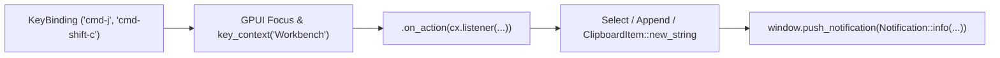

Power users in developer workbenches rarely reach for the mouse to jump between turns, insert a follow-up prompt, or copy an entire conversation session into another tool. In this lesson you wire GPUI's typed **action dispatch** pipeline (`gpui_kit::actions!`, `KeyBinding::new`, `FocusHandle`, `.key_context("Workbench")`, `.on_action(...)`) together with clipboard export and non-blocking **toast notifications** via `WindowExt::push_notification`.

:::callout title="Recommended Primary Sources"
- **Interactive app**: `apps/0009-keyboard-actions-and-notifications/` (`cargo run`, click anywhere in the workbench, then test `Cmd+J`, `Cmd+K`, `Cmd+N`, `Cmd+Shift+N`, and `Cmd+Shift+C`)
- **Framework source**: `gpui-kit` `lib.rs` (`actions!` macro, `open_window` wrapping `Root`) and `gpui-component` `notification.rs` (`Notification::info`, `WindowExt::push_notification`)
- Course References: [Glossary](../reference/GLOSSARY.md) and [GPUI Kit & Rust Quick Reference](../reference/gpui-kit-cheatsheet.md)
:::

## Architecture: Action Dispatch & Toast Overlays

In GPUI, keyboard shortcuts are split into two decoupled layers:
1. **Keymap bindings** (`cx.bind_keys`) map key combinations such as `"cmd-j"` or `"cmd-shift-c"` under a named context (`Some("Workbench")`) to strongly typed unit structs (`SelectNextTurn`, `CopySessionMarkdown`).
2. **Element action handlers** (`.on_action(...)`) listen for those typed structs on the element tree and execute state mutations + `window.push_notification(...)`.



## Block-by-Block Source Walkthrough

### Block 1 — Declaring Typed Actions with `gpui_kit::actions!`

```rust caption="Declaring namespaced zero-sized Action structs and registering keybindings"
gpui_kit::actions!(
    workbench,
    [
        SelectNextTurn,
        SelectPrevTurn,
        NewUserTurn,
        NewAgentTurn,
        CopySessionMarkdown
    ]
);

pub fn register_workbench_keys(cx: &mut App) {
    cx.bind_keys([
        KeyBinding::new("cmd-j", SelectNextTurn, Some("Workbench")),
        KeyBinding::new("cmd-k", SelectPrevTurn, Some("Workbench")),
        KeyBinding::new("cmd-n", NewUserTurn, Some("Workbench")),
        KeyBinding::new("cmd-shift-n", NewAgentTurn, Some("Workbench")),
        KeyBinding::new("cmd-shift-c", CopySessionMarkdown, Some("Workbench")),
    ]);
}
```

#### Rust Concept: Declarative Macros (`macro_rules!`) & Unit Structs

`gpui_kit::actions!(workbench, [...])` expands at compile time into five zero-sized unit structs (`pub struct SelectNextTurn;`, etc.) implementing `Clone`, `PartialEq`, `Default`, `Debug`, and GPUI's `Action` trait inside the `workbench` namespace. Because actions are real Rust types rather than string event names, typoed handler signatures fail immediately at compile time.

---

### Block 2 — Clipboard Export and `WindowExt::push_notification`

```rust caption="Updating last_status, writing to the system clipboard, and pushing toast alerts"
    pub fn notify_status(
        &mut self,
        message: impl Into<String>,
        window: &mut Window,
        cx: &mut Context<Self>,
    ) {
        let msg = message.into();
        self.last_status = msg.clone();
        window.push_notification(Notification::info(msg), cx);
    }

    pub fn copy_markdown_to_clipboard(&mut self, window: &mut Window, cx: &mut Context<Self>) {
        let md = self.doc.to_markdown();
        let word_count = self.doc.total_words();
        cx.write_to_clipboard(ClipboardItem::new_string(md));
        self.notify_status(
            format!("Copied Markdown session ({word_count} words) to clipboard"),
            window,
            cx,
        );
    }
```

#### Why `push_notification` Works Out of the Box

Notice the trait import `use gpui_kit::component::WindowExt as _;`. That activates `window.push_notification(...)`, which locates the top-level `Root` view in the current window (`gpui_kit::open_window` automatically wraps your view in `Root`!) and queues the toast notification overlay.

---

### Block 3 — Focus Tracking, `key_context`, and `.on_action` Wiring

```rust caption="Binding FocusHandle, key_context, and typed action handlers on the outer root div"
        let mut root = div()
            .id("workbench-root")
            .key_context("Workbench")
            .size_full();
        if let Some(handle) = &self.focus_handle {
            root = root.track_focus(handle);
        }

        root.on_action(cx.listener(|this, _: &SelectNextTurn, window, cx| {
            this.select_next_turn();
            this.sync_editor_to_active_turn(window, cx);
            cx.notify();
        }))
        .on_action(cx.listener(|this, _: &SelectPrevTurn, window, cx| {
            this.select_prev_turn();
            this.sync_editor_to_active_turn(window, cx);
            cx.notify();
        }))
        .on_action(cx.listener(|this, _: &NewUserTurn, window, cx| {
            let ix = this.append_turn(TurnRole::User, "Follow-up prompt added via Cmd+N.");
            this.sync_editor_to_active_turn(window, cx);
            this.notify_status(format!("Added User Turn #{}", ix + 1), window, cx);
            cx.notify();
        }))
        .on_action(cx.listener(|this, _: &NewAgentTurn, window, cx| {
            let ix = this.append_turn(
                TurnRole::Assistant,
                "Draft response:\n- [ ] Verify shortcut dispatch",
            );
            this.sync_editor_to_active_turn(window, cx);
            this.notify_status(format!("Added Agent Turn #{}", ix + 1), window, cx);
            cx.notify();
        }))
        .on_action(
            cx.listener(|this, _: &CopySessionMarkdown, window, cx| {
                this.copy_markdown_to_clipboard(window, cx);
                cx.notify();
            }),
        )
```

Notice that both `NewUserTurn` (`Cmd+N`) and the `+ User Turn` button invoke `append_turn` + `sync_editor_to_active_turn` + `notify_status`, keeping mouse and keyboard flows identical. Remember to call `register_workbench_keys(cx)` in `main()` right after `gpui_kit::init(cx)`!

---

### Complete `src/main.rs` Listing

```rust caption="apps/0009-keyboard-actions-and-notifications/src/main.rs"
use std::ops::Range;

use gpui_kit::component::ActiveTheme as _;
use gpui_kit::component::Disableable as _;
use gpui_kit::component::Selectable as _;
use gpui_kit::component::WindowExt as _;
use gpui_kit::component::badge::Badge;
use gpui_kit::component::button::{Button, ButtonVariants as _};
use gpui_kit::component::input::{Editor, EditorState, Input, InputEvent, InputState};
use gpui_kit::component::notification::Notification;
use gpui_kit::component::resizable::{h_resizable, resizable_panel};
use gpui_kit::component::tab::{Tab, TabBar};
use gpui_kit::component::tag::Tag;
use gpui_kit::component::text::{TaskToggleEvent, TextView};
use gpui_kit::component::theme::{Theme, ThemeMode};
use gpui_kit::component::{h_flex, v_flex};
use gpui_kit::*;

gpui_kit::actions!(
    workbench,
    [
        SelectNextTurn,
        SelectPrevTurn,
        NewUserTurn,
        NewAgentTurn,
        CopySessionMarkdown
    ]
);

pub fn register_workbench_keys(cx: &mut App) {
    cx.bind_keys([
        KeyBinding::new("cmd-j", SelectNextTurn, Some("Workbench")),
        KeyBinding::new("cmd-k", SelectPrevTurn, Some("Workbench")),
        KeyBinding::new("cmd-n", NewUserTurn, Some("Workbench")),
        KeyBinding::new("cmd-shift-n", NewAgentTurn, Some("Workbench")),
        KeyBinding::new("cmd-shift-c", CopySessionMarkdown, Some("Workbench")),
    ]);
}

#[derive(Debug, Clone, Copy, PartialEq, Eq)]
pub enum TurnRole {
    User,
    Assistant,
}

impl TurnRole {
    pub fn badge_label(&self) -> &'static str {
        match self {
            TurnRole::User => "USER",
            TurnRole::Assistant => "AGENT",
        }
    }
}

#[derive(Debug, Clone, Copy, PartialEq, Eq)]
pub enum WorkspaceLayoutMode {
    EditOnly,
    Split,
    PreviewOnly,
}

impl WorkspaceLayoutMode {
    pub fn index(&self) -> usize {
        match self {
            WorkspaceLayoutMode::EditOnly => 0,
            WorkspaceLayoutMode::Split => 1,
            WorkspaceLayoutMode::PreviewOnly => 2,
        }
    }

    pub fn from_index(index: usize) -> Self {
        match index {
            0 => WorkspaceLayoutMode::EditOnly,
            2 => WorkspaceLayoutMode::PreviewOnly,
            _ => WorkspaceLayoutMode::Split,
        }
    }

    pub fn label(&self) -> &'static str {
        match self {
            WorkspaceLayoutMode::EditOnly => "Edit",
            WorkspaceLayoutMode::Split => "Split",
            WorkspaceLayoutMode::PreviewOnly => "Preview",
        }
    }
}

pub fn apply_task_marker_toggle(
    markdown: &str,
    marker_range: Range<usize>,
    checked: bool,
) -> Option<String> {
    let slice = markdown.get(marker_range.clone())?;
    if !matches!(slice, "[ ]" | "[x]" | "[X]") {
        return None;
    }

    let replacement = if checked { "[x]" } else { "[ ]" };
    Some(format!(
        "{}{}{}",
        &markdown[..marker_range.start],
        replacement,
        &markdown[marker_range.end..]
    ))
}

#[derive(Debug, Clone, PartialEq, Eq)]
pub struct ConversationTurn {
    pub role: TurnRole,
    pub markdown: String,
}

impl ConversationTurn {
    pub fn new(role: TurnRole, markdown: impl Into<String>) -> Self {
        Self {
            role,
            markdown: markdown.into(),
        }
    }

    pub fn word_count(&self) -> usize {
        self.markdown.split_whitespace().count()
    }

    pub fn line_count(&self) -> usize {
        self.markdown.lines().count().max(1)
    }

    pub fn task_counts(&self) -> (usize, usize) {
        let mut completed = 0usize;
        let mut total = 0usize;
        for line in self.markdown.lines() {
            let trimmed = line.trim_start();
            if trimmed.starts_with("- [x]") || trimmed.starts_with("- [X]") {
                completed += 1;
                total += 1;
            } else if trimmed.starts_with("- [ ]") {
                total += 1;
            }
        }
        (completed, total)
    }

    pub fn fenced_code_languages(&self) -> Vec<String> {
        let mut langs = Vec::new();
        let mut in_fence = false;
        for line in self.markdown.lines() {
            let trimmed = line.trim();
            if let Some(rest) = trimmed.strip_prefix("```") {
                if !in_fence {
                    let lang = rest.split_whitespace().next().unwrap_or("");
                    if !lang.is_empty() && !langs.iter().any(|existing| existing == lang) {
                        langs.push(lang.to_string());
                    }
                }
                in_fence = !in_fence;
            }
        }
        langs
    }

    pub fn preview_line(&self) -> &str {
        self.markdown.lines().next().unwrap_or("")
    }
}

#[derive(Debug, Clone, PartialEq, Eq)]
pub struct WorkbenchDoc {
    pub title: String,
    pub turns: Vec<ConversationTurn>,
}

impl WorkbenchDoc {
    pub fn sample_session() -> Self {
        Self {
            title: String::from("Antigravity Session: Refactor CLI Parser"),
            turns: vec![
                ConversationTurn::new(
                    TurnRole::User,
                    "Inspect `src/args.rs` and summarize why `--quiet` overrides `--verbose`.",
                ),
                ConversationTurn::new(
                    TurnRole::Assistant,
                    "In `parse_flags`, `--quiet` runs second and mutates `verbosity` to `0`.\n\n```rust\nfn parse_flags(args: &[&str]) -> u8 {\n    let quiet = args.contains(&\"--quiet\");\n    if quiet { 0 } else { 1 }\n}\n```\n\nChecklist:\n- [x] Track explicit CLI precedence\n- [ ] Keep flag parsing pure",
                ),
                ConversationTurn::new(
                    TurnRole::User,
                    "Draft a regression test checking flag order independence.",
                ),
            ],
        }
    }

    pub fn set_title(&mut self, title: impl Into<String>) {
        let trimmed = title.into();
        if !trimmed.trim().is_empty() {
            self.title = trimmed;
        }
    }

    pub fn update_turn_markdown(&mut self, index: usize, markdown: impl Into<String>) -> bool {
        if let Some(turn) = self.turns.get_mut(index) {
            turn.markdown = markdown.into();
            true
        } else {
            false
        }
    }

    pub fn filtered_turn_indices(&self, query: &str) -> Vec<usize> {
        let needle = query.trim().to_lowercase();
        self.turns
            .iter()
            .enumerate()
            .filter(|(_, turn)| {
                needle.is_empty()
                    || turn.markdown.to_lowercase().contains(&needle)
                    || turn.role.badge_label().to_lowercase().contains(&needle)
            })
            .map(|(ix, _)| ix)
            .collect()
    }

    pub fn turn_at(&self, index: usize) -> Option<&ConversationTurn> {
        self.turns.get(index)
    }

    pub fn total_words(&self) -> usize {
        self.turns.iter().map(ConversationTurn::word_count).sum()
    }

    pub fn to_markdown(&self) -> String {
        let mut out = format!("# {}\n\n", self.title);
        for turn in &self.turns {
            out.push_str(&format!(
                "## {}\n\n{}\n\n",
                turn.role.badge_label(),
                turn.markdown
            ));
        }
        out.trim_end().to_string()
    }
}

pub struct WorkbenchView {
    pub doc: WorkbenchDoc,
    pub active_turn: usize,
    pub filter_query: String,
    pub layout_mode: WorkspaceLayoutMode,
    pub line_numbers: bool,
    pub soft_wrap: bool,
    pub last_status: String,
    pub focus_handle: Option<FocusHandle>,
    pub title_input: Option<Entity<InputState>>,
    pub filter_input: Option<Entity<InputState>>,
    pub body_editor: Option<Entity<EditorState>>,
    _subscriptions: Vec<Subscription>,
}

impl WorkbenchView {
    pub fn new() -> Self {
        Self {
            doc: WorkbenchDoc::sample_session(),
            active_turn: 0,
            filter_query: String::new(),
            layout_mode: WorkspaceLayoutMode::Split,
            line_numbers: true,
            soft_wrap: true,
            last_status: String::from(
                "Ready — Shortcuts: Cmd+J/K navigate, Cmd+N new turn, Cmd+Shift+C copy",
            ),
            focus_handle: None,
            title_input: None,
            filter_input: None,
            body_editor: None,
            _subscriptions: Vec::new(),
        }
    }

    pub fn new_with_window(window: &mut Window, cx: &mut Context<Self>) -> Self {
        let mut view = Self::new();
        let focus_handle = cx.focus_handle();
        let initial_title = view.doc.title.clone();
        let initial_markdown = view
            .active_turn_ref()
            .map(|turn| turn.markdown.clone())
            .unwrap_or_default();

        let title_input = cx.new(|cx| {
            InputState::new(window, cx)
                .placeholder("Session title...")
                .default_value(initial_title)
        });
        let filter_input = cx.new(|cx| {
            InputState::new(window, cx)
                .clean_on_escape()
                .placeholder("Filter turns by text or role (USER / AGENT)...")
        });
        let body_editor = cx.new(|cx| {
            EditorState::new(window, cx)
                .language("markdown")
                .line_number(view.line_numbers)
                .soft_wrap(view.soft_wrap)
                .default_value(initial_markdown)
        });

        let title_sub = cx.subscribe_in(
            &title_input,
            window,
            |this, state, event: &InputEvent, _window, cx| {
                if matches!(event, InputEvent::Change) {
                    let next_title = state.read(cx).value().to_string();
                    this.doc.set_title(next_title);
                    cx.notify();
                }
            },
        );

        let filter_sub = cx.subscribe_in(
            &filter_input,
            window,
            |this, state, event: &InputEvent, _window, cx| {
                if matches!(event, InputEvent::Change) {
                    this.filter_query = state.read(cx).value().to_string();
                    cx.notify();
                }
            },
        );

        let body_sub = cx.subscribe_in(
            &body_editor,
            window,
            |this, state, event: &InputEvent, _window, cx| {
                if matches!(event, InputEvent::Change) {
                    let next_body = state.read(cx).value().to_string();
                    this.update_active_markdown(next_body);
                    cx.notify();
                }
            },
        );

        view.focus_handle = Some(focus_handle);
        view.title_input = Some(title_input);
        view.filter_input = Some(filter_input);
        view.body_editor = Some(body_editor);
        view._subscriptions.push(title_sub);
        view._subscriptions.push(filter_sub);
        view._subscriptions.push(body_sub);
        view
    }

    pub fn set_layout_mode(&mut self, mode: WorkspaceLayoutMode) {
        self.layout_mode = mode;
        self.last_status = format!("Switched layout to {} mode", mode.label());
    }

    pub fn toggle_line_numbers(&mut self) -> bool {
        self.line_numbers = !self.line_numbers;
        self.line_numbers
    }

    pub fn toggle_soft_wrap(&mut self) -> bool {
        self.soft_wrap = !self.soft_wrap;
        self.soft_wrap
    }

    pub fn apply_editor_options(&mut self, window: &mut Window, cx: &mut Context<Self>) {
        let line_numbers = self.line_numbers;
        let soft_wrap = self.soft_wrap;
        if let Some(editor) = &self.body_editor {
            editor.update(cx, |state, cx| {
                state.set_line_number(line_numbers, window, cx);
                state.set_soft_wrap(soft_wrap, window, cx);
            });
        }
    }

    pub fn sync_editor_to_active_turn(&mut self, window: &mut Window, cx: &mut Context<Self>) {
        let active_md = self
            .active_turn_ref()
            .map(|turn| turn.markdown.clone())
            .unwrap_or_default();
        if let Some(editor) = &self.body_editor {
            editor.update(cx, |state, cx| {
                state.set_value(active_md, window, cx);
            });
        }
    }

    pub fn update_active_markdown(&mut self, markdown: impl Into<String>) -> bool {
        self.doc.update_turn_markdown(self.active_turn, markdown)
    }

    pub fn toggle_active_task_marker(
        &mut self,
        marker_range: Range<usize>,
        checked: bool,
        window: &mut Window,
        cx: &mut Context<Self>,
    ) -> bool {
        let Some(updated) = self
            .active_turn_ref()
            .and_then(|turn| apply_task_marker_toggle(&turn.markdown, marker_range, checked))
        else {
            return false;
        };
        if !self.update_active_markdown(updated) {
            return false;
        }
        self.sync_editor_to_active_turn(window, cx);
        self.last_status = format!("Updated checklist item in Turn #{}", self.active_turn + 1);
        true
    }

    pub fn notify_status(
        &mut self,
        message: impl Into<String>,
        window: &mut Window,
        cx: &mut Context<Self>,
    ) {
        let msg = message.into();
        self.last_status = msg.clone();
        window.push_notification(Notification::info(msg), cx);
    }

    pub fn copy_markdown_to_clipboard(&mut self, window: &mut Window, cx: &mut Context<Self>) {
        let md = self.doc.to_markdown();
        let word_count = self.doc.total_words();
        cx.write_to_clipboard(ClipboardItem::new_string(md));
        self.notify_status(
            format!("Copied Markdown session ({word_count} words) to clipboard"),
            window,
            cx,
        );
    }

    pub fn select_turn(&mut self, index: usize) -> bool {
        if index < self.doc.turns.len() {
            self.active_turn = index;
            self.last_status = format!("Selected Turn #{}", index + 1);
            true
        } else {
            false
        }
    }

    pub fn select_next_turn(&mut self) {
        if self.active_turn + 1 < self.doc.turns.len() {
            self.active_turn += 1;
            self.last_status = format!("Selected Turn #{}", self.active_turn + 1);
        }
    }

    pub fn select_prev_turn(&mut self) {
        self.active_turn = self.active_turn.saturating_sub(1);
        self.last_status = format!("Selected Turn #{}", self.active_turn + 1);
    }

    pub fn append_turn(&mut self, role: TurnRole, markdown: impl Into<String>) -> usize {
        self.doc.turns.push(ConversationTurn::new(role, markdown));
        let new_index = self.doc.turns.len() - 1;
        self.active_turn = new_index;
        self.last_status = format!("Added {} Turn #{}", role.badge_label(), new_index + 1);
        new_index
    }

    pub fn remove_active_turn(&mut self) -> Option<ConversationTurn> {
        if self.doc.turns.len() <= 1 || self.active_turn >= self.doc.turns.len() {
            return None;
        }
        let removed = self.doc.turns.remove(self.active_turn);
        if self.active_turn >= self.doc.turns.len() {
            self.active_turn = self.doc.turns.len() - 1;
        }
        self.last_status = format!(
            "Deleted {} turn; {} remaining",
            removed.role.badge_label(),
            self.doc.turns.len()
        );
        Some(removed)
    }

    pub fn active_turn_ref(&self) -> Option<&ConversationTurn> {
        self.doc.turn_at(self.active_turn)
    }
}

impl Default for WorkbenchView {
    fn default() -> Self {
        Self::new()
    }
}

impl Render for WorkbenchView {
    fn render(&mut self, _window: &mut Window, cx: &mut Context<Self>) -> impl IntoElement {
        let theme = cx.theme();
        let visible_indices = self.doc.filtered_turn_indices(&self.filter_query);
        let visible_count = visible_indices.len();
        let summary = format!(
            "{} ({} / {} visible, {} words) — {} mode — {} ",
            self.doc.title,
            visible_count,
            self.doc.turns.len(),
            self.doc.total_words(),
            self.layout_mode.label(),
            self.last_status
        );
        let can_delete = self.doc.turns.len() > 1;
        let (active_markdown, active_words, active_lines, (tasks_done, tasks_total), fence_langs) =
            self.active_turn_ref()
                .map(|turn| {
                    (
                        turn.markdown.clone(),
                        turn.word_count(),
                        turn.line_count(),
                        turn.task_counts(),
                        turn.fenced_code_languages(),
                    )
                })
                .unwrap_or_default();
        let view = cx.entity().downgrade();

        let turn_list_pane =
            v_flex()
                .size_full()
                .pr_3()
                .gap_2()
                .children(visible_indices.into_iter().filter_map(|ix| {
                    let turn = self.doc.turn_at(ix)?;
                    let is_active = ix == self.active_turn;
                    let role_tag = match turn.role {
                        TurnRole::User => Tag::primary().child("USER"),
                        TurnRole::Assistant => Tag::secondary().child("AGENT"),
                    };
                    let border_color = if is_active {
                        theme.primary
                    } else {
                        theme.border
                    };

                    Some(
                        h_flex()
                            .p_3()
                            .gap_3()
                            .items_center()
                            .justify_between()
                            .rounded_md()
                            .border_1()
                            .border_color(border_color)
                            .bg(theme.secondary)
                            .child(
                                h_flex()
                                    .gap_2()
                                    .items_center()
                                    .child(role_tag)
                                    .child(format!("#{} — {}", ix + 1, turn.preview_line())),
                            )
                            .child(
                                Button::new(("select-turn", ix))
                                    .ghost()
                                    .selected(is_active)
                                    .label(if is_active { "Selected" } else { "Inspect" })
                                    .on_click(cx.listener(move |this, _, window, cx| {
                                        this.select_turn(ix);
                                        this.sync_editor_to_active_turn(window, cx);
                                        cx.notify();
                                    })),
                            ),
                    )
                }));

        let editor_pane = v_flex()
            .size_full()
            .p_4()
            .gap_2()
            .rounded_md()
            .border_1()
            .border_color(theme.border)
            .bg(theme.background)
            .child(
                h_flex()
                    .items_center()
                    .justify_between()
                    .child(
                        h_flex()
                            .items_center()
                            .gap_2()
                            .child(
                                div()
                                    .text_sm()
                                    .text_color(theme.muted_foreground)
                                    .child("Markdown Code Editor"),
                            )
                            .children(
                                fence_langs
                                    .into_iter()
                                    .map(|lang| Tag::secondary().child(lang)),
                            ),
                    )
                    .child(
                        h_flex()
                            .gap_2()
                            .child(
                                Button::new("toggle-line-numbers")
                                    .ghost()
                                    .selected(self.line_numbers)
                                    .label("Line #")
                                    .on_click(cx.listener(|this, _, window, cx| {
                                        this.toggle_line_numbers();
                                        this.apply_editor_options(window, cx);
                                        cx.notify();
                                    })),
                            )
                            .child(
                                Button::new("toggle-soft-wrap")
                                    .ghost()
                                    .selected(self.soft_wrap)
                                    .label("Wrap")
                                    .on_click(cx.listener(|this, _, window, cx| {
                                        this.toggle_soft_wrap();
                                        this.apply_editor_options(window, cx);
                                        cx.notify();
                                    })),
                            )
                            .child(Tag::secondary().child(format!("{active_words} words")))
                            .child(Tag::secondary().child(format!("{active_lines} lines"))),
                    ),
            )
            .children(
                self.body_editor
                    .as_ref()
                    .map(|editor| Editor::new(editor).h(px(280.))),
            );

        let preview_pane = v_flex()
            .size_full()
            .p_4()
            .gap_2()
            .rounded_md()
            .border_1()
            .border_color(theme.border)
            .bg(theme.background)
            .child(
                h_flex()
                    .items_center()
                    .justify_between()
                    .child(
                        div()
                            .text_sm()
                            .text_color(theme.muted_foreground)
                            .child("Live Rendered Markdown Preview"),
                    )
                    .child(Tag::secondary().child(format!("{tasks_done}/{tasks_total} tasks"))),
            )
            .child(
                TextView::markdown("turn-markdown-preview", active_markdown)
                    .selectable(true)
                    .on_task_toggle(move |event: &TaskToggleEvent, window, cx| {
                        let marker_range = event.marker_range();
                        let checked = event.checked();
                        let _ = view.update(cx, |this, cx| {
                            if this.toggle_active_task_marker(marker_range, checked, window, cx) {
                                cx.notify();
                            }
                        });
                    }),
            );

        let right_workspace = match self.layout_mode {
            WorkspaceLayoutMode::EditOnly => div()
                .size_full()
                .pl_3()
                .child(editor_pane)
                .into_any_element(),
            WorkspaceLayoutMode::Split => div()
                .size_full()
                .pl_3()
                .child(
                    h_resizable("editor-preview-split")
                        .child(resizable_panel().child(div().size_full().pr_2().child(editor_pane)))
                        .child(
                            resizable_panel().child(div().size_full().pl_2().child(preview_pane)),
                        ),
                )
                .into_any_element(),
            WorkspaceLayoutMode::PreviewOnly => div()
                .size_full()
                .pl_3()
                .child(preview_pane)
                .into_any_element(),
        };

        let mut root = div()
            .id("workbench-root")
            .key_context("Workbench")
            .size_full();
        if let Some(handle) = &self.focus_handle {
            root = root.track_focus(handle);
        }

        root.on_action(cx.listener(|this, _: &SelectNextTurn, window, cx| {
            this.select_next_turn();
            this.sync_editor_to_active_turn(window, cx);
            cx.notify();
        }))
        .on_action(cx.listener(|this, _: &SelectPrevTurn, window, cx| {
            this.select_prev_turn();
            this.sync_editor_to_active_turn(window, cx);
            cx.notify();
        }))
        .on_action(cx.listener(|this, _: &NewUserTurn, window, cx| {
            let ix = this.append_turn(TurnRole::User, "Follow-up prompt added via Cmd+N.");
            this.sync_editor_to_active_turn(window, cx);
            this.notify_status(format!("Added User Turn #{}", ix + 1), window, cx);
            cx.notify();
        }))
        .on_action(cx.listener(|this, _: &NewAgentTurn, window, cx| {
            let ix = this.append_turn(
                TurnRole::Assistant,
                "Draft response:\n- [ ] Verify shortcut dispatch",
            );
            this.sync_editor_to_active_turn(window, cx);
            this.notify_status(format!("Added Agent Turn #{}", ix + 1), window, cx);
            cx.notify();
        }))
        .on_action(cx.listener(|this, _: &CopySessionMarkdown, window, cx| {
            this.copy_markdown_to_clipboard(window, cx);
            cx.notify();
        }))
        .child(
            v_flex()
                .size_full()
                .p_6()
                .gap_4()
                .bg(theme.background)
                .text_color(theme.foreground)
                .child(
                    h_flex()
                        .items_center()
                        .justify_between()
                        .child(
                            h_flex()
                                .items_center()
                                .gap_3()
                                .child("Antigravity Markdown & Conversation Workbench")
                                .child(
                                    Badge::new()
                                        .count(visible_count)
                                        .child(div().px_2().py_1().child("Visible")),
                                ),
                        )
                        .child(
                            h_flex()
                                .items_center()
                                .gap_2()
                                .child(
                                    TabBar::new("layout-mode-tabs")
                                        .segmented()
                                        .selected_index(self.layout_mode.index())
                                        .on_click(cx.listener(|this, ix: &usize, _window, cx| {
                                            this.set_layout_mode(WorkspaceLayoutMode::from_index(
                                                *ix,
                                            ));
                                            cx.notify();
                                        }))
                                        .child(
                                            Tab::new().label(WorkspaceLayoutMode::EditOnly.label()),
                                        )
                                        .child(Tab::new().label(WorkspaceLayoutMode::Split.label()))
                                        .child(
                                            Tab::new()
                                                .label(WorkspaceLayoutMode::PreviewOnly.label()),
                                        ),
                                )
                                .child(Button::new("prev-turn").secondary().label("Prev").on_click(
                                    cx.listener(|this, _, window, cx| {
                                        this.select_prev_turn();
                                        this.sync_editor_to_active_turn(window, cx);
                                        cx.notify();
                                    }),
                                ))
                                .child(Button::new("next-turn").secondary().label("Next").on_click(
                                    cx.listener(|this, _, window, cx| {
                                        this.select_next_turn();
                                        this.sync_editor_to_active_turn(window, cx);
                                        cx.notify();
                                    }),
                                ))
                                .child(
                                    Button::new("add-user-turn")
                                        .secondary()
                                        .label("+ User Turn")
                                        .on_click(cx.listener(|this, _, window, cx| {
                                            let ix = this.append_turn(
                                                TurnRole::User,
                                                "Follow-up question about CLI flag precedence.",
                                            );
                                            this.sync_editor_to_active_turn(window, cx);
                                            this.notify_status(
                                                format!("Added User Turn #{}", ix + 1),
                                                window,
                                                cx,
                                            );
                                            cx.notify();
                                        })),
                                )
                                .child(
                                    Button::new("add-agent-turn")
                                        .secondary()
                                        .label("+ Agent Turn")
                                        .on_click(cx.listener(|this, _, window, cx| {
                                            let ix = this.append_turn(
                                                TurnRole::Assistant,
                                                "Proposed checklist:\n- [ ] Keep flag parsing pure",
                                            );
                                            this.sync_editor_to_active_turn(window, cx);
                                            this.notify_status(
                                                format!("Added Agent Turn #{}", ix + 1),
                                                window,
                                                cx,
                                            );
                                            cx.notify();
                                        })),
                                )
                                .child(
                                    Button::new("delete-turn")
                                        .danger()
                                        .label("Delete Turn")
                                        .disabled(!can_delete)
                                        .on_click(cx.listener(|this, _, window, cx| {
                                            if this.remove_active_turn().is_some() {
                                                this.sync_editor_to_active_turn(window, cx);
                                                this.notify_status(
                                                    "Deleted selected turn",
                                                    window,
                                                    cx,
                                                );
                                                cx.notify();
                                            }
                                        })),
                                )
                                .child(
                                    Button::new("copy-md")
                                        .primary()
                                        .label("Copy Markdown")
                                        .on_click(cx.listener(|this, _, window, cx| {
                                            this.copy_markdown_to_clipboard(window, cx);
                                            cx.notify();
                                        })),
                                ),
                        ),
                )
                .child(
                    h_flex()
                        .gap_3()
                        .children(
                            self.title_input
                                .as_ref()
                                .map(|input| div().flex_1().child(Input::new(input))),
                        )
                        .children(self.filter_input.as_ref().map(|input| {
                            div().w(px(320.)).child(Input::new(input).cleanable(true))
                        })),
                )
                .child(div().text_color(theme.muted_foreground).child(summary))
                .child(
                    div().flex_1().min_h_0().child(
                        h_resizable("workbench-main-split")
                            .child(
                                resizable_panel()
                                    .size(px(320.))
                                    .size_range(px(220.)..px(520.))
                                    .child(turn_list_pane),
                            )
                            .child(resizable_panel().child(right_workspace)),
                    ),
                ),
        )
    }
}

fn main() {
    gpui_kit::application()
        .with_assets(gpui_kit::assets::Assets)
        .run(|cx| {
            gpui_kit::init(cx);
            Theme::change(ThemeMode::Dark, None, cx);
            register_workbench_keys(cx);
            gpui_kit::open_window(WindowOptions::default(), cx, |window, cx| {
                cx.new(|cx| WorkbenchView::new_with_window(window, cx))
            })
            .expect("failed to open workbench window");
        });
}

#[cfg(test)]
mod tests {
    use super::{
        TurnRole, WorkbenchDoc, WorkbenchView, WorkspaceLayoutMode, apply_task_marker_toggle,
    };

    #[test]
    fn action_helpers_update_active_turn_and_last_status() {
        let mut view = WorkbenchView::new();
        assert_eq!(view.active_turn, 0);

        view.select_next_turn();
        assert_eq!(view.active_turn, 1);
        assert_eq!(view.last_status, "Selected Turn #2");

        view.select_prev_turn();
        assert_eq!(view.active_turn, 0);
        assert_eq!(view.last_status, "Selected Turn #1");

        let idx = view.append_turn(TurnRole::User, "Keyboard shortcut check");
        assert_eq!(idx, 3);
        assert_eq!(view.last_status, "Added USER Turn #4");
    }

    #[test]
    fn remove_active_turn_updates_last_status() {
        let mut view = WorkbenchView::new();
        view.select_turn(1);
        let removed = view.remove_active_turn().expect("can remove turn #2");
        assert_eq!(removed.role, TurnRole::Assistant);
        assert!(view.last_status.starts_with("Deleted AGENT turn"));
    }

    #[test]
    fn fenced_code_languages_extracts_unique_opening_fences() {
        let turn = &WorkbenchDoc::sample_session().turns[1];
        assert_eq!(turn.fenced_code_languages(), vec!["rust"]);
    }

    #[test]
    fn editor_toggles_flip_line_numbers_and_soft_wrap() {
        let mut view = WorkbenchView::new();
        assert!(!view.toggle_line_numbers());
        assert!(!view.toggle_soft_wrap());
        assert!(view.focus_handle.is_none());
    }

    #[test]
    fn layout_mode_round_trips_tab_indices() {
        for (ix, expected) in [
            (0, WorkspaceLayoutMode::EditOnly),
            (1, WorkspaceLayoutMode::Split),
            (2, WorkspaceLayoutMode::PreviewOnly),
        ] {
            assert_eq!(WorkspaceLayoutMode::from_index(ix), expected);
            assert_eq!(expected.index(), ix);
        }
    }

    #[test]
    fn apply_task_marker_toggle_flips_valid_checkbox_ranges() {
        let source = "- [x] Done item\n- [ ] Pending item";
        let unchecked = apply_task_marker_toggle(source, 2..5, false).expect("valid marker range");
        assert_eq!(unchecked, "- [ ] Done item\n- [ ] Pending item");
    }

    #[test]
    fn turn_task_counts_totals_completed_and_open_items() {
        let turn = &WorkbenchDoc::sample_session().turns[1];
        assert_eq!(turn.task_counts(), (1, 2));
    }

    #[test]
    fn filtered_turn_indices_finds_code_and_task_items() {
        let doc = WorkbenchDoc::sample_session();
        assert_eq!(doc.filtered_turn_indices("parse_flags"), vec![1]);
        assert_eq!(
            doc.filtered_turn_indices("nonexistent phrase"),
            Vec::<usize>::new()
        );
    }
}
```

## Hands-On Exercise: Typed Keybindings & Toasts

:::exercise id="ex-0009" title="Interactive Lab: Typed Keybindings & Toasts" badge="Skill Practice"
Fill in the blanks to bind `"cmd-shift-c"` to `CopySessionMarkdown` and display an info toast via `WindowExt`:

```rust
pub fn register_workbench_keys(cx: &mut App) {
    cx.bind_keys([
        KeyBinding::new("cmd-shift-c", {{blank:CopySessionMarkdown|Unit Action struct generated by gpui_kit::actions!|???|19}}, Some("Workbench")),
    ]);
}

pub fn notify_status(
    &mut self,
    message: impl Into<String>,
    window: &mut Window,
    cx: &mut Context<Self>,
) {
    let msg = message.into();
    self.last_status = msg.clone();
    window.{{blank:push_notification|WindowExt method displaying Notification toast alerts|???|17}}(Notification::info(msg), cx);
}
```

:::prompts
hint: "Pass the CopySessionMarkdown unit struct to KeyBinding::new and call window.push_notification(...)."
success: "Awesome! Typed shortcuts and toast feedback now integrate seamlessly."
:::
:::

## Check Your Understanding

:::quiz id="quiz-0009" title="Retrieval Practice: Actions, Focus & Notifications" badge="3 Questions • Equal-Length Options"
- question: "Why does WorkbenchView attach .key_context(\"Workbench\") and .track_focus(handle) to its outer wrapper div?"
  wrong_hint: "Consider how GPUI bubbles unhandled keystrokes up from child inputs."
  options:
    - letter: "A"
      text: "GPUI immediately deletes any Entity<EditorState> on screen unless its parent div tracks raw keystrokes"
      correct: false
      explain: "Child entities live inside GPUI's entity store regardless of key tracking."
    - letter: "B"
      text: "Focus and context form a dispatch ancestor so shortcuts bubble up from child inputs"
      correct: true
      explain: "Correct! Child inputs propagate unhandled shortcuts up the focus + context hierarchy to .on_action handlers."
    - letter: "C"
      text: "Notification toast overlays cannot ever paint anywhere in the window without a focused FocusHandle"
      correct: false
      explain: "Notification overlays use Root layer positioning rather than FocusHandle."
    - letter: "D"
      text: "KeyBinding::new rejects macOS command modifiers unless that outer root element also registers clipboard handlers"
      correct: false
      explain: "KeyBinding::new binds key chords globally; clipboard handlers are independent."
- question: "Why does window.push_notification(Notification::info(msg), cx) work directly inside WorkbenchView without constructing Root manually?"
  wrong_hint: "Remember what gpui_kit::open_window injects around your root view automatically."
  options:
    - letter: "A"
      text: "Notification::info bypasses GPUI windows by printing an ANSI banner straight to standard error"
      correct: false
      explain: "Notification::info builds a GPUI toast alert rendered inside the window overlay."
    - letter: "B"
      text: "WindowExt allocates a standalone borderless macOS OS process for every popup toast card"
      correct: false
      explain: "Toasts render cleanly in-process inside the existing GPUI window."
    - letter: "C"
      text: "gpui_kit::open_window already wraps your root view inside GPUI Kit's Root notification host automatically"
      correct: true
      explain: "Correct! gpui_kit::open_window wraps your root view inside Root, which hosts notification layers."
    - letter: "D"
      text: "actions! automatically attaches an invisible NotificationLayer entity onto every button element during compilation"
      correct: false
      explain: "actions! only declares Action structs; Root supplies the notification host."
- question: "What does importing gpui_kit::component::WindowExt as _ enable in Rust?"
  wrong_hint: "Recall Rust's anonymous underscore trait import pattern."
  options:
    - letter: "A"
      text: "It activates WindowExt trait methods like push_notification without naming WindowExt itself later"
      correct: true
      explain: "Correct! use SomeTrait as _; brings trait methods into scope without polluting the namespace."
    - letter: "B"
      text: "It suppresses compiler errors whenever two crates export duplicate Notification structs everywhere"
      correct: false
      explain: "Duplicate struct names require module qualification or aliases; as _ imports trait methods."
    - letter: "C"
      text: "It converts Window references into thread-safe WeakEntity handles inside async background closures"
      correct: false
      explain: "Window references never convert to WeakEntity via WindowExt."
    - letter: "D"
      text: "It rewrites KeyBinding shortcuts so Cmd+N maps directly onto Ctrl+N across Linux"
      correct: false
      explain: "WindowExt provides window-level extension helpers, not keystroke translation."
:::

## Verify & Run

Run formatting, unit tests, strict Clippy lints, and test the keyboard shortcuts inside the desktop workbench:

:::verify id="verify-0009" title="Verification Lab: Keyboard Actions & Toast Notifications" badge="Terminal Gate"
```bash
cargo fmt --manifest-path apps/0009-keyboard-actions-and-notifications/Cargo.toml --check
cargo test --manifest-path apps/0009-keyboard-actions-and-notifications/Cargo.toml
cargo clippy --manifest-path apps/0009-keyboard-actions-and-notifications/Cargo.toml --all-targets -- -D warnings
cargo run --manifest-path apps/0009-keyboard-actions-and-notifications/Cargo.toml
```

Expected verification output:

```text
running 8 tests
test tests::layout_mode_round_trips_tab_indices ... ok
test tests::apply_task_marker_toggle_flips_valid_checkbox_ranges ... ok
test tests::remove_active_turn_updates_last_status ... ok
test tests::action_helpers_update_active_turn_and_last_status ... ok
test tests::filtered_turn_indices_finds_code_and_task_items ... ok
test tests::fenced_code_languages_extracts_unique_opening_fences ... ok
test tests::editor_toggles_flip_line_numbers_and_soft_wrap ... ok
test tests::turn_task_counts_totals_completed_and_open_items ... ok

test result: ok. 8 passed; 0 failed; 0 ignored; 0 measured; 0 filtered out; finished in 0.00s
```
:::

:::teacher-prompt title="Extend This Lesson with Your Agent"
Ask your AI teacher: *"In Lesson 0009, add a `DeleteActiveTurn` action bound to `cmd-backspace` that displays `Notification::warning(...)` if only one turn remains."*
:::
