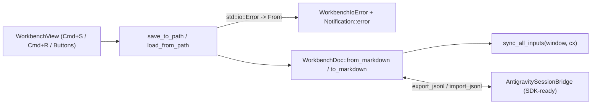

Across Lessons 0001–0009 you built a full desktop workbench: turn cards, reactive state, title and filter inputs, multiline editing, live task-toggleable Markdown rendering, resizable split panes, syntax-highlighted editing, and typed keyboard shortcuts. In this capstone lesson you close the loop between the desktop UI, the filesystem, and **`antigravity-sdk-rust`** by adding lossless `.md` parsing/saving, a structured `WorkbenchIoError` enum, an `AntigravitySessionBridge` JSONL trait, and `Cmd+S` / `Cmd+R` persistence workflows.

:::callout title="Recommended Primary Sources"
- **Interactive app**: `apps/0010-markdown-persistence-and-sdk-bridge/` (`cargo run`, edit turns, press `Cmd+S` to save to `/tmp/antigravity-workbench-session.md` or `$TMPDIR`, inspect or edit the file externally, and press `Cmd+R` to reload)
- **Rust standard library docs**: [`std::error::Error`](https://doc.rust-lang.org/std/error/trait.Error.html), [`std::convert::From`](https://doc.rust-lang.org/std/convert/trait.From.html), and [`std::path::Path`](https://doc.rust-lang.org/std/path/struct.Path.html)
- Course References: [Glossary](../reference/GLOSSARY.md) and [GPUI Kit & Rust Quick Reference](../reference/gpui-kit-cheatsheet.md)
:::

## Architecture: Persistence & SDK Boundary

Separating disk I/O (`save_to_path`, `load_from_path`), pure parsers (`from_markdown`, `import_jsonl`), and UI synchronization (`sync_all_inputs`, `notify_status`, `notify_error`) lets you unit-test round-trips deterministically without booting a GPU window—and lets future adapters swap file storage for live `antigravity-sdk-rust` transport calls behind `AntigravitySessionBridge`.



## Block-by-Block Source Walkthrough

### Block 1 — Custom Error Types, `Display`, `Error`, and `From<std::io::Error>`

```rust caption="Defining WorkbenchIoError with automatic conversion from std::io::Error via From"
#[derive(Debug, Clone, PartialEq, Eq)]
pub enum WorkbenchIoError {
    EmptyDocument,
    InvalidFormat(String),
    Io(String),
}

impl fmt::Display for WorkbenchIoError {
    fn fmt(&self, f: &mut fmt::Formatter<'_>) -> fmt::Result {
        match self {
            WorkbenchIoError::EmptyDocument => write!(f, "session document is empty"),
            WorkbenchIoError::InvalidFormat(msg) => write!(f, "invalid session format: {msg}"),
            WorkbenchIoError::Io(msg) => write!(f, "file I/O error: {msg}"),
        }
    }
}

impl std::error::Error for WorkbenchIoError {}

impl From<std::io::Error> for WorkbenchIoError {
    fn from(err: std::io::Error) -> Self {
        WorkbenchIoError::Io(err.to_string())
    }
}
```

#### Rust Concept: `Result<T, E>`, `From`, and the `?` Operator

Every fallible file or parser function returns `Result<T, WorkbenchIoError>`. Because `WorkbenchIoError` implements `From<std::io::Error>`, any call to `std::fs::create_dir_all(...)`, `std::fs::write(...)`, or `std::fs::read_to_string(...)` inside a function returning `Result<_, WorkbenchIoError>` can end with `?`. On failure, Rust automatically converts `std::io::Error` into `WorkbenchIoError::Io(...)` and returns early. Implementing `fmt::Display` lets us format user-facing toasts directly via `format!("Reload failed: {err}")`.

---

### Block 2 — Parsing Markdown Back Into `WorkbenchDoc` & Disk Helpers

```rust caption="Parsing `# Title` and `## USER` / `## AGENT` headings back into structured turns"
    pub fn from_markdown(raw: &str) -> Result<Self, WorkbenchIoError> {
        if raw.trim().is_empty() {
            return Err(WorkbenchIoError::EmptyDocument);
        }

        let mut lines = raw.lines().peekable();
        while let Some(line) = lines.peek() {
            if line.trim().is_empty() {
                lines.next();
            } else {
                break;
            }
        }

        let title = match lines.next() {
            Some(heading) => match heading.trim().strip_prefix("# ") {
                Some(rest) if !rest.trim().is_empty() => rest.trim().to_string(),
                _ => {
                    return Err(WorkbenchIoError::InvalidFormat(String::from(
                        "expected `# <title>` on first non-empty line",
                    )));
                }
            },
            None => return Err(WorkbenchIoError::EmptyDocument),
        };

        let mut turns = Vec::new();
        let mut active_role: Option<TurnRole> = None;
        let mut body_lines: Vec<&str> = Vec::new();

        for line in lines {
            if let Some(heading) = line.trim().strip_prefix("## ")
                && let Some(role) = TurnRole::from_badge_label(heading)
            {
                if let Some(prev_role) = active_role.take() {
                    let body = body_lines.join("\n").trim().to_string();
                    turns.push(ConversationTurn::new(prev_role, body));
                    body_lines.clear();
                }
                active_role = Some(role);
                continue;
            }

            if active_role.is_some() {
                body_lines.push(line);
            }
        }

        if let Some(last_role) = active_role {
            let body = body_lines.join("\n").trim().to_string();
            turns.push(ConversationTurn::new(last_role, body));
        }

        if turns.is_empty() {
            return Err(WorkbenchIoError::InvalidFormat(String::from(
                "expected at least one `## USER` or `## AGENT` section",
            )));
        }

        Ok(Self { title, turns })
    }

    pub fn save_to_path(&self, path: &Path) -> Result<(), WorkbenchIoError> {
        if let Some(parent) = path.parent().filter(|p| !p.as_os_str().is_empty()) {
            std::fs::create_dir_all(parent)?;
        }
        std::fs::write(path, self.to_markdown())?;
        Ok(())
    }

    pub fn load_from_path(path: &Path) -> Result<Self, WorkbenchIoError> {
        let raw = std::fs::read_to_string(path)?;
        Self::from_markdown(&raw)
    }
```

#### Rust Concept: `Path` vs `PathBuf` (`&str` vs `String` Parallel)

Just as `&str` borrows a string slice while `String` owns heap text, `&Path` borrows an OS file path while `PathBuf` owns it (like `session_path: PathBuf` stored inside `WorkbenchView`). Also note `path.parent().filter(|p| !p.as_os_str().is_empty())`: calling `.filter(...)` on an `Option` keeps Clippy happy by avoiding nested `if` checks when someone passes a relative filename like `"session.md"` whose parent is empty.

---

### Block 3 — The `AntigravitySessionBridge` Trait for SDK Interop

```rust caption="Trait abstraction bridging WorkbenchDoc with Antigravity JSONL streams"
pub trait AntigravitySessionBridge {
    fn export_jsonl(&self) -> String;
    fn import_jsonl(title: impl Into<String>, raw: &str) -> Result<WorkbenchDoc, WorkbenchIoError>;
}
```

#### Rust Concept: Trait Contracts Across Crates

Defining `AntigravitySessionBridge` as a `trait` decouples **what** operations a session stream must support (`export_jsonl` and `import_jsonl`) from the internal UI representation (`WorkbenchView`). When you plug in `antigravity-sdk-rust` in your own project, `TurnRole::sdk_role()` already translates `"USER"`/`"AGENT"` into `"user"`/`"model"` so stream messages align directly with SDK roles.

---

### Block 4 — Reload Syncing & `Notification::error` Toasts

```rust caption="Saving, reloading, syncing both InputState and EditorState, and surfacing Result errors"
    pub fn sync_all_inputs(&mut self, window: &mut Window, cx: &mut Context<Self>) {
        let title = self.doc.title.clone();
        if let Some(title_input) = &self.title_input {
            title_input.update(cx, |state, cx| {
                state.set_value(title, window, cx);
            });
        }
        self.sync_editor_to_active_turn(window, cx);
    }

    pub fn notify_error(
        &mut self,
        message: impl Into<String>,
        window: &mut Window,
        cx: &mut Context<Self>,
    ) {
        let msg = message.into();
        self.last_status = msg.clone();
        window.push_notification(Notification::error(msg), cx);
    }

    pub fn save_session_to_disk(&mut self, window: &mut Window, cx: &mut Context<Self>) {
        match self.doc.save_to_path(&self.session_path) {
            Ok(()) => {
                let turns = self.doc.turns.len();
                let path_display = self.session_path.display().to_string();
                self.notify_status(format!("Saved {turns} turns to {path_display}"), window, cx);
            }
            Err(err) => {
                self.notify_error(format!("Save failed: {err}"), window, cx);
            }
        }
    }

    pub fn reload_session_from_disk(&mut self, window: &mut Window, cx: &mut Context<Self>) {
        match WorkbenchDoc::load_from_path(&self.session_path) {
            Ok(doc) => {
                let turns = doc.turns.len();
                self.doc = doc;
                self.active_turn = 0;
                self.sync_all_inputs(window, cx);
                let path_display = self.session_path.display().to_string();
                self.notify_status(
                    format!("Reloaded {turns} turns from {path_display}"),
                    window,
                    cx,
                );
            }
            Err(err) => {
                self.notify_error(format!("Reload failed: {err}"), window, cx);
            }
        }
    }
```

Notice the two-way sync guarantee: when `reload_session_from_disk` succeeds, it replaces `self.doc`, resets `self.active_turn = 0`, and calls `self.sync_all_inputs(window, cx)` so both the title `InputState` and the multiline `EditorState` update immediately. When reloading before ever saving, `Err(err)` produces a non-blocking red `Notification::error(...)` toast instead of panicking!

---

### Complete `src/main.rs` Listing

```rust caption="apps/0010-markdown-persistence-and-sdk-bridge/src/main.rs"
use std::fmt;
use std::ops::Range;
use std::path::{Path, PathBuf};

use gpui_kit::component::ActiveTheme as _;
use gpui_kit::component::Disableable as _;
use gpui_kit::component::Selectable as _;
use gpui_kit::component::WindowExt as _;
use gpui_kit::component::badge::Badge;
use gpui_kit::component::button::{Button, ButtonVariants as _};
use gpui_kit::component::input::{Editor, EditorState, Input, InputEvent, InputState};
use gpui_kit::component::notification::Notification;
use gpui_kit::component::resizable::{h_resizable, resizable_panel};
use gpui_kit::component::tab::{Tab, TabBar};
use gpui_kit::component::tag::Tag;
use gpui_kit::component::text::{TaskToggleEvent, TextView};
use gpui_kit::component::{h_flex, v_flex};
use gpui_kit::*;

gpui_kit::actions!(
    workbench,
    [
        SelectNextTurn,
        SelectPrevTurn,
        NewUserTurn,
        NewAgentTurn,
        CopySessionMarkdown,
        SaveSession,
        ReloadSession
    ]
);

pub fn register_workbench_keys(cx: &mut App) {
    cx.bind_keys([
        KeyBinding::new("cmd-j", SelectNextTurn, Some("Workbench")),
        KeyBinding::new("cmd-k", SelectPrevTurn, Some("Workbench")),
        KeyBinding::new("cmd-n", NewUserTurn, Some("Workbench")),
        KeyBinding::new("cmd-shift-n", NewAgentTurn, Some("Workbench")),
        KeyBinding::new("cmd-shift-c", CopySessionMarkdown, Some("Workbench")),
        KeyBinding::new("cmd-s", SaveSession, Some("Workbench")),
        KeyBinding::new("cmd-r", ReloadSession, Some("Workbench")),
    ]);
}

#[derive(Debug, Clone, Copy, PartialEq, Eq)]
pub enum TurnRole {
    User,
    Assistant,
}

impl TurnRole {
    pub fn badge_label(&self) -> &'static str {
        match self {
            TurnRole::User => "USER",
            TurnRole::Assistant => "AGENT",
        }
    }

    pub fn sdk_role(&self) -> &'static str {
        match self {
            TurnRole::User => "user",
            TurnRole::Assistant => "model",
        }
    }

    pub fn from_badge_label(label: &str) -> Option<Self> {
        match label.trim() {
            "USER" | "user" => Some(TurnRole::User),
            "AGENT" | "model" | "assistant" => Some(TurnRole::Assistant),
            _ => None,
        }
    }
}

#[derive(Debug, Clone, PartialEq, Eq)]
pub enum WorkbenchIoError {
    EmptyDocument,
    InvalidFormat(String),
    Io(String),
}

impl fmt::Display for WorkbenchIoError {
    fn fmt(&self, f: &mut fmt::Formatter<'_>) -> fmt::Result {
        match self {
            WorkbenchIoError::EmptyDocument => write!(f, "session document is empty"),
            WorkbenchIoError::InvalidFormat(msg) => write!(f, "invalid session format: {msg}"),
            WorkbenchIoError::Io(msg) => write!(f, "file I/O error: {msg}"),
        }
    }
}

impl std::error::Error for WorkbenchIoError {}

impl From<std::io::Error> for WorkbenchIoError {
    fn from(err: std::io::Error) -> Self {
        WorkbenchIoError::Io(err.to_string())
    }
}

pub trait AntigravitySessionBridge {
    fn export_jsonl(&self) -> String;
    fn import_jsonl(title: impl Into<String>, raw: &str) -> Result<WorkbenchDoc, WorkbenchIoError>;
}

fn escape_json_str(input: &str) -> String {
    let mut out = String::with_capacity(input.len());
    for ch in input.chars() {
        match ch {
            '"' => out.push_str("\\\""),
            '\\' => out.push_str("\\\\"),
            '\n' => out.push_str("\\n"),
            '\r' => out.push_str("\\r"),
            '\t' => out.push_str("\\t"),
            other => out.push(other),
        }
    }
    out
}

fn extract_json_string_field(line: &str, key: &str) -> Option<String> {
    let needle = format!("\"{key}\":\"");
    let start = line.find(&needle)? + needle.len();
    let mut out = String::new();
    let mut chars = line[start..].chars();
    while let Some(ch) = chars.next() {
        match ch {
            '"' => return Some(out),
            '\\' => match chars.next()? {
                '"' => out.push('"'),
                '\\' => out.push('\\'),
                'n' => out.push('\n'),
                'r' => out.push('\r'),
                't' => out.push('\t'),
                other => {
                    out.push('\\');
                    out.push(other);
                }
            },
            other => out.push(other),
        }
    }
    None
}

#[derive(Debug, Clone, Copy, PartialEq, Eq)]
pub enum WorkspaceLayoutMode {
    EditOnly,
    Split,
    PreviewOnly,
}

impl WorkspaceLayoutMode {
    pub fn index(&self) -> usize {
        match self {
            WorkspaceLayoutMode::EditOnly => 0,
            WorkspaceLayoutMode::Split => 1,
            WorkspaceLayoutMode::PreviewOnly => 2,
        }
    }

    pub fn from_index(index: usize) -> Self {
        match index {
            0 => WorkspaceLayoutMode::EditOnly,
            2 => WorkspaceLayoutMode::PreviewOnly,
            _ => WorkspaceLayoutMode::Split,
        }
    }

    pub fn label(&self) -> &'static str {
        match self {
            WorkspaceLayoutMode::EditOnly => "Edit",
            WorkspaceLayoutMode::Split => "Split",
            WorkspaceLayoutMode::PreviewOnly => "Preview",
        }
    }
}

pub fn apply_task_marker_toggle(
    markdown: &str,
    marker_range: Range<usize>,
    checked: bool,
) -> Option<String> {
    let slice = markdown.get(marker_range.clone())?;
    if !matches!(slice, "[ ]" | "[x]" | "[X]") {
        return None;
    }

    let replacement = if checked { "[x]" } else { "[ ]" };
    Some(format!(
        "{}{}{}",
        &markdown[..marker_range.start],
        replacement,
        &markdown[marker_range.end..]
    ))
}

#[derive(Debug, Clone, PartialEq, Eq)]
pub struct ConversationTurn {
    pub role: TurnRole,
    pub markdown: String,
}

impl ConversationTurn {
    pub fn new(role: TurnRole, markdown: impl Into<String>) -> Self {
        Self {
            role,
            markdown: markdown.into(),
        }
    }

    pub fn word_count(&self) -> usize {
        self.markdown.split_whitespace().count()
    }

    pub fn line_count(&self) -> usize {
        self.markdown.lines().count().max(1)
    }

    pub fn task_counts(&self) -> (usize, usize) {
        let mut completed = 0usize;
        let mut total = 0usize;
        for line in self.markdown.lines() {
            let trimmed = line.trim_start();
            if trimmed.starts_with("- [x]") || trimmed.starts_with("- [X]") {
                completed += 1;
                total += 1;
            } else if trimmed.starts_with("- [ ]") {
                total += 1;
            }
        }
        (completed, total)
    }

    pub fn fenced_code_languages(&self) -> Vec<String> {
        let mut langs = Vec::new();
        let mut in_fence = false;
        for line in self.markdown.lines() {
            let trimmed = line.trim();
            if let Some(rest) = trimmed.strip_prefix("```") {
                if !in_fence {
                    let lang = rest.split_whitespace().next().unwrap_or("");
                    if !lang.is_empty() && !langs.iter().any(|existing| existing == lang) {
                        langs.push(lang.to_string());
                    }
                }
                in_fence = !in_fence;
            }
        }
        langs
    }

    pub fn preview_line(&self) -> &str {
        self.markdown.lines().next().unwrap_or("")
    }
}

#[derive(Debug, Clone, PartialEq, Eq)]
pub struct WorkbenchDoc {
    pub title: String,
    pub turns: Vec<ConversationTurn>,
}

impl WorkbenchDoc {
    pub fn sample_session() -> Self {
        Self {
            title: String::from("Antigravity Session: Refactor CLI Parser"),
            turns: vec![
                ConversationTurn::new(
                    TurnRole::User,
                    "Inspect `src/args.rs` and summarize why `--quiet` overrides `--verbose`.",
                ),
                ConversationTurn::new(
                    TurnRole::Assistant,
                    "In `parse_flags`, `--quiet` runs second and mutates `verbosity` to `0`.\n\n```rust\nfn parse_flags(args: &[&str]) -> u8 {\n    let quiet = args.contains(&\"--quiet\");\n    if quiet { 0 } else { 1 }\n}\n```\n\nChecklist:\n- [x] Track explicit CLI precedence\n- [ ] Keep flag parsing pure",
                ),
                ConversationTurn::new(
                    TurnRole::User,
                    "Draft a regression test checking flag order independence.",
                ),
            ],
        }
    }

    pub fn from_markdown(raw: &str) -> Result<Self, WorkbenchIoError> {
        if raw.trim().is_empty() {
            return Err(WorkbenchIoError::EmptyDocument);
        }

        let mut lines = raw.lines().peekable();
        while let Some(line) = lines.peek() {
            if line.trim().is_empty() {
                lines.next();
            } else {
                break;
            }
        }

        let title = match lines.next() {
            Some(heading) => match heading.trim().strip_prefix("# ") {
                Some(rest) if !rest.trim().is_empty() => rest.trim().to_string(),
                _ => {
                    return Err(WorkbenchIoError::InvalidFormat(String::from(
                        "expected `# <title>` on first non-empty line",
                    )));
                }
            },
            None => return Err(WorkbenchIoError::EmptyDocument),
        };

        let mut turns = Vec::new();
        let mut active_role: Option<TurnRole> = None;
        let mut body_lines: Vec<&str> = Vec::new();

        for line in lines {
            if let Some(heading) = line.trim().strip_prefix("## ")
                && let Some(role) = TurnRole::from_badge_label(heading)
            {
                if let Some(prev_role) = active_role.take() {
                    let body = body_lines.join("\n").trim().to_string();
                    turns.push(ConversationTurn::new(prev_role, body));
                    body_lines.clear();
                }
                active_role = Some(role);
                continue;
            }

            if active_role.is_some() {
                body_lines.push(line);
            }
        }

        if let Some(last_role) = active_role {
            let body = body_lines.join("\n").trim().to_string();
            turns.push(ConversationTurn::new(last_role, body));
        }

        if turns.is_empty() {
            return Err(WorkbenchIoError::InvalidFormat(String::from(
                "expected at least one `## USER` or `## AGENT` section",
            )));
        }

        Ok(Self { title, turns })
    }

    pub fn save_to_path(&self, path: &Path) -> Result<(), WorkbenchIoError> {
        if let Some(parent) = path.parent().filter(|p| !p.as_os_str().is_empty()) {
            std::fs::create_dir_all(parent)?;
        }
        std::fs::write(path, self.to_markdown())?;
        Ok(())
    }

    pub fn load_from_path(path: &Path) -> Result<Self, WorkbenchIoError> {
        let raw = std::fs::read_to_string(path)?;
        Self::from_markdown(&raw)
    }

    pub fn set_title(&mut self, title: impl Into<String>) {
        let trimmed = title.into();
        if !trimmed.trim().is_empty() {
            self.title = trimmed;
        }
    }

    pub fn update_turn_markdown(&mut self, index: usize, markdown: impl Into<String>) -> bool {
        if let Some(turn) = self.turns.get_mut(index) {
            turn.markdown = markdown.into();
            true
        } else {
            false
        }
    }

    pub fn filtered_turn_indices(&self, query: &str) -> Vec<usize> {
        let needle = query.trim().to_lowercase();
        self.turns
            .iter()
            .enumerate()
            .filter(|(_, turn)| {
                needle.is_empty()
                    || turn.markdown.to_lowercase().contains(&needle)
                    || turn.role.badge_label().to_lowercase().contains(&needle)
            })
            .map(|(ix, _)| ix)
            .collect()
    }

    pub fn turn_at(&self, index: usize) -> Option<&ConversationTurn> {
        self.turns.get(index)
    }

    pub fn total_words(&self) -> usize {
        self.turns.iter().map(ConversationTurn::word_count).sum()
    }

    pub fn to_markdown(&self) -> String {
        let mut out = format!("# {}\n\n", self.title);
        for turn in &self.turns {
            out.push_str(&format!(
                "## {}\n\n{}\n\n",
                turn.role.badge_label(),
                turn.markdown
            ));
        }
        out.trim_end().to_string()
    }
}

impl AntigravitySessionBridge for WorkbenchDoc {
    fn export_jsonl(&self) -> String {
        self.turns
            .iter()
            .map(|turn| {
                format!(
                    "{{\"role\":\"{}\",\"markdown\":\"{}\"}}",
                    turn.role.sdk_role(),
                    escape_json_str(&turn.markdown)
                )
            })
            .collect::<Vec<_>>()
            .join("\n")
    }

    fn import_jsonl(title: impl Into<String>, raw: &str) -> Result<WorkbenchDoc, WorkbenchIoError> {
        if raw.trim().is_empty() {
            return Err(WorkbenchIoError::EmptyDocument);
        }

        let mut turns = Vec::new();
        for (line_no, line) in raw.lines().enumerate() {
            let trimmed = line.trim();
            if trimmed.is_empty() {
                continue;
            }
            let role_raw = extract_json_string_field(trimmed, "role").ok_or_else(|| {
                WorkbenchIoError::InvalidFormat(format!("line {} missing `role`", line_no + 1))
            })?;
            let role = TurnRole::from_badge_label(&role_raw).ok_or_else(|| {
                WorkbenchIoError::InvalidFormat(format!("unknown role `{role_raw}`"))
            })?;
            let markdown = extract_json_string_field(trimmed, "markdown").ok_or_else(|| {
                WorkbenchIoError::InvalidFormat(format!("line {} missing `markdown`", line_no + 1))
            })?;
            turns.push(ConversationTurn::new(role, markdown));
        }

        if turns.is_empty() {
            return Err(WorkbenchIoError::EmptyDocument);
        }

        Ok(WorkbenchDoc {
            title: title.into(),
            turns,
        })
    }
}

pub struct WorkbenchView {
    pub doc: WorkbenchDoc,
    pub active_turn: usize,
    pub filter_query: String,
    pub layout_mode: WorkspaceLayoutMode,
    pub line_numbers: bool,
    pub soft_wrap: bool,
    pub last_status: String,
    pub session_path: PathBuf,
    pub focus_handle: Option<FocusHandle>,
    pub title_input: Option<Entity<InputState>>,
    pub filter_input: Option<Entity<InputState>>,
    pub body_editor: Option<Entity<EditorState>>,
    _subscriptions: Vec<Subscription>,
}

impl WorkbenchView {
    pub fn new() -> Self {
        let session_path = std::env::temp_dir().join("antigravity-workbench-session.md");
        Self {
            doc: WorkbenchDoc::sample_session(),
            active_turn: 0,
            filter_query: String::new(),
            layout_mode: WorkspaceLayoutMode::Split,
            line_numbers: true,
            soft_wrap: true,
            last_status: format!(
                "Ready — File: {} (Cmd+S save, Cmd+R reload)",
                session_path.display()
            ),
            session_path,
            focus_handle: None,
            title_input: None,
            filter_input: None,
            body_editor: None,
            _subscriptions: Vec::new(),
        }
    }

    pub fn new_with_window(window: &mut Window, cx: &mut Context<Self>) -> Self {
        let mut view = Self::new();
        let focus_handle = cx.focus_handle();
        let initial_title = view.doc.title.clone();
        let initial_markdown = view
            .active_turn_ref()
            .map(|turn| turn.markdown.clone())
            .unwrap_or_default();

        let title_input = cx.new(|cx| {
            InputState::new(window, cx)
                .placeholder("Session title...")
                .default_value(initial_title)
        });
        let filter_input = cx.new(|cx| {
            InputState::new(window, cx)
                .clean_on_escape()
                .placeholder("Filter turns by text or role (USER / AGENT)...")
        });
        let body_editor = cx.new(|cx| {
            EditorState::new(window, cx)
                .language("markdown")
                .line_number(view.line_numbers)
                .soft_wrap(view.soft_wrap)
                .default_value(initial_markdown)
        });

        let title_sub = cx.subscribe_in(
            &title_input,
            window,
            |this, state, event: &InputEvent, _window, cx| {
                if matches!(event, InputEvent::Change) {
                    let next_title = state.read(cx).value().to_string();
                    this.doc.set_title(next_title);
                    cx.notify();
                }
            },
        );

        let filter_sub = cx.subscribe_in(
            &filter_input,
            window,
            |this, state, event: &InputEvent, _window, cx| {
                if matches!(event, InputEvent::Change) {
                    this.filter_query = state.read(cx).value().to_string();
                    cx.notify();
                }
            },
        );

        let body_sub = cx.subscribe_in(
            &body_editor,
            window,
            |this, state, event: &InputEvent, _window, cx| {
                if matches!(event, InputEvent::Change) {
                    let next_body = state.read(cx).value().to_string();
                    this.update_active_markdown(next_body);
                    cx.notify();
                }
            },
        );

        view.focus_handle = Some(focus_handle);
        view.title_input = Some(title_input);
        view.filter_input = Some(filter_input);
        view.body_editor = Some(body_editor);
        view._subscriptions.push(title_sub);
        view._subscriptions.push(filter_sub);
        view._subscriptions.push(body_sub);
        view
    }

    pub fn set_layout_mode(&mut self, mode: WorkspaceLayoutMode) {
        self.layout_mode = mode;
        self.last_status = format!("Switched layout to {} mode", mode.label());
    }

    pub fn toggle_line_numbers(&mut self) -> bool {
        self.line_numbers = !self.line_numbers;
        self.line_numbers
    }

    pub fn toggle_soft_wrap(&mut self) -> bool {
        self.soft_wrap = !self.soft_wrap;
        self.soft_wrap
    }

    pub fn apply_editor_options(&mut self, window: &mut Window, cx: &mut Context<Self>) {
        let line_numbers = self.line_numbers;
        let soft_wrap = self.soft_wrap;
        if let Some(editor) = &self.body_editor {
            editor.update(cx, |state, cx| {
                state.set_line_number(line_numbers, window, cx);
                state.set_soft_wrap(soft_wrap, window, cx);
            });
        }
    }

    pub fn sync_editor_to_active_turn(&mut self, window: &mut Window, cx: &mut Context<Self>) {
        let active_md = self
            .active_turn_ref()
            .map(|turn| turn.markdown.clone())
            .unwrap_or_default();
        if let Some(editor) = &self.body_editor {
            editor.update(cx, |state, cx| {
                state.set_value(active_md, window, cx);
            });
        }
    }

    pub fn sync_all_inputs(&mut self, window: &mut Window, cx: &mut Context<Self>) {
        let title = self.doc.title.clone();
        if let Some(title_input) = &self.title_input {
            title_input.update(cx, |state, cx| {
                state.set_value(title, window, cx);
            });
        }
        self.sync_editor_to_active_turn(window, cx);
    }

    pub fn update_active_markdown(&mut self, markdown: impl Into<String>) -> bool {
        self.doc.update_turn_markdown(self.active_turn, markdown)
    }

    pub fn toggle_active_task_marker(
        &mut self,
        marker_range: Range<usize>,
        checked: bool,
        window: &mut Window,
        cx: &mut Context<Self>,
    ) -> bool {
        let Some(updated) = self
            .active_turn_ref()
            .and_then(|turn| apply_task_marker_toggle(&turn.markdown, marker_range, checked))
        else {
            return false;
        };
        if !self.update_active_markdown(updated) {
            return false;
        }
        self.sync_editor_to_active_turn(window, cx);
        self.last_status = format!("Updated checklist item in Turn #{}", self.active_turn + 1);
        true
    }

    pub fn notify_status(
        &mut self,
        message: impl Into<String>,
        window: &mut Window,
        cx: &mut Context<Self>,
    ) {
        let msg = message.into();
        self.last_status = msg.clone();
        window.push_notification(Notification::info(msg), cx);
    }

    pub fn notify_error(
        &mut self,
        message: impl Into<String>,
        window: &mut Window,
        cx: &mut Context<Self>,
    ) {
        let msg = message.into();
        self.last_status = msg.clone();
        window.push_notification(Notification::error(msg), cx);
    }

    pub fn copy_markdown_to_clipboard(&mut self, window: &mut Window, cx: &mut Context<Self>) {
        let md = self.doc.to_markdown();
        let word_count = self.doc.total_words();
        cx.write_to_clipboard(ClipboardItem::new_string(md));
        self.notify_status(
            format!("Copied Markdown session ({word_count} words) to clipboard"),
            window,
            cx,
        );
    }

    pub fn save_session_to_disk(&mut self, window: &mut Window, cx: &mut Context<Self>) {
        match self.doc.save_to_path(&self.session_path) {
            Ok(()) => {
                let turns = self.doc.turns.len();
                let path_display = self.session_path.display().to_string();
                self.notify_status(format!("Saved {turns} turns to {path_display}"), window, cx);
            }
            Err(err) => {
                self.notify_error(format!("Save failed: {err}"), window, cx);
            }
        }
    }

    pub fn reload_session_from_disk(&mut self, window: &mut Window, cx: &mut Context<Self>) {
        match WorkbenchDoc::load_from_path(&self.session_path) {
            Ok(doc) => {
                let turns = doc.turns.len();
                self.doc = doc;
                self.active_turn = 0;
                self.sync_all_inputs(window, cx);
                let path_display = self.session_path.display().to_string();
                self.notify_status(
                    format!("Reloaded {turns} turns from {path_display}"),
                    window,
                    cx,
                );
            }
            Err(err) => {
                self.notify_error(format!("Reload failed: {err}"), window, cx);
            }
        }
    }

    pub fn select_turn(&mut self, index: usize) -> bool {
        if index < self.doc.turns.len() {
            self.active_turn = index;
            self.last_status = format!("Selected Turn #{}", index + 1);
            true
        } else {
            false
        }
    }

    pub fn select_next_turn(&mut self) {
        if self.active_turn + 1 < self.doc.turns.len() {
            self.active_turn += 1;
            self.last_status = format!("Selected Turn #{}", self.active_turn + 1);
        }
    }

    pub fn select_prev_turn(&mut self) {
        self.active_turn = self.active_turn.saturating_sub(1);
        self.last_status = format!("Selected Turn #{}", self.active_turn + 1);
    }

    pub fn append_turn(&mut self, role: TurnRole, markdown: impl Into<String>) -> usize {
        self.doc.turns.push(ConversationTurn::new(role, markdown));
        let new_index = self.doc.turns.len() - 1;
        self.active_turn = new_index;
        self.last_status = format!("Added {} Turn #{}", role.badge_label(), new_index + 1);
        new_index
    }

    pub fn remove_active_turn(&mut self) -> Option<ConversationTurn> {
        if self.doc.turns.len() <= 1 || self.active_turn >= self.doc.turns.len() {
            return None;
        }
        let removed = self.doc.turns.remove(self.active_turn);
        if self.active_turn >= self.doc.turns.len() {
            self.active_turn = self.doc.turns.len() - 1;
        }
        self.last_status = format!(
            "Deleted {} turn; {} remaining",
            removed.role.badge_label(),
            self.doc.turns.len()
        );
        Some(removed)
    }

    pub fn active_turn_ref(&self) -> Option<&ConversationTurn> {
        self.doc.turn_at(self.active_turn)
    }
}

impl Default for WorkbenchView {
    fn default() -> Self {
        Self::new()
    }
}

impl Render for WorkbenchView {
    fn render(&mut self, _window: &mut Window, cx: &mut Context<Self>) -> impl IntoElement {
        let theme = cx.theme();
        let visible_indices = self.doc.filtered_turn_indices(&self.filter_query);
        let visible_count = visible_indices.len();
        let summary = format!(
            "{} ({} / {} visible, {} words) — {} mode — {}",
            self.doc.title,
            visible_count,
            self.doc.turns.len(),
            self.doc.total_words(),
            self.layout_mode.label(),
            self.last_status
        );
        let can_delete = self.doc.turns.len() > 1;
        let (active_markdown, active_words, active_lines, (tasks_done, tasks_total), fence_langs) =
            self.active_turn_ref()
                .map(|turn| {
                    (
                        turn.markdown.clone(),
                        turn.word_count(),
                        turn.line_count(),
                        turn.task_counts(),
                        turn.fenced_code_languages(),
                    )
                })
                .unwrap_or_default();
        let view = cx.entity().downgrade();

        let turn_list_pane =
            v_flex()
                .size_full()
                .pr_3()
                .gap_2()
                .children(visible_indices.into_iter().filter_map(|ix| {
                    let turn = self.doc.turn_at(ix)?;
                    let is_active = ix == self.active_turn;
                    let role_tag = match turn.role {
                        TurnRole::User => Tag::primary().child("USER"),
                        TurnRole::Assistant => Tag::secondary().child("AGENT"),
                    };
                    let border_color = if is_active {
                        theme.primary
                    } else {
                        theme.border
                    };

                    Some(
                        h_flex()
                            .p_3()
                            .gap_3()
                            .items_center()
                            .justify_between()
                            .rounded_md()
                            .border_1()
                            .border_color(border_color)
                            .bg(theme.secondary)
                            .child(
                                h_flex()
                                    .gap_2()
                                    .items_center()
                                    .child(role_tag)
                                    .child(format!("#{} — {}", ix + 1, turn.preview_line())),
                            )
                            .child(
                                Button::new(("select-turn", ix))
                                    .ghost()
                                    .selected(is_active)
                                    .label(if is_active { "Selected" } else { "Inspect" })
                                    .on_click(cx.listener(move |this, _, window, cx| {
                                        this.select_turn(ix);
                                        this.sync_editor_to_active_turn(window, cx);
                                        cx.notify();
                                    })),
                            ),
                    )
                }));

        let editor_pane = v_flex()
            .size_full()
            .p_4()
            .gap_2()
            .rounded_md()
            .border_1()
            .border_color(theme.border)
            .bg(theme.background)
            .child(
                h_flex()
                    .items_center()
                    .justify_between()
                    .child(
                        h_flex()
                            .items_center()
                            .gap_2()
                            .child(
                                div()
                                    .text_sm()
                                    .text_color(theme.muted_foreground)
                                    .child("Markdown Code Editor"),
                            )
                            .children(
                                fence_langs
                                    .into_iter()
                                    .map(|lang| Tag::secondary().child(lang)),
                            ),
                    )
                    .child(
                        h_flex()
                            .gap_2()
                            .child(
                                Button::new("toggle-line-numbers")
                                    .ghost()
                                    .selected(self.line_numbers)
                                    .label("Line #")
                                    .on_click(cx.listener(|this, _, window, cx| {
                                        this.toggle_line_numbers();
                                        this.apply_editor_options(window, cx);
                                        cx.notify();
                                    })),
                            )
                            .child(
                                Button::new("toggle-soft-wrap")
                                    .ghost()
                                    .selected(self.soft_wrap)
                                    .label("Wrap")
                                    .on_click(cx.listener(|this, _, window, cx| {
                                        this.toggle_soft_wrap();
                                        this.apply_editor_options(window, cx);
                                        cx.notify();
                                    })),
                            )
                            .child(Tag::secondary().child(format!("{active_words} words")))
                            .child(Tag::secondary().child(format!("{active_lines} lines"))),
                    ),
            )
            .children(
                self.body_editor
                    .as_ref()
                    .map(|editor| Editor::new(editor).h(px(280.))),
            );

        let preview_pane = v_flex()
            .size_full()
            .p_4()
            .gap_2()
            .rounded_md()
            .border_1()
            .border_color(theme.border)
            .bg(theme.background)
            .child(
                h_flex()
                    .items_center()
                    .justify_between()
                    .child(
                        div()
                            .text_sm()
                            .text_color(theme.muted_foreground)
                            .child("Live Rendered Markdown Preview"),
                    )
                    .child(Tag::secondary().child(format!("{tasks_done}/{tasks_total} tasks"))),
            )
            .child(
                TextView::markdown("turn-markdown-preview", active_markdown)
                    .selectable(true)
                    .on_task_toggle(move |event: &TaskToggleEvent, window, cx| {
                        let marker_range = event.marker_range();
                        let checked = event.checked();
                        let _ = view.update(cx, |this, cx| {
                            if this.toggle_active_task_marker(marker_range, checked, window, cx) {
                                cx.notify();
                            }
                        });
                    }),
            );

        let right_workspace = match self.layout_mode {
            WorkspaceLayoutMode::EditOnly => div()
                .size_full()
                .pl_3()
                .child(editor_pane)
                .into_any_element(),
            WorkspaceLayoutMode::Split => div()
                .size_full()
                .pl_3()
                .child(
                    h_resizable("editor-preview-split")
                        .child(resizable_panel().child(div().size_full().pr_2().child(editor_pane)))
                        .child(
                            resizable_panel().child(div().size_full().pl_2().child(preview_pane)),
                        ),
                )
                .into_any_element(),
            WorkspaceLayoutMode::PreviewOnly => div()
                .size_full()
                .pl_3()
                .child(preview_pane)
                .into_any_element(),
        };

        let mut root = div()
            .id("workbench-root")
            .key_context("Workbench")
            .size_full();
        if let Some(handle) = &self.focus_handle {
            root = root.track_focus(handle);
        }

        root.on_action(cx.listener(|this, _: &SelectNextTurn, window, cx| {
            this.select_next_turn();
            this.sync_editor_to_active_turn(window, cx);
            cx.notify();
        }))
        .on_action(cx.listener(|this, _: &SelectPrevTurn, window, cx| {
            this.select_prev_turn();
            this.sync_editor_to_active_turn(window, cx);
            cx.notify();
        }))
        .on_action(cx.listener(|this, _: &NewUserTurn, window, cx| {
            let ix = this.append_turn(TurnRole::User, "Follow-up prompt added via Cmd+N.");
            this.sync_editor_to_active_turn(window, cx);
            this.notify_status(format!("Added User Turn #{}", ix + 1), window, cx);
            cx.notify();
        }))
        .on_action(cx.listener(|this, _: &NewAgentTurn, window, cx| {
            let ix = this.append_turn(
                TurnRole::Assistant,
                "Draft response:\n- [ ] Verify shortcut dispatch",
            );
            this.sync_editor_to_active_turn(window, cx);
            this.notify_status(format!("Added Agent Turn #{}", ix + 1), window, cx);
            cx.notify();
        }))
        .on_action(cx.listener(|this, _: &CopySessionMarkdown, window, cx| {
            this.copy_markdown_to_clipboard(window, cx);
            cx.notify();
        }))
        .on_action(cx.listener(|this, _: &SaveSession, window, cx| {
            this.save_session_to_disk(window, cx);
            cx.notify();
        }))
        .on_action(cx.listener(|this, _: &ReloadSession, window, cx| {
            this.reload_session_from_disk(window, cx);
            cx.notify();
        }))
        .child(
            v_flex()
                .size_full()
                .p_6()
                .gap_4()
                .bg(theme.background)
                .text_color(theme.foreground)
                .child(
                    h_flex()
                        .items_center()
                        .justify_between()
                        .child(
                            h_flex()
                                .items_center()
                                .gap_3()
                                .child("Antigravity Markdown & Conversation Workbench")
                                .child(
                                    Badge::new()
                                        .count(visible_count)
                                        .child(div().px_2().py_1().child("Visible")),
                                ),
                        )
                        .child(
                            h_flex()
                                .items_center()
                                .gap_2()
                                .child(
                                    TabBar::new("layout-mode-tabs")
                                        .segmented()
                                        .selected_index(self.layout_mode.index())
                                        .on_click(cx.listener(|this, ix: &usize, _window, cx| {
                                            this.set_layout_mode(WorkspaceLayoutMode::from_index(
                                                *ix,
                                            ));
                                            cx.notify();
                                        }))
                                        .child(
                                            Tab::new().label(WorkspaceLayoutMode::EditOnly.label()),
                                        )
                                        .child(Tab::new().label(WorkspaceLayoutMode::Split.label()))
                                        .child(
                                            Tab::new()
                                                .label(WorkspaceLayoutMode::PreviewOnly.label()),
                                        ),
                                )
                                .child(Button::new("prev-turn").secondary().label("Prev").on_click(
                                    cx.listener(|this, _, window, cx| {
                                        this.select_prev_turn();
                                        this.sync_editor_to_active_turn(window, cx);
                                        cx.notify();
                                    }),
                                ))
                                .child(Button::new("next-turn").secondary().label("Next").on_click(
                                    cx.listener(|this, _, window, cx| {
                                        this.select_next_turn();
                                        this.sync_editor_to_active_turn(window, cx);
                                        cx.notify();
                                    }),
                                ))
                                .child(
                                    Button::new("add-user-turn")
                                        .secondary()
                                        .label("+ User Turn")
                                        .on_click(cx.listener(|this, _, window, cx| {
                                            let ix = this.append_turn(
                                                TurnRole::User,
                                                "Follow-up question about CLI flag precedence.",
                                            );
                                            this.sync_editor_to_active_turn(window, cx);
                                            this.notify_status(
                                                format!("Added User Turn #{}", ix + 1),
                                                window,
                                                cx,
                                            );
                                            cx.notify();
                                        })),
                                )
                                .child(
                                    Button::new("add-agent-turn")
                                        .secondary()
                                        .label("+ Agent Turn")
                                        .on_click(cx.listener(|this, _, window, cx| {
                                            let ix = this.append_turn(
                                                TurnRole::Assistant,
                                                "Proposed checklist:\n- [ ] Keep flag parsing pure",
                                            );
                                            this.sync_editor_to_active_turn(window, cx);
                                            this.notify_status(
                                                format!("Added Agent Turn #{}", ix + 1),
                                                window,
                                                cx,
                                            );
                                            cx.notify();
                                        })),
                                )
                                .child(
                                    Button::new("delete-turn")
                                        .danger()
                                        .label("Delete Turn")
                                        .disabled(!can_delete)
                                        .on_click(cx.listener(|this, _, window, cx| {
                                            if this.remove_active_turn().is_some() {
                                                this.sync_editor_to_active_turn(window, cx);
                                                this.notify_status(
                                                    "Deleted selected turn",
                                                    window,
                                                    cx,
                                                );
                                                cx.notify();
                                            }
                                        })),
                                )
                                .child(
                                    Button::new("save-md")
                                        .secondary()
                                        .label("Save .md")
                                        .on_click(cx.listener(|this, _, window, cx| {
                                            this.save_session_to_disk(window, cx);
                                            cx.notify();
                                        })),
                                )
                                .child(
                                    Button::new("reload-md")
                                        .secondary()
                                        .label("Reload .md")
                                        .on_click(cx.listener(|this, _, window, cx| {
                                            this.reload_session_from_disk(window, cx);
                                            cx.notify();
                                        })),
                                )
                                .child(
                                    Button::new("copy-md")
                                        .primary()
                                        .label("Copy Markdown")
                                        .on_click(cx.listener(|this, _, window, cx| {
                                            this.copy_markdown_to_clipboard(window, cx);
                                            cx.notify();
                                        })),
                                ),
                        ),
                )
                .child(
                    h_flex()
                        .gap_3()
                        .children(
                            self.title_input
                                .as_ref()
                                .map(|input| div().flex_1().child(Input::new(input))),
                        )
                        .children(self.filter_input.as_ref().map(|input| {
                            div().w(px(320.)).child(Input::new(input).cleanable(true))
                        })),
                )
                .child(div().text_color(theme.muted_foreground).child(summary))
                .child(
                    div().flex_1().min_h_0().child(
                        h_resizable("workbench-main-split")
                            .child(
                                resizable_panel()
                                    .size(px(320.))
                                    .size_range(px(220.)..px(520.))
                                    .child(turn_list_pane),
                            )
                            .child(resizable_panel().child(right_workspace)),
                    ),
                ),
        )
    }
}

fn main() {
    gpui_kit::application()
        .with_assets(gpui_kit::assets::Assets)
        .run(|cx| {
            gpui_kit::init(cx);
            register_workbench_keys(cx);
            gpui_kit::open_window(WindowOptions::default(), cx, |window, cx| {
                cx.new(|cx| WorkbenchView::new_with_window(window, cx))
            })
            .expect("failed to open workbench window");
        });
}

#[cfg(test)]
mod tests {
    use super::{
        AntigravitySessionBridge, ConversationTurn, TurnRole, WorkbenchDoc, WorkbenchIoError,
        WorkbenchView, WorkspaceLayoutMode, apply_task_marker_toggle,
    };

    #[test]
    fn markdown_round_trips_sample_session_losslessly() {
        let original = WorkbenchDoc::sample_session();
        let serialized = original.to_markdown();
        let parsed = WorkbenchDoc::from_markdown(&serialized).expect("valid serialized markdown");
        assert_eq!(parsed, original);
    }

    #[test]
    fn from_markdown_rejects_empty_and_malformed_inputs() {
        assert_eq!(
            WorkbenchDoc::from_markdown("   \n  "),
            Err(WorkbenchIoError::EmptyDocument)
        );
        assert!(matches!(
            WorkbenchDoc::from_markdown("Not a heading\n## USER\nhi"),
            Err(WorkbenchIoError::InvalidFormat(_))
        ));
        assert!(matches!(
            WorkbenchDoc::from_markdown("# Title only\n\nNo turns yet"),
            Err(WorkbenchIoError::InvalidFormat(_))
        ));
    }

    #[test]
    fn jsonl_sdk_bridge_round_trips_multiline_code_and_quotes() {
        let original = WorkbenchDoc::sample_session();
        let jsonl = original.export_jsonl();
        let imported =
            WorkbenchDoc::import_jsonl(&original.title, &jsonl).expect("valid jsonl stream");
        assert_eq!(imported, original);
    }

    #[test]
    fn disk_save_and_load_round_trip_temp_file() {
        let doc = WorkbenchDoc::sample_session();
        let path = std::env::temp_dir().join(format!(
            "gpui-kit-lesson-0010-{}-{}.md",
            std::process::id(),
            doc.total_words()
        ));

        doc.save_to_path(&path).expect("save to temp path");
        let loaded = WorkbenchDoc::load_from_path(&path).expect("load from temp path");
        let _ = std::fs::remove_file(&path);

        assert_eq!(loaded, doc);
    }

    #[test]
    fn action_helpers_update_active_turn_and_last_status() {
        let mut view = WorkbenchView::new();
        view.select_next_turn();
        assert_eq!(view.active_turn, 1);
        assert_eq!(view.last_status, "Selected Turn #2");

        let idx = view.append_turn(TurnRole::User, "Follow-up prompt");
        assert_eq!(idx, 3);
        assert_eq!(view.last_status, "Added USER Turn #4");
    }

    #[test]
    fn layout_mode_round_trips_tab_indices() {
        for (ix, expected) in [
            (0, WorkspaceLayoutMode::EditOnly),
            (1, WorkspaceLayoutMode::Split),
            (2, WorkspaceLayoutMode::PreviewOnly),
        ] {
            assert_eq!(WorkspaceLayoutMode::from_index(ix), expected);
            assert_eq!(expected.index(), ix);
        }
    }

    #[test]
    fn apply_task_marker_toggle_flips_valid_checkbox_ranges() {
        let source = "- [x] Done item\n- [ ] Pending item";
        let unchecked = apply_task_marker_toggle(source, 2..5, false).expect("valid marker range");
        assert_eq!(unchecked, "- [ ] Done item\n- [ ] Pending item");
    }

    #[test]
    fn fenced_code_and_task_counts_work_together() {
        let turn = ConversationTurn::new(
            TurnRole::Assistant,
            "```rust\nlet x = 1;\n```\n- [x] Parsed\n- [ ] Verified",
        );
        assert_eq!(turn.fenced_code_languages(), vec!["rust"]);
        assert_eq!(turn.task_counts(), (1, 2));
    }

    #[test]
    fn filtered_turn_indices_finds_code_and_task_items() {
        let doc = WorkbenchDoc::sample_session();
        assert_eq!(doc.filtered_turn_indices("parse_flags"), vec![1]);
        assert_eq!(
            doc.filtered_turn_indices("nonexistent phrase"),
            Vec::<usize>::new()
        );
    }
}
```

## Hands-On Exercise: `Result` Propagation & Input Synchronization

:::exercise id="ex-0010" title="Interactive Lab: Error Propagation & Input Sync" badge="Skill Practice"
Fill in the blanks so `save_to_path` propagates I/O errors with `?` and `reload_session_from_disk` keeps every widget synchronized with the reloaded document:

```rust
pub fn save_to_path(&self, path: &Path) -> Result<(), WorkbenchIoError> {
    if let Some(parent) = path.parent().filter(|p| !p.as_os_str().is_empty()) {
        std::fs::create_dir_all(parent){{blank:?|Propagate std::io::Error via From into Result return type|?|1}};
    }
    std::fs::write(path, self.to_markdown()){{blank:?|Propagate std::io::Error via From into Result return type|?|1}};
    Ok(())
}

// Inside reload_session_from_disk after self.active_turn = 0:
self.{{blank:sync_all_inputs|Push reloaded title InputState and body EditorState buffers|???|15}}(window, cx);
```

:::prompts
hint: "Use ? after both std::fs calls and call self.sync_all_inputs(window, cx) after loading."
success: "Congratulations on completing Lesson 0010! Your persistence layer and UI entities are locked in sync."
:::
:::

## Check Your Understanding

:::quiz id="quiz-0010" title="Retrieval Practice: Error Traits, Disk Sync & SDK Bridge" badge="3 Questions • Equal-Length Options"
- question: "Why does WorkbenchIoError implement From<std::io::Error> alongside fmt::Display and std::error::Error?"
  wrong_hint: "Remember how Rust's ? operator automatically adapts error types on early returns."
  options:
    - letter: "A"
      text: "So std::fs functions return Markdown headings directly without writing any disk parser code"
      correct: false
      explain: "std::fs only reads and writes raw bytes or UTF-8 strings; from_markdown parses headings."
    - letter: "B"
      text: "So the ? operator automatically converts std::io::Error values into WorkbenchIoError::Io during file I/O"
      correct: true
      explain: "Correct! Implementing From<std::io::Error> enables ergonomic ? conversion across filesystem calls."
    - letter: "C"
      text: "So Notification::error automatically bypasses the GPUI window and logs failures straight to disk"
      correct: false
      explain: "Notification::error paints a toast inside the window using fmt::Display formatting."
    - letter: "D"
      text: "So Cargo compiles the workbench crate without needing any standard library imports anywhere"
      correct: false
      explain: "std::fs and std::io are part of the Rust standard library imported directly."
- question: "Why must WorkbenchView::reload_session_from_disk call sync_all_inputs(window, cx) after replacing self.doc?"
  wrong_hint: "Recall where InputState and EditorState hold their live editing text."
  options:
    - letter: "A"
      text: "Because std::fs::read_to_string strips out all Markdown code blocks unless editor widgets reload separately"
      correct: false
      explain: "read_to_string preserves every byte from disk without altering code blocks."
    - letter: "B"
      text: "Because InputState and EditorState own separate text buffers from the stored self.doc fields"
      correct: true
      explain: "Correct! Entities store their own text buffers, so both title_input and body_editor must sync after reload."
    - letter: "C"
      text: "Because From<std::io::Error> refuses to drop previous turns until every Window handle closes safely"
      correct: false
      explain: "From only runs on error paths and does not restrict dropping self.doc."
    - letter: "D"
      text: "Because TabBar segmented views automatically discard user edits whenever SaveSession runs anywhere today"
      correct: false
      explain: "TabBar only switches layout modes without altering document or editor buffers."
- question: "Why does defining the AntigravitySessionBridge trait prepare the workbench for antigravity-sdk-rust?"
  wrong_hint: "Think about abstracting serialization behind a shared trait boundary."
  options:
    - letter: "A"
      text: "It decouples the serialization contract so disk files or SDK clients share types"
      correct: true
      explain: "Correct! AntigravitySessionBridge separates message conversion from UI widgets so local JSONL and SDK transport align."
    - letter: "B"
      text: "It compiles Chrome DevTools bindings inside Cargo without modifying any Cargo.toml manifest dependencies"
      correct: false
      explain: "Cargo.toml dependencies are unrelated to pure Rust trait boundaries."
    - letter: "C"
      text: "It grants Notification::error background OS threads direct access to stored macOS Keychain tokens"
      correct: false
      explain: "Traits do not alter OS keychain permissions or notification thread behavior."
    - letter: "D"
      text: "It automatically streams every keystroke over TCP before the user saves any file"
      correct: false
      explain: "Streaming over TCP requires an SDK client implementation; traits define the interface first."
:::

## Verify & Run

Run formatting, all 9 unit tests (including Markdown/JSONL round-trips and real temp-file save/load), strict Clippy lints, and launch the desktop capstone app:

:::verify id="verify-0010" title="Verification Lab: Persistence & Antigravity SDK Bridge" badge="Terminal Gate"
```bash
cargo fmt --manifest-path apps/0010-markdown-persistence-and-sdk-bridge/Cargo.toml --check
cargo test --manifest-path apps/0010-markdown-persistence-and-sdk-bridge/Cargo.toml
cargo clippy --manifest-path apps/0010-markdown-persistence-and-sdk-bridge/Cargo.toml --all-targets -- -D warnings
cargo run --manifest-path apps/0010-markdown-persistence-and-sdk-bridge/Cargo.toml
```

Expected verification output:

```text
running 9 tests
test tests::apply_task_marker_toggle_flips_valid_checkbox_ranges ... ok
test tests::layout_mode_round_trips_tab_indices ... ok
test tests::from_markdown_rejects_empty_and_malformed_inputs ... ok
test tests::filtered_turn_indices_finds_code_and_task_items ... ok
test tests::jsonl_sdk_bridge_round_trips_multiline_code_and_quotes ... ok
test tests::fenced_code_and_task_counts_work_together ... ok
test tests::markdown_round_trips_sample_session_losslessly ... ok
test tests::action_helpers_update_active_turn_and_last_status ... ok
test tests::disk_save_and_load_round_trip_temp_file ... ok

test result: ok. 9 passed; 0 failed; 0 ignored; 0 measured; 0 filtered out; finished in 0.00s
```
:::

:::teacher-prompt title="Extend This Lesson with Your Agent"
Ask your AI teacher: *"In Lesson 0010, wire real `antigravity-sdk-rust` dependency calls behind an `SdkSessionClient` implementation of `AntigravitySessionBridge` and add an `Export JSONL` button."*
:::
